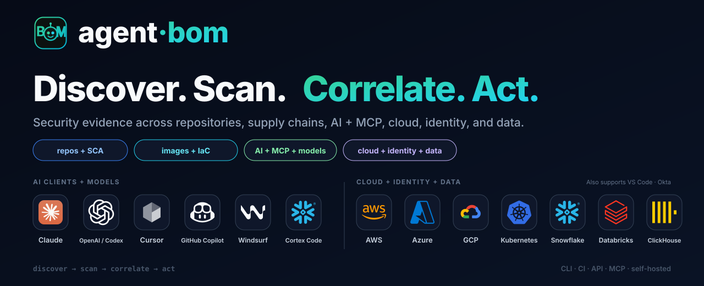
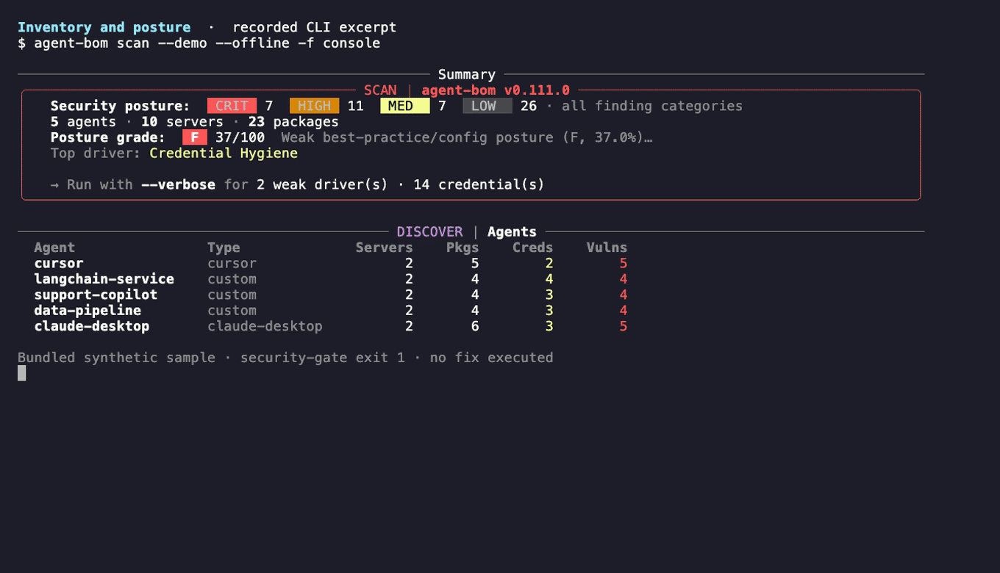
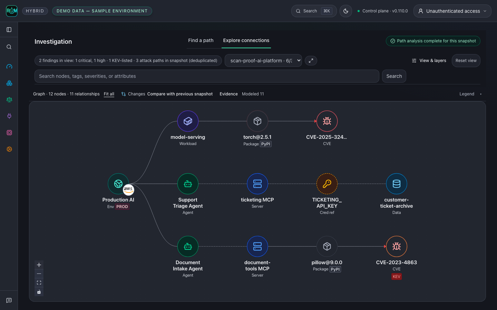
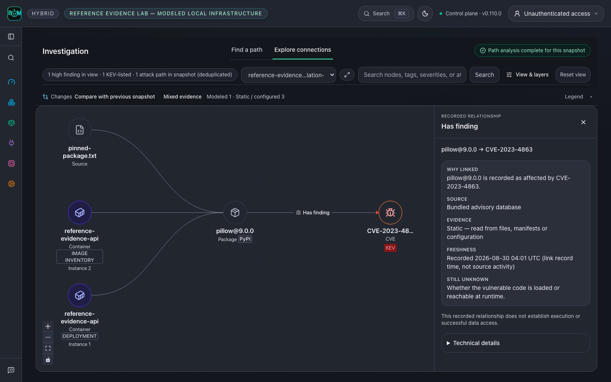
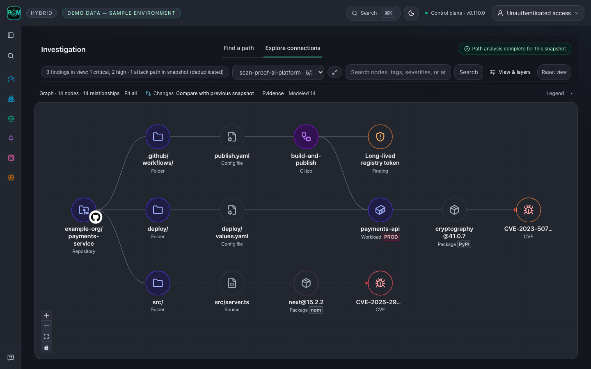
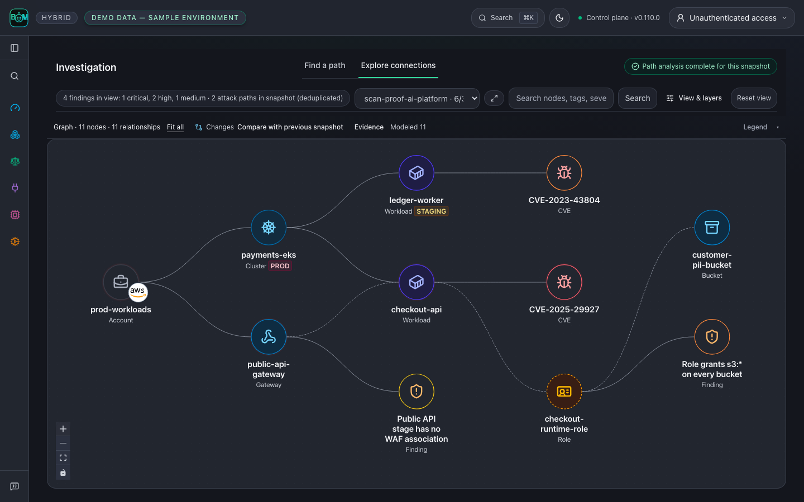

<p align="center">
  
</p>

<p align="center">
  <a href="https://github.com/koda-ai-studio/agent-bom/actions/workflows/ci.yml"></a>
  <a href="https://pypi.org/project/agent-bom/"></a>
  <a href="https://pypi.org/project/agent-bom/"></a>
  <a href="https://hub.docker.com/r/agentbom/agent-bom"></a>
  <a href="LICENSE"></a>
  <a href="https://securityscorecards.dev/viewer/?uri=github.com/koda-ai-studio/agent-bom"></a>
  <a href="https://glama.ai/mcp/servers/msaad00/agent-bom"></a>
  <a href="https://smithery.ai/servers/agentbom/agent-bom"></a>
</p>
<!-- mcp-name: io.github.koda-ai-studio/agent-bom -->

<p align="center"><b>Find vulnerable software behind your AI agents—and trace the exposure evidence.</b></p>

For AppSec and platform engineers responsible for AI agents and MCP servers:
scan a repository, correlate its findings with agent and infrastructure context,
and prioritize fixes using blast radius and reachability evidence.
**Open security scanner and self-hosted control plane for AI, MCP, and cloud infrastructure.** Local scans need no account.

<p align="center">
  <a href="#quick-start"><b>Quick start</b></a> ·
  <a href="#open-the-sample-graph">Sample graph</a> ·
  <a href="#self-host-in-your-environment">Self-host</a> ·
  <a href="docs/GALLERY.md">Product tour</a> ·
  <a href="https://koda-ai-studio.github.io/agent-bom/">Docs</a>
</p>

## Quick start

From the repository you want to inspect:

```bash
pip install agent-bom
agent-bom scan .
```

Read the inventory, findings, coverage gaps, and remediation guidance in the terminal.
Save a report with `agent-bom scan . -f sarif -o findings.sarif`, then
[upload it and gate CI](docs/FIRST_RUN.md#5-gate-ci-on-the-result).
Run `agent-bom doctor` if setup fails. See the [first-run guide](docs/FIRST_RUN.md).

No project handy? Run `agent-bom scan --demo --offline` for a bundled sample.
Exit `1` is expected: the sample trips the security gate. A non-zero exit
can mean a security gate or incomplete assessment; inspect the report and coverage.
See the [exit codes](site-docs/reference/exit-codes.md).

<p align="center"></p>

The recording uses labeled sample data and bundled advisories. Credential
references are names, not secret values. Recorded relationships do not prove
exploitation or successful data access.

## Investigate context and exposure

**Which agent uses the vulnerable component? What could it reach? What evidence supports that path?**
Correlate retained scans by exact, tenant-scoped identities; trace the recorded
blast radius from each agent through its MCP servers to packages, findings,
credentials and data stores. Inspect each relationship's source and evidence
kind, then rescan the same scope to check what changed.

<p align="center"><a href="docs/images/graph-environment-dark-live.png"><picture><source media="(prefers-color-scheme: light)" srcset="docs/images/graph-environment-light-live.png"></picture></a></p>

*Fictional sample estate. Dashed use, credential and access links are configured
or modeled, not observed at runtime; path analysis covers the collected snapshot only.*

**From agent to verified fix:** select Document Intake Agent → inspect
CVE-2023-4863 (high, KEV-listed) and the evidence on each arrow → take the
proposed [remediation](docs/GALLERY.md#engineers-and-grc-fix-and-verify) →
[rescan the changed pin](examples/connected-bom/README.md) and compare snapshots.
The comparison verifies the changed input, not a running deployment.

**Supporting evidence: one package, three parsed inputs.** A repository pin, an
image SBOM and a modeled Kubernetes workload resolve to one `pillow@9.0.0`. The
image inventory and the deployment occurrence stay separate nodes; the advisory
receipt is open.

<p align="center"><a href="docs/images/graph-relationship-dark-live.png"><picture><source media="(prefers-color-scheme: light)" srcset="docs/images/graph-relationship-light-live.png"></picture></a></p>

*Real parsers, modeled infrastructure; a graph path does not prove exploitation.*

[Explore context, correlation and reachability](docs/GALLERY.md#context-correlation-and-reachability) · [Run the reference lab](examples/reference-evidence-lab/README.md) · [Reproduce these screenshots](docs/GALLERY.md#reproduce-the-readme-screenshots)

<details>
<summary>Repository and cloud investigations</summary>

Trace source imports, deployment configuration and CI to a published container
and its vulnerable packages:

<p align="center"><a href="docs/images/graph-repository-dark-live.png"><picture><source media="(prefers-color-scheme: light)" srcset="docs/images/graph-repository-light-live.png"></picture></a></p>

Follow a public API gateway into a vulnerable workload, its role and a PII bucket:

<p align="center"><a href="docs/images/graph-cloud-dark-live.png"><picture><source media="(prefers-color-scheme: light)" srcset="docs/images/graph-cloud-light-live.png"></picture></a></p>

</details>


## Open the sample graph

```bash
pip install 'agent-bom[ui]==0.109.0'
agent-bom quickstart --run --offline
```

Run the server command it prints, then open its graph URL. Offline quickstart
skips package-CVE lookup, so zero CVEs is not a clean verdict; use the bundled
demo for advisory-backed findings or [populate the advisory database](docs/FIRST_RUN.md).

## Self-host in your environment

**Your infrastructure, identity, database, and audit boundary.** Start a local
pilot from a [published release checkout](https://github.com/koda-ai-studio/agent-bom/releases):

```bash
git clone --depth 1 --branch v0.109.0 https://github.com/koda-ai-studio/agent-bom.git && cd agent-bom
AGENT_BOM_IMAGE_TAG=0.109.0 docker compose up -d
```

Open **http://localhost:3000**, then **Connections** or **New Scan**. The pilot
binds to loopback and retains state in a Docker volume. For cloud accounts, add a
scoped read-only connection, verify access, then start a scan. Use the
[authenticated deployment](site-docs/deployment/authenticated-hosted-instance.md).

- **Scan** with CLI or CI; export findings, SBOMs and reports.
- **Centralize** inventory, graph evidence, remediation and compliance in your own control plane.
- **Enforce** policy on selected live MCP tool calls through the proxy or gateway.

[Docker pilot guide](docs/DEPLOY_PLATFORM.md) · [Compose with PostgreSQL](deploy/docker-compose.platform.yml) · [Choose a deployment](site-docs/deployment/overview.md) · [Enterprise controls](docs/TRUST.md) · [Connect cloud accounts](docs/CLOUD_CONNECT.md)

<details>
<summary>Work with your existing tools</summary>

Use **CLI or GitHub Action**, **REST API**, or **MCP**; export **SARIF, CycloneDX,
SPDX, JSON and HTML**. Cloud connectors and fleet sync collect inventory;
proxy and gateway deployments add runtime evidence.

For coding assistants, run `agent-bom mcp server`.
In Claude Code, install the plugin with `/plugin marketplace add koda-ai-studio/agent-bom`
then `/plugin install agent-bom@agent-bom` ([details](integrations/claude-code/README.md)).
Start with eight focused tools in the default profile.
[Choose an MCP profile](docs/MCP_SERVER.md) for graph, cloud, runtime or audit work.
[Try three investigations](docs/MCP_SERVER.md): affected agents, exposure receipts and a before/after scan comparison.
[Import existing scanner reports](docs/IMPORTERS.md) without replacing their source evidence.

Prefer an isolated invocation? Use `uvx agent-bom scan .` or check a dependency
with `uvx agent-bom check requests@2.33.0 --ecosystem pypi`. Add
[pre-commit and CI setup](docs/FIRST_RUN.md#pre-commit-hook) for repeated checks.

[Proxy, gateway and fleet](site-docs/deployment/proxy-vs-gateway-vs-fleet.md) · [Integration capability matrix](docs/CLOUD_CONNECT.md) · [MCP client setup](docs/MCP_SERVER.md) · [Smithery setup and manifest](site-docs/integrations/smithery.md)

</details>

## Trust and evidence

Discovery uses read-only access by default. Explicit disk side-scans create
temporary cloud resources. Missing evidence stays unavailable or partial;
control mappings are not audit certification.

MITRE technique associations provide investigation context, not proof of an
attack. [ATLAS mapping receipts](docs/ATLAS_COVERAGE.md) retain the weakness
association and source catalog hashes; modeled graph paths do not establish
observed execution or effective access.

[Measured matcher proof](site-docs/features/scanning.md#reproducible-matching-evidence) · [Product boundaries](docs/PRODUCT_BOUNDARIES.md) · [Permissions](docs/PERMISSIONS.md) · [Threat model](docs/THREAT_MODEL.md) · [Release verification](docs/RELEASE_VERIFICATION.md) · [Graph data model](docs/graph/DATA_MODEL.md)

## Contributing and support

[Contributing](CONTRIBUTING.md) · [Capabilities and roadmap](docs/ROADMAP.md) · [Support](SUPPORT.md) · [Report an inaccurate finding](https://github.com/koda-ai-studio/agent-bom/issues/new?template=inaccurate_finding.yml) · [Apache-2.0](LICENSE)

Source version: **v0.110.0** · Latest release: **v0.109.0** · [Changelog](CHANGELOG.md)
