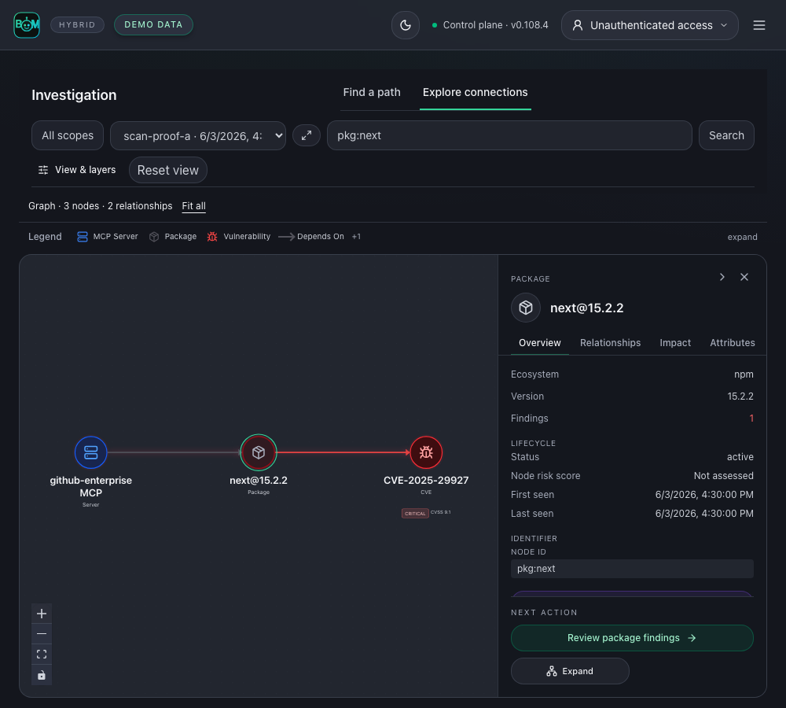

<p align="center">
  
</p>

<p align="center">
  <a href="https://github.com/koda-ai-studio/agent-bom/actions/workflows/ci.yml"></a>
  <a href="https://pypi.org/project/agent-bom/"></a>
  <a href="https://pypi.org/project/agent-bom/"></a>
  <a href="https://hub.docker.com/r/agentbom/agent-bom"></a>
  <a href="LICENSE"></a>
  <a href="https://securityscorecards.dev/viewer/?uri=github.com/koda-ai-studio/agent-bom"></a>
  <a href="https://glama.ai/mcp/servers/msaad00/agent-bom"></a>
  <a href="https://smithery.ai/servers/agentbom/agent-bom"></a>
</p>
<!-- mcp-name: io.github.msaad00/agent-bom -->

<p align="center"><b>Open security scanner and self-hosted control plane for AI, MCP, and cloud infrastructure.</b></p>

<p align="center">
  <a href="#quick-start"><b>Quick start</b></a> ·
  <a href="#self-host-in-your-environment"><b>Self-host</b></a> ·
  <a href="#deployment-models">Deployment models</a> ·
  <a href="#product-tour">Product tour</a> ·
  <a href="https://koda-ai-studio.github.io/agent-bom/">Docs</a>
</p>

For security, AppSec and GRC teams: discover AI agents, MCP servers, packages, credential references and infrastructure across repositories, container images, Kubernetes and cloud accounts. Check vulnerabilities and configuration, import existing scanner findings, and investigate the recorded relationships behind each finding.

- **Scan** from the CLI or CI and export findings, SBOMs and reports.
- **Centralize** inventory, graph evidence, remediation and compliance in your own control plane.
- **Enforce** policy on live MCP tool calls through the proxy or gateway.

## Quick start

```bash
pip install agent-bom
agent-bom scan .
```

The scan prints project inventory, package findings and remediation guidance. Run `agent-bom doctor` to check setup, or follow the [first-run guide](docs/FIRST_RUN.md). No project handy? Run `agent-bom scan --demo --offline` for a bundled sample without network access. Exit `1` is expected: the sample trips the security gate.

For CI, save a report with `agent-bom scan . -f sarif -o findings.sarif`, then [upload it and gate the build](docs/FIRST_RUN.md#5-gate-ci-on-the-result). A non-zero exit can mean a security gate or incomplete assessment; inspect the report and [exit codes](site-docs/reference/exit-codes.md).

<details>
<summary>No project handy? Scan the bundled sample estate offline</summary>

```bash
agent-bom scan --demo --offline
```

The sample lists agents, CVEs and policy findings (excerpt from current source; installed-release output may differ):

```text
  Security posture:   CRIT  7   HIGH  10   MED   8   LOW   26 · all finding categories
  5 agents · 10 servers · 23 packages
DISCOVER | Agents
  Agent                Type              Servers    Pkgs    Creds    Vulns
  langchain-service    custom                  2       4        4        4
  claude-desktop       claude-desktop          2       6        3        5
ANALYZE | Critical Details
  CVE-2023-36258 · langchain@0.0.150 · CRITICAL
  Fix: upgrade to ≥ 0.0.247
  Blast: langchain-service → llm-orchestrator-server → ANTHROPIC_API_KEY, OPENAI_API_KEY
ANALYZE | Graph & Policy Findings (36 occurrences)
   CRIT  COMBINATION AI agent can reach a credential or privileged tool: langchain-service
   HIGH  PROMPT_SECURITY No verified agent identity observed in MCP configuration
   MED   PROMPT_SECURITY Long-lived static credential on MCP server
```

For sample inventory with an exact graph link, run `agent-bom quickstart --run --offline` (it skips package-CVE lookup). [First-run guide](docs/FIRST_RUN.md#2-inspect-the-bundled-sample-project)

<p align="center">
  
</p>

</details>

<details>
<summary>Developer gates and offline scans</summary>

Use `uvx agent-bom scan .` without a global install, or
`uvx agent-bom check requests@2.33.0 --ecosystem pypi` before adding a package.
For automatic dependency and secret gates, see [pre-commit and CI setup](docs/DEPLOYMENT.md#pre-commit-hook).

`agent-bom db update --osv-ecosystem PyPI` covers only the selected ecosystem;
add the ecosystems you need before running `agent-bom scan . --offline`.
The full `agent-bom db update --source osv` archive can exceed 1 GB; the command shows live progress.
A non-zero exit can mean a security gate or incomplete assessment: inspect the
report and coverage. [Exit codes](site-docs/reference/exit-codes.md)

</details>

<p align="center"><a href="docs/images/context-map-horizontal-dark-live.png"><picture><source media="(prefers-color-scheme: light)" srcset="docs/images/context-map-horizontal-light-live.png"></picture></a></p>

**Graph workspace:** inspect agents, MCP servers, packages and credential references. The map above uses labeled sample data; recorded relationships do not prove execution or data access. Click any screenshot to view it at full size. To trace one vulnerable dependency to the affected agents and into remediation, [try the connected-BOM walkthrough](examples/connected-bom/README.md).

## Self-host in your environment

**Your infrastructure, your identity, your database, your audit boundary.** From a [published release checkout](https://github.com/koda-ai-studio/agent-bom/releases):

```bash
git clone --depth 1 --branch v0.108.4 https://github.com/koda-ai-studio/agent-bom.git && cd agent-bom
AGENT_BOM_IMAGE_TAG=0.108.4 docker compose up -d
```

Open **http://localhost:3000**, then **Connections** or **New Scan**. For cloud accounts, add a scoped read-only connection, verify access, then start a scan. The pilot binds to loopback and retains state in a Docker volume. Use the authenticated deployment guide for a shared instance.

**Shared deployment:** Agent-Bom + PostgreSQL + your chosen identity provider. Local CLI/CI scans need no database service or login stack.
Grafana/Prometheus and ClickHouse are optional. [Choose the stack](site-docs/deployment/overview.md#start-with-a-small-stack).

### Deployment models

| Start with | Guide |
|---|---|
| Local evaluation | [Docker pilot](docs/DEPLOY_QUICKSTART.md) |
| Shared control plane | [Authenticated deployment](site-docs/deployment/authenticated-hosted-instance.md) · [Compose with PostgreSQL](deploy/docker-compose.platform.yml) |
| Kubernetes or AWS | [Helm](site-docs/deployment/control-plane-helm.md) · [EKS Terraform](deploy/terraform/platform-eks) |
| Restricted networks | [Air-gapped bundle](site-docs/deployment/airgapped-image-bundle.md) |
| Snowflake preview | [Native App installation](docs/snowflake-native-app/INSTALL.md) |

[Choose a deployment](site-docs/deployment/overview.md) · [Enterprise configuration](docs/ENTERPRISE.md) · [Connect cloud accounts](docs/CLOUD_CONNECT.md)

<details>
<summary>Work with your existing tools</summary>

Use **CLI or GitHub Action**, **REST API**, or **MCP**; export **SARIF, CycloneDX, SPDX, JSON and HTML**. Cloud connectors and fleet sync collect inventory; proxy and gateway deployments add runtime evidence. Audit MCP security before granting tool access: `agent-bom mcp audit . --format json --output mcp-audit.json`. Inspect descriptor injection, risky tool inputs, authentication configuration and excess capability findings alongside coverage. Review the recorded evidence and remediation, then repeat the scoped audit. [MCP security audit](docs/MCP_AUDIT.md)

For coding assistants, run `agent-bom mcp server`. Start with eight focused tools, then choose a graph, cloud, runtime or audit profile. The full catalog has 90 MCP tools, 7 resources, and 8 workflow prompts in current source. [MCP workflows](docs/MCP_WORKFLOWS.md)

**Current-source workflows (not yet in the pinned release above):**

- Audit MCP descriptors with `agent-bom mcp audit . --format json --output mcp-audit.json`. Review the scoped findings in `mcp-audit.json`, then inspect their recorded graph relationships. See [MCP audit](docs/MCP_AUDIT.md) for descriptor availability and rule coverage.
- Start a configured control plane with `agent-bom api`, then use **Connections → Observability & SIEM** to import a bounded Langfuse or LangSmith window. Retained native spans, parents, revisions and resume receipts appear in **Traces**. See [managed trace connections](docs/TRACE_CONNECTIONS.md) for mounted credential references and API examples. Exact inventory links require matching canonical identifiers and scope; names alone do not establish a link.

[Integration capability matrix](docs/INTEGRATIONS.md) · [MCP client setup](docs/MCP_CLIENT_GUIDES.md) ·
[Proxy, gateway and fleet](site-docs/deployment/proxy-vs-gateway-vs-fleet.md) · [Smithery setup and manifest](site-docs/integrations/smithery.md)

</details>

## Built for the teams that build, secure and govern AI

| Your team | What you can do |
|---|---|
| **Developers & AI engineers** | Inspect repositories, dependencies and MCP configuration; bring findings into CI and coding assistants. |
| **AppSec & cloud security** | Connect cloud accounts, trace findings through workloads and identities, and prioritize fixes using recorded exposure and evidence gaps. |
| **Platform & DevOps** | Run a shared control plane, collect fleet evidence, and apply policy to MCP traffic through the proxy or gateway. |
| **GRC & audit** | Open **Compliance** to review mappings and [export scan evidence](docs/GALLERY.md#scan-a-repository-before-shipping) with its source, freshness and assessment gaps. |
| **Security & engineering leaders** | Open **Overview** to review posture, remediation priorities and tracked AI spend across connected sources. |
| **AI assistants & automation** | Use [MCP workflows](docs/MCP_WORKFLOWS.md) to query evidence and inspect findings within the caller’s permissions. |

## Product tour

### Security, engineering and GRC: prioritize findings

Start with **Posture**, inspect evidence in **Top risks**, and scope inventory in **Assets & coverage**.
**Compliance** separates evaluated-control pass rate from assessment coverage. OWASP and MITRE ATLAS risk mappings describe applicability, not control pass/fail.
The offline synthetic enterprise estate shown below includes evaluated checks; results do not establish certification or an audit opinion.

<p align="center"><a href="docs/images/dashboard-live.png"></a></p>

Explore [expanded framework evidence](docs/images/dashboard-paths-live.png), [Top risks](docs/images/dashboard-risks-live.png), [scoped Inventory](docs/images/inventory-live.png), [recorded scan history](docs/GALLERY.md#compare-recorded-scan-history), [framework controls and evidence](site-docs/features/compliance.md), and the [per-agent BOM preview](docs/SCAN_EVIDENCE_JOURNEY.md).

### AppSec and cloud teams: investigate a finding

Follow **CVE-2023-4863 in pillow@9.0.0** through recorded relationships between the service, workload, container, tool and modeled data asset.
Inspect the source receipts and carry the selected finding into remediation. A recorded path does not by itself prove exploitation or successful data access.

<a href="docs/images/correlation-graph-live.png"></a>

<details>
<summary>Explore graph navigation, permissions and evidence</summary>

Use **Find a path** to investigate a finding, or **Explore connections** to browse
recorded entities in the same workspace. Choose a snapshot and exact entity, then
filter by type or severity and expand bounded connections. Select a node or arrow
for its source evidence; incomplete views remain labeled. Relationship pages are
pinned to the snapshot generation, so a replaced snapshot requires a fresh page.
Permission, execution and exploitability require separate supporting receipts.
[Investigation workflow](site-docs/architecture/security-graph-model.md#investigate-an-agent-from-context).

**Connect data locations to security evidence.** Explore recorded stores and datasets alongside identities and findings.
Distinguish storage, access evidence and collection sources; derived classifications do not prove contents or successful reads. [Data and evidence model](site-docs/architecture/security-graph-model.md#data-locations-access-and-evidence-sources).
</details>

### Engineers and GRC: fix and verify

Connect the upgrade decision, the responsible owner and the evidence needed to close the risk.

| Decision | Engineering and governance evidence |
|---|---|
| **What do we fix first?** | Prioritize package upgrades using severity, recorded agent and credential associations, and available fixes. |
| **Who owns the work?** | Assign owners and SLAs, link tickets, and track remediation campaigns. |
| **Did the fix hold?** | Re-scan the same scope, compare retained findings, and verify the campaign before closing it. |
| **What supports the control review?** | Review evaluated checks, source receipts and assessment gaps; export scoped evidence. A control mapping alone is not a passing check. |

<p align="center"><a href="docs/images/remediation-live.png"></a></p>

[Run the before-and-after dependency example](examples/connected-bom/README.md) · [Review component control evidence](docs/images/component-controls-dark-live.png) · [Compliance evidence workflow](site-docs/features/compliance.md)

These are application captures, not mockups. Overview, Findings and remediation use labeled sample data. Re-scan your own scope for current versions and fixes. The investigation graph uses the reproducible reference lab: real parsers, a pinned advisory scan and authenticated gateway calls, with modeled infrastructure. A blocked call does not establish that the underlying package was fixed.

[Discover and scan](docs/GALLERY.md) · [Runtime policy and agent workflows](site-docs/deployment/proxy-vs-gateway-vs-fleet.md) ·
[Run the reference evidence lab](examples/reference-evidence-lab/README.md) ·
[Evidence workflow](docs/HOW_IT_WORKS.md) · [Control-plane architecture](docs/ARCHITECTURE.md)

## Trust and evidence

Discovery uses read-only access by default. Explicit disk side-scans create temporary cloud resources; runtime enforcement
acts on selected tool calls. Missing evidence stays unavailable or partial. Control mappings are not audit certification.

[Product boundaries](docs/PRODUCT_BOUNDARIES.md) · [Permissions](docs/PERMISSIONS.md) · [Threat model](docs/THREAT_MODEL.md) ·
[Security policy](SECURITY.md) · [Release verification](docs/RELEASE_VERIFICATION.md) ·
[Measured matcher proof](site-docs/features/scanning.md#reproducible-matching-evidence) · [Graph workload: command, receipt and limits](docs/perf/graph-mixed-load.md)

## Contributing and support

[Contributing](CONTRIBUTING.md) · [Capabilities and roadmap](docs/ROADMAP.md) · [Support](SUPPORT.md) · [Open issues](https://github.com/koda-ai-studio/agent-bom/issues) · [Apache-2.0 license](LICENSE)

Source version: **v0.108.4** · Latest release: **v0.108.4** · [Changelog](CHANGELOG.md)
