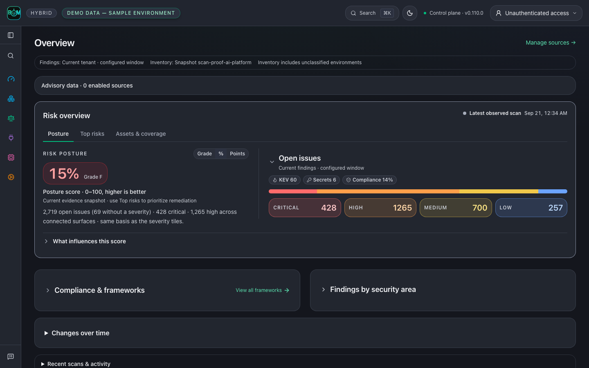
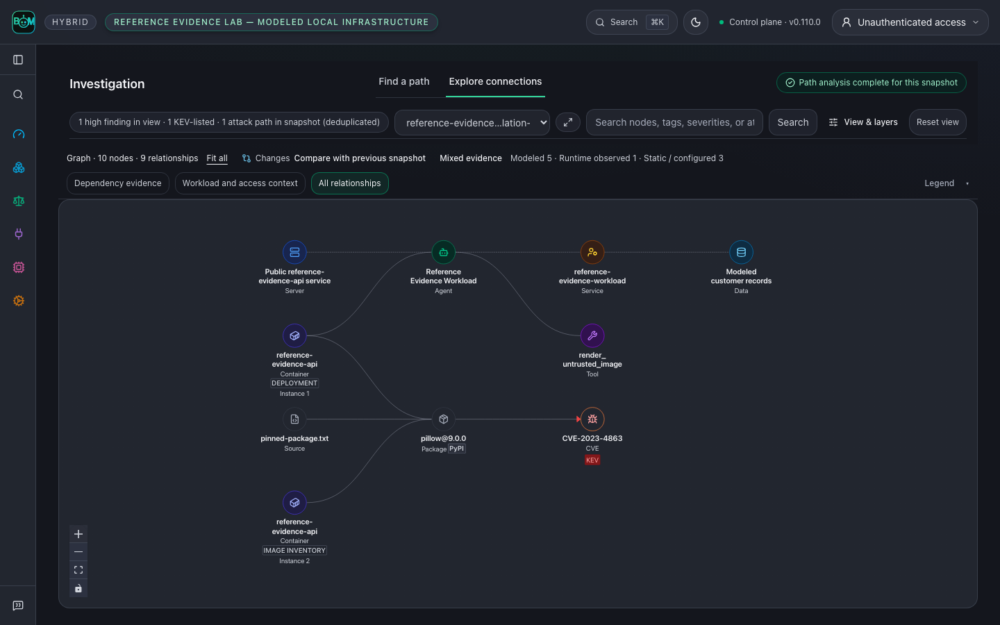
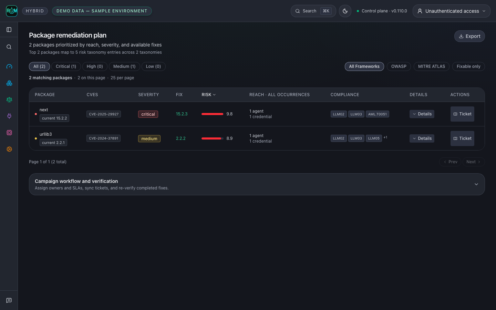

# Product scenarios

Start with a question, run the workflow, and inspect its evidence. The image
below uses the **Reference evidence lab — modeled local infrastructure**:
real parser and local gateway execution, a published advisory, and explicit
modeled infrastructure. It is not a customer incident or live-cloud proof.

## Scan a repository before shipping

From the repository you want to inspect:

```bash
agent-bom scan . -f json -o scan.json
agent-bom report compliance-narrative scan.json
```

The first command produces inventory, findings, and coverage for the selected
project. The second turns that saved evidence into a compliance narrative.
Review incomplete collectors before treating an absence of findings as a clean
result. Use the [first-run guide](FIRST_RUN.md) for SARIF and CI gates.

## Follow an image-processing exposure

An AppSec engineer receives an advisory affecting an image-processing service.
The actionable question is whether the affected package belongs to a workload
with a route to a sensitive asset.

The [reference lab](../examples/reference-evidence-lab/README.md) follows
`CVE-2023-4863` through a pinned Pillow dependency, image SBOM, Kubernetes
manifest, MCP configuration, and modeled identity. The shared graph shows the
recorded relationships and their direction. Select a node or relationship to
inspect its source, then open the scoped findings and remediation.


This is a structural exposure supported by the lab inputs, not execution of an
exploit. The lab observes an allowed local gateway call, then checks that graph
enforcement blocks another call before the upstream tool runs. That proves the
local enforcement decision, not removal of the vulnerable deployment.

The upstream [Pillow 10.0.1 release notes](https://pillow.readthedocs.io/en/stable/releasenotes/10.0.1.html)
document updated wheels containing libwebp 1.3.2 for this advisory. The lab
matches package versions; it does not inspect a running service's libwebp binary.

## Verify the package change

From a repository checkout, run the offline before/after replay:

```bash
uv run python scripts/replay_package_remediation.py --output /tmp/package-replay.json
```

The real dependency parser and scanner read two isolated manifests. Pillow
9.0.0 matches the pinned advisory; 10.0.1 crosses that advisory's fixed-version
boundary. Neither package is installed or executed. The JSON receipt records
both results and the limited advisory coverage. This historical version pair
is a reproducible test case, not a current upgrade recommendation.

In an actual environment, rebuild and redeploy using a supported version,
collect a fresh SBOM and runtime identity, and re-run correlation. Close the
exposure only when the new evidence supports that decision. Retain the prior
scan and receipts for the audit trail.

[Run the complete lab](../examples/reference-evidence-lab/README.md) ·
[Start a self-hosted control plane](registry/DOCKER_HUB_UI_README.md) ·
[Evidence and graph contract](graph/CONTRACT.md)

Synthetic layout fixtures remain in the [capture protocol](CAPTURE.md) for UI
regression coverage. They are separate from these reproducible scenario claims.

## Compare recorded scan history

In a self-hosted control plane, run repeated scans of the same explicit target,
then open **Overview → Changes over time**. Select the history window and scan
scope to see newly detected findings, findings no longer detected, and median
open-finding and evidence ages. The table links each observation to its scan's
findings. History loads when this section opens.

Comparisons require compatible scope, measurement version and complete collection.
Partial scans and legacy records without comparison metadata show unavailable
changes. A missing finding does not prove remediation: verification remains a
separate audited workflow. Ages use recorded timestamps; evidence age is measured
at scan completion, and missing timestamps remain unavailable. Imported standalone
reports do not establish historical trends. Scan history has a separate scope from
the aggregate posture summary.

## Follow one component

Open **Inventory → Packages**, select a component, then follow **Findings →
Compliance**. The component identifier and retained snapshot stay in scope.
The captures below are synthetic UI states from the packaged product routes.

| Step | Inspect | Captures |
|---|---|---|
| Component | Recorded relationships, sources, timestamps and unknown collection coverage | [Light](images/component-detail-light-live.png) · [Dark](images/component-detail-dark-live.png) |
| Findings | Directly linked finding records in this component snapshot | [Light](images/component-findings-light-live.png) · [Dark](images/component-findings-dark-live.png) |
| Controls | Applicability mapping marked **Mapped · Not evaluated**, with exportable evidence | [Light](images/component-controls-light-live.png) · [Dark](images/component-controls-dark-live.png) |

For a parser-backed scan and changed-input rescan, run the
[connected-BOM example](../examples/connected-bom/README.md). It uses a different
bounded advisory fixture and explicitly synthetic cloud topology. A finding no
longer present after the input change is not proof that a deployment was repaired.

## Explore connections and inspect evidence

These graph views follow current source; check the [release notes](../CHANGELOG.md)
for your installed version. In **Investigation → Explore connections**, select a
snapshot and search for a package or agent. Start with its bounded neighborhood,
then use **Show more connections** or **Expand** to inspect related entities.

**Repository — connect source, configuration and dependencies.** A sample
service links its source imports, deployment configuration and CI job to the
published container, two vulnerable packages and a CI misconfiguration. The
fixture models configured relationships; it does not establish that the CI job
ran or that a workload was deployed.

<picture><source media="(prefers-color-scheme: light)" srcset="images/graph-repository-light-live.png"></picture>

**Environment — see agents alongside their infrastructure.** A sample
production AI environment holds two agents and an internet-facing model-serving
workload. Follow each to its MCP server, vulnerable package, KEV-listed
advisory, exposed API key and the customer data store that key can reach.
Badges show the provider, environment tier and package ecosystem; rings show
the worst linked finding.

<picture><source media="(prefers-color-scheme: light)" srcset="images/graph-environment-light-live.png"></picture>

**Cloud estate — inspect accounts, workloads, identities and data.** A sample
account exposes a workload through a public API gateway; the workload carries a
critical advisory and authenticates as a role with permission to a PII bucket.
Misconfigurations sit beside the assets they affect. Configuration does not
prove reachability or effective access.

<picture><source media="(prefers-color-scheme: light)" srcset="images/graph-cloud-light-live.png"></picture>

These three views use explicitly labeled synthetic UI fixtures. Each is captured
through its actual **View & layers** preset; none is live-cloud evidence.

**Start with one component.** The selected package stays beside its MCP server
and vulnerability. The inspector links to that package's findings in the same
snapshot. This capture uses labeled synthetic UI fixtures.

<picture><source media="(prefers-color-scheme: light)" srcset="images/context-map-light-live.png"></picture>

**Open the relationship evidence.** Select an arrow to inspect its direction,
snapshot, first/last seen timestamps and source receipt. In the reference lab
below, a repository pin, an image SBOM and a modeled Kubernetes workload resolve
to one `pillow@9.0.0`; its advisory link came from the bundled scanner.
It does not establish a cloud execution or downstream effect.

<picture><source media="(prefers-color-scheme: light)" srcset="images/graph-relationship-light-live.png"></picture>

**Follow the finding into action.** Switch to **Find a path** to investigate
recorded finding paths, then use the scoped findings and remediation links.
Re-scan the same scope before closing the finding. Missing receipts remain
missing evidence; graph connectivity alone does not prove successful access.

[See the full reference graph](images/correlation-graph-live.png) ·
[Inspect the mobile view](images/correlation-path-mobile-live.png) ·
[Run the reference lab](../examples/reference-evidence-lab/README.md)

## Team investigation walkthrough


This tour follows current source. Check the [release notes](../CHANGELOG.md)
for the features included in your installed version. For commands that start
with the published package, use the [README](../README.md).

<p align="center"><a href="images/graph-environment-dark-live.png"><picture><source media="(prefers-color-scheme: light)" srcset="images/graph-environment-light-live.png"></picture></a></p>

**See your AI environment in context.** Follow workloads, agents, models, MCP servers, tools and dependencies in one graph. Switch to **Repository** or **Cloud estate** to inspect code, build configuration, accounts, identities and storage. The graph above uses labeled sample data. Click any screenshot to view it at full size.

**One investigation workspace:** follow a finding with **Find a path**, or inspect a snapshot with **Explore connections**. Select nodes and relationship arrows for details, expand the connections you need, and carry the finding into remediation. [Repository, environment and cloud gallery](GALLERY.md#explore-connections-and-inspect-evidence) · [Try the connected-BOM walkthrough](../examples/connected-bom/README.md).

These graph views follow current source. Recorded relationships do not by themselves prove execution or data access.

## Context, correlation and reachability

The useful result is a supported investigation and a next action:

| Operator question | Evidence to inspect |
|---|---|
| **Why does this finding matter here?** | Exact component, affected agent/workload, tool and resource context in the selected snapshot. |
| **Do these records describe the same entity?** | Canonical identifiers, tenant scope and retained source scans; similar names alone do not establish a correlation. |
| **What is the recorded blast radius?** | Directed connections to affected agents, tools, credential references and resources, with collection and traversal limits visible. |
| **Is this path supported?** | Per-hop direction, provenance, freshness and reachability basis; distinguish dependency reachability, recorded permissions and observed runtime activity. |
| **Did the change remove this exposure?** | Re-scan the same scope, compare retained snapshots and inspect remaining findings before closing the work. |

A provenance-backed graph path is labelled `likely`: it shows the collected
topology connects, not that the vulnerable code executes. Only function-level
(symbol) or runtime-observed evidence yields `confirmed`. Neither verdict proves
exploitation, effective access to every resource, or complete estate coverage. The experimental [consequence assessment](GRAPH_CONSEQUENCES.md)
keeps assumed compromise, exploitation prerequisites, stopping controls and
missing evidence separate. [Evidence boundaries](PRODUCT_BOUNDARIES.md) ·
[Measure an investigation](operations/INVESTIGATION_MEASUREMENT.md).

## Built for the teams that build, secure and govern AI

| Your team | What you can do |
|---|---|
| **Developers & AI engineers** | Inspect repositories, dependencies and MCP configuration; bring findings into CI and coding assistants. |
| **AppSec & cloud security** | Connect cloud accounts, trace findings through workloads and identities, and prioritize fixes using recorded exposure and evidence gaps. |
| **Platform & DevOps** | Run a shared control plane, collect fleet evidence, and apply policy to MCP traffic through the proxy or gateway. |
| **GRC & audit** | Open **Compliance** to review mappings and [export scan evidence](GALLERY.md#scan-a-repository-before-shipping) with its source, freshness and assessment gaps. |
| **Security & engineering leaders** | Open **Overview** to review posture, remediation priorities and tracked AI spend across connected sources. |
| **AI assistants & automation** | Use [MCP workflows](MCP_SERVER.md) to query evidence and inspect findings within the caller’s permissions. |

## Product tour

### Security, engineering and GRC: prioritize findings

Start with **Posture**, inspect **Top risks**, and scope **Assets & coverage**. **Compliance** separates evaluated-control pass rate from assessment coverage; OWASP and MITRE ATLAS mappings show applicability. Results from this offline synthetic enterprise estate do not establish certification or an audit opinion.

<p align="center"><a href="images/dashboard-live.png"></a></p>

Explore [expanded framework evidence](images/dashboard-paths-live.png), [Top risks](images/dashboard-risks-live.png), [scoped Inventory](images/inventory-live.png), [recorded scan history](GALLERY.md#compare-recorded-scan-history), [framework controls and evidence](../site-docs/features/compliance.md), and the [per-agent BOM preview](SCAN_EVIDENCE_JOURNEY.md).

### AppSec and cloud teams: investigate a finding

Follow **CVE-2023-4863 in pillow@9.0.0** through recorded relationships between the service, workload, container, tool and modeled data asset. Inspect the source receipts and carry the selected finding into remediation. A recorded path does not by itself prove exploitation or successful data access.

<a href="images/correlation-graph-live.png"></a>

**Inspect the evidence behind an arrow.** Select a relationship to see its direction, retained snapshot, timestamps and recorded source evidence. This focused view shows three parsed inputs (a repository pin, an image SBOM and a modeled Kubernetes workload) resolving to one package, with the plain-language relationship evidence open; modeled cloud permissions and downstream effects remain separate claims.

<p align="center"><a href="images/graph-relationship-dark-live.png"><picture><source media="(prefers-color-scheme: light)" srcset="images/graph-relationship-light-live.png"></picture></a></p>

**Find a path → Explore connections → Inspect evidence → Remediate.** Keep the snapshot and selected finding in scope as you move through the workflow. Expand within a hop limit and browse relationships in bounded pages; incomplete views remain labeled. Configured permissions, observed activity and downstream effects have separate evidence requirements.

[Explore the graph gallery](GALLERY.md#explore-connections-and-inspect-evidence) · [View the mobile graph](images/correlation-path-mobile-live.png) · [Run the reference lab](../examples/reference-evidence-lab/README.md)


### Engineers and GRC: fix and verify

Connect the upgrade decision, the responsible owner and the evidence needed to close the risk.

| Decision | Engineering and governance evidence |
|---|---|
| **What do we fix first?** | Prioritize package upgrades using severity, recorded agent and credential associations, and available fixes. |
| **Who owns the work?** | Assign owners and SLAs, link tickets, and track remediation campaigns. |
| **Did the fix hold?** | Re-scan the same scope, compare retained findings, and verify the campaign before closing it. |
| **What supports the control review?** | Review evaluated checks, source receipts and assessment gaps; export scoped evidence. A control mapping alone is not a passing check. |

<p align="center"><a href="images/remediation-live.png"></a></p>

[Run the before-and-after dependency example](../examples/connected-bom/README.md) · [Review component control evidence](images/component-controls-dark-live.png) · [Compliance evidence workflow](../site-docs/features/compliance.md)

These are application captures, not mockups. Overview, Findings and remediation use labeled sample data. Re-scan your own scope for current versions and fixes. The investigation graph uses the reproducible reference lab: real parsers, a pinned advisory scan and authenticated gateway calls, with modeled infrastructure. A blocked call does not establish that the underlying package was fixed.

[Discover and scan](#scan-a-repository-before-shipping) · [Runtime policy and agent workflows](../site-docs/deployment/proxy-vs-gateway-vs-fleet.md) ·
[Run the reference evidence lab](../examples/reference-evidence-lab/README.md) ·
[Evidence workflow](ARCHITECTURE.md) · [Control-plane architecture](ARCHITECTURE.md)


### Deployment models

| Start with | Guide |
|---|---|
| Local evaluation | [Docker pilot](DEPLOY_PLATFORM.md) |
| Shared control plane | [Authenticated deployment](../site-docs/deployment/authenticated-hosted-instance.md) · [Compose with PostgreSQL](../deploy/docker-compose.platform.yml) |
| Kubernetes or AWS | [Helm](../site-docs/deployment/control-plane-helm.md) · [EKS Terraform](../deploy/terraform/platform-eks) |
| Restricted networks | [Air-gapped bundle](../site-docs/deployment/airgapped-image-bundle.md) |
| Snowflake preview | [Native App installation](snowflake-native-app/INSTALL.md) |

[Choose a deployment](../site-docs/deployment/overview.md) · [Enterprise configuration](TRUST.md) · [Connect cloud accounts](CLOUD_CONNECT.md)

## Reproduce the README screenshots

The pictured graphs are the committed UI build serving fictional fixtures
(`ui/scripts/product-proof-scope-showcase.mjs` and the hash-pinned
reference-lab output). From the repository root:

```bash
cd ui && npm ci && npm run build
npm run capture:product-proof   # refreshes the README screenshots in docs/images
```

The capture manifest records the source commit, input digest, screenshot hashes,
and the version visible in each image. Review the regenerated dark, light and
mobile views before publishing them.

To refresh the terminal recording from this checkout, install VHS, FFmpeg and
Pillow, then run from the repository root:

```bash
uv run --with pillow bash scripts/render_demo_gif.sh
```

The renderer records real output from `agent-bom scan --demo --offline`, requires
the expected security-gate exit `1`, and preserves the old GIF if recording fails.
It presents inventory, findings and remediation guidance; it does not execute a
fix.

To explore a labeled demo estate in the current-source dashboard instead
(different sample data from the screenshots):

```bash
make build-ui
uv run --extra ui agent-bom serve --demo-estate --allow-insecure-no-auth --port 8422
```

Open **http://127.0.0.1:8422/graph**. Loopback only; the flag disables
authentication for local evaluation.
