# Security graph data model

> Generated from the code by `scripts/generate_graph_data_model.py`. Do not edit by hand: re-run the
> generator and commit the result. CI runs it with `--check` and fails on drift.

Every node kind, edge kind, evidence tier and normalization table behind the security graph. The [graph contract](CONTRACT.md) states what the graph guarantees; this page lists what it is made of. How report fields reach the database, exports and this graph is in the [data model atlas](../DATA_MODEL.md). Detail pages: [relationship pairs](data-model/relationships.md) · [entity emitters and id formats](data-model/entities.md) · [storage ERD](data-model/storage-erd.md) · [cross-source correlation](data-model/correlation.md).

## Overview

Entity types grouped by domain (from each type's semantic layer in `graph/container.py` `ENTITY_LEGEND`). An arrow carries every relationship whose allowed pairs connect the two domains.

```mermaid
flowchart LR
  subgraph identity["Identity and access"]
    identity_0[access_grant · access_policy · account · credential]
    identity_4[credential_ref · federated_identity · group · managed_identity]
    identity_8[org · policy · role · service_account]
    identity_12[service_principal · user]
  end
  subgraph ai["AI and agents"]
    ai_0[agent · application · blueprint · framework]
    ai_4[server · tool · tool_call]
  end
  subgraph supply["Code and supply chain"]
    supply_0[ci_job · code_module · config_file · directory]
    supply_4[external_import · package · source_file]
  end
  subgraph cloud["Cloud, infrastructure and data"]
    cloud_0[api_gateway · cloud_resource · cluster · container]
    cloud_4[data_store · dataset · environment · fleet]
    cloud_8[model · provider · resource]
  end
  subgraph findings["Findings"]
    findings_0[drift_incident · misconfiguration · vulnerability]
  end
  ai -- "belongs_to, called, can_access, correlates_with<br/>delegated_to, exposed_to, governs, invoked<br/>lateral_path, member_of, observes, part_of<br/>possibly_correlates_with, provides_tool, reaches_tool, shares_cred<br/>shares_server, trace_step, uses, uses_framework" --> ai
  ai -- "accessed, can_access, exposed_to, hosted_on<br/>member_of, part_of, serves_model, stores<br/>trace_step" --> cloud
  ai -- "contains, exhibits_drift, governs, vulnerable_to" --> findings
  ai -- "accessed, assumes, authenticates_as, exposes_cred<br/>governs, member_of, part_of, trace_step<br/>used_credential" --> identity
  ai -- "can_access, depends_on, trace_step" --> supply
  cloud -- "belongs_to, can_access, contains, hosts<br/>trace_step" --> ai
  cloud -- "can_access, contains, depends_on, exposed_to<br/>hosted_on, hosts, part_of, possibly_correlates_with<br/>protects, serves_model, stores, trace_step" --> cloud
  cloud -- "contains, vulnerable_to" --> findings
  cloud -- "assumes, contains, exposed_to, hosts<br/>part_of, trace_step" --> identity
  cloud -- "can_access, contains, depends_on, trace_step" --> supply
  findings -- "affects, belongs_to, exploitable_via, scoped_to" --> ai
  findings -- "affects" --> cloud
  findings -- "triggers" --> findings
  findings -- "affects, exploitable_via" --> identity
  findings -- "affects" --> supply
  identity -- "acted_as, belongs_to, can_access, contains<br/>governs, has_permission, hosts, invoked<br/>manages, member_of, owns, reaches_tool<br/>scoped_to, trace_step" --> ai
  identity -- "accessed, can_access, contains, has_permission<br/>hosts, invoked, manages, member_of<br/>owns, part_of, trace_step" --> cloud
  identity -- "contains, governs, vulnerable_to" --> findings
  identity -- "assumes, attached, authenticates_as, can_access<br/>contains, cross_account_trust, governs, has_permission<br/>hosts, inherits, member_of, owns<br/>part_of, possibly_correlates_with, trace_step, trusts" --> identity
  identity -- "can_access, trace_step" --> supply
  supply -- "belongs_to, configures, contains, defines<br/>part_of, runs, trace_step" --> ai
  supply -- "contains, trace_step" --> cloud
  supply -- "contains, remediates, vulnerable_to" --> findings
  supply -- "trace_step" --> identity
  supply -- "configures, contains, defines, depends_on<br/>imports, trace_step" --> supply
```

## Entities

42 entity types (`agent_bom.core.entity_types.EntityType`). Emitting modules are found by a static scan for call sites that pass the literal enum member; see [entities](data-model/entities.md) for the module list and node id formats.

| Entity | Label | Domain | Semantic layer | OCSF category / class | Finding | Emitting modules |
|---|---|---|---|---|---|---|
| `access_grant` | Access Grant | Identity and access | `identity` | 3 / 3001 |  | 1 |
| `access_policy` | Access Policy | Identity and access | `identity` | 3 / 3001 |  | 1 (+1 demo) |
| `account` | Account | Identity and access | `identity` | 3 / 3001 |  | 12 (+2 demo) |
| `agent` | AI Agent | AI and agents | `orchestration` | 5 / 4001 |  | 13 (+2 demo) |
| `api_gateway` | API Gateway | Cloud, infrastructure and data | `api_gateway` | 5 / 4001 |  | 1 |
| `application` | Application | AI and agents | `app` | 5 / 4001 |  | 2 (+1 demo) |
| `blueprint` | Blueprint | AI and agents | `orchestration` | 5 / 4001 |  | 1 |
| `ci_job` | CI/CD Job | Code and supply chain | `ci` | 5 / 4001 |  | 1 (+1 demo) |
| `cloud_resource` | Cloud Resource | Cloud, infrastructure and data | `infra` | 5 / 4001 |  | 15 (+2 demo) |
| `cluster` | Cluster | Cloud, infrastructure and data | `infra` | 5 / 4001 |  | 0 (+1 demo) |
| `code_module` | Code Module | Code and supply chain | `code` | 5 / 4001 |  | 2 |
| `config_file` | Config File | Code and supply chain | `code` | 5 / 4001 |  | 2 (+1 demo) |
| `container` | Container | Cloud, infrastructure and data | `infra` | 5 / 4001 |  | 3 (+1 demo) |
| `credential` | Credential | Identity and access | `identity` | 5 / 4001 |  | 1 (+1 demo) |
| `credential_ref` | Credential Reference | Identity and access | `identity` | 5 / 4001 |  | 0 |
| `data_store` | Data Store | Cloud, infrastructure and data | `asset` | 5 / 4001 |  | 8 (+1 demo) |
| `dataset` | Dataset | Cloud, infrastructure and data | `asset` | 5 / 4001 |  | 1 (+1 demo) |
| `directory` | Directory | Code and supply chain | `code` | 5 / 4001 |  | 2 |
| `drift_incident` | Drift Incident | Findings | `finding` | 2 / 2004 | yes | 1 |
| `environment` | Environment | Cloud, infrastructure and data | `infra` | 0 / 0 |  | 0 (+2 demo) |
| `external_import` | External Import | Code and supply chain | `code` | 5 / 4001 |  | 0 |
| `federated_identity` | Federated Identity | Identity and access | `identity` | 3 / 3001 |  | 2 |
| `fleet` | Fleet | Cloud, infrastructure and data | `infra` | 5 / 4001 |  | 1 |
| `framework` | AI Framework | AI and agents | `orchestration` | 5 / 4001 |  | 1 (+1 demo) |
| `group` | Group | Identity and access | `identity` | 3 / 3001 |  | 4 |
| `managed_identity` | Managed Identity | Identity and access | `identity` | 3 / 3001 |  | 8 |
| `misconfiguration` | Misconfiguration | Findings | `finding` | 2 / 2003 | yes | 6 (+2 demo) |
| `model` | Model | Cloud, infrastructure and data | `asset` | 5 / 4001 |  | 3 (+1 demo) |
| `org` | Organization | Identity and access | `identity` | 3 / 3001 |  | 4 (+2 demo) |
| `package` | Package | Code and supply chain | `package` | 5 / 4001 |  | 4 (+2 demo) |
| `policy` | Policy | Identity and access | `identity` | 3 / 3001 |  | 3 (+1 demo) |
| `provider` | Provider | Cloud, infrastructure and data | `infra` | 0 / 0 |  | 3 |
| `resource` | Resource | Cloud, infrastructure and data | `asset` | 5 / 4001 |  | 3 |
| `role` | Role | Identity and access | `identity` | 3 / 3001 |  | 7 (+2 demo) |
| `server` | MCP Server | AI and agents | `mcp_server` | 5 / 4001 |  | 3 (+2 demo) |
| `service_account` | Service Account | Identity and access | `identity` | 3 / 3001 |  | 3 (+1 demo) |
| `service_principal` | Service Principal | Identity and access | `identity` | 3 / 3001 |  | 3 (+1 demo) |
| `source_file` | Source File | Code and supply chain | `code` | 5 / 4001 |  | 3 |
| `tool` | Tool | AI and agents | `tool` | 5 / 4001 |  | 6 (+2 demo) |
| `tool_call` | Tool Call | AI and agents | `runtime_evidence` | 5 / 4001 |  | 0 (+1 demo) |
| `user` | User | Identity and access | `user` | 3 / 3001 |  | 7 (+1 demo) |
| `vulnerability` | Vulnerability | Findings | `finding` | 2 / 2001 | yes | 6 (+2 demo) |

## Relationships

51 relationship types, one `RelationshipSpec` each (`agent_bom.graph.relationship_specs`). Source and target kinds are the spec's `source_types` / `target_types`; the exact allowed pairs are in [relationship pairs](data-model/relationships.md). *Traversable* is the default for the attack-path view (`UnifiedGraph.attack_path_view` keeps traversable edges only).

Consumed by: **FU** Attack-path fusion · **CR** Credential reach · **BR** Dependency reach (blast radius) · **LT** Toxic-combination lateral reach · **MT** ATT&CK / ATLAS hop mapping · **RT** Runtime-observed path evidence.

| Relationship | Class | Category | Direction | Traversable | Source kinds | Target kinds | Pairs | Consumed by | Emitting modules |
|---|---|---|---|---|---|---|---|---|---|
| `accessed` | `runtime` | runtime | directed | yes | `agent`, `federated_identity`, `role`, `service_account`, `service_principal`, `tool` (+2 more) | `cloud_resource`, `credential`, `credential_ref`, `data_store`, `dataset`, `resource` | 34 | FU, RT | 4 |
| `acted_as` | `runtime` | runtime | directed | yes | `federated_identity`, `service_account`, `service_principal`, `user` | `agent` | 4 | RT | 0 |
| `affects` | `finding` | vulnerability | directed | yes | `misconfiguration`, `vulnerability` | `access_policy`, `account`, `agent`, `api_gateway`, `application`, `ci_job` (+17 more) | 28 | BR | 5 (+2 demo) |
| `assumes` | `authority` | identity | directed | yes | `agent`, `cloud_resource`, `cluster`, `container`, `federated_identity`, `model` (+5 more) | `managed_identity`, `role`, `service_account`, `service_principal` | 29 | FU, LT | 5 (+1 demo) |
| `attached` | `authority` | identity | directed | yes | `group`, `managed_identity`, `role`, `service_account`, `service_principal`, `user` | `access_grant`, `policy` | 12 | — | 3 (+1 demo) |
| `authenticates_as` | `authority` | governance | directed | yes | `agent`, `credential` | `managed_identity`, `role`, `service_account`, `service_principal` | 7 | FU | 2 |
| `belongs_to` | `structural` | aspm | directed | yes | `cloud_resource`, `container`, `credential`, `misconfiguration`, `package`, `server` (+1 more) | `application` | 7 | — | 1 |
| `called` | `runtime` | runtime | directed | yes | `agent`, `tool_call` | `server`, `tool` | 4 | CR, RT | 2 (+1 demo) |
| `can_access` | `authority` | identity | directed | yes | `account`, `agent`, `application`, `cloud_resource`, `cluster`, `container` (+10 more) | `agent`, `api_gateway`, `cloud_resource`, `cluster`, `config_file`, `container` (+10 more) | 183 | FU, LT, MT | 4 (+2 demo) |
| `configures` | `structural` | code_topology | directed | yes | `config_file` | `agent`, `ci_job`, `server`, `tool` | 4 | — | 1 |
| `contains` | `structural` | inventory | directed | yes | `access_policy`, `account`, `agent`, `api_gateway`, `application`, `ci_job` (+19 more) | `access_policy`, `account`, `agent`, `api_gateway`, `application`, `ci_job` (+21 more) | 93 | FU, BR | 8 (+3 demo) |
| `correlates_with` | `correlation` | correlation | bidirectional | no | `agent`, `server` | `agent`, `server` | 4 | — | 1 |
| `cross_account_trust` | `authority` | identity | directed | yes | `account`, `federated_identity`, `role`, `service_principal` | `account`, `federated_identity`, `role`, `service_principal` | 16 | — | 2 |
| `defines` | `structural` | code_topology | directed | yes | `source_file` | `ci_job`, `code_module`, `tool` | 3 | — | 2 |
| `delegated_to` | `runtime` | runtime | directed | yes | `agent` | `agent` | 1 | RT | 1 |
| `depends_on` | `dependency` | inventory | directed | yes | `cloud_resource`, `config_file`, `container`, `data_store`, `directory`, `framework` (+2 more) | `cloud_resource`, `container`, `data_store`, `package` | 10 | FU, BR | 6 (+1 demo) |
| `exhibits_drift` | `governance` | governance | bidirectional | yes | `agent` | `drift_incident` | 1 | — | 1 |
| `exploitable_via` | `finding` | vulnerability | directed | yes | `misconfiguration`, `vulnerability` | `credential`, `tool` | 4 | FU | 1 (+1 demo) |
| `exposed_to` | `exposure` | exposure | directed | yes | `agent`, `api_gateway`, `cloud_resource`, `container`, `data_store`, `server` | `account`, `agent`, `cloud_resource`, `data_store`, `resource` | 20 | FU | 5 (+2 demo) |
| `exposes_cred` | `authority` | inventory | directed | yes | `agent`, `server` | `credential` | 2 | FU, CR | 2 (+1 demo) |
| `governs` | `governance` | governance | directed | no | `access_policy`, `blueprint`, `policy` | `account`, `agent`, `drift_incident`, `managed_identity`, `org`, `tool` | 10 | — | 2 |
| `has_permission` | `authority` | identity | directed | yes | `group`, `managed_identity`, `role`, `service_account`, `service_principal`, `user` | `account`, `cloud_resource`, `data_store`, `org`, `resource`, `tool` | 36 | FU, LT | 5 |
| `hosted_on` | `dependency` | inventory | directed | yes | `agent`, `container`, `server` | `cloud_resource`, `cluster`, `container`, `fleet` | 12 | — | 2 |
| `hosts` | `structural` | inventory | directed | yes | `account`, `cloud_resource`, `environment`, `fleet`, `provider` | `account`, `agent`, `cloud_resource`, `org`, `server` | 25 | — | 3 |
| `imports` | `dependency` | code_topology | directed | yes | `code_module`, `source_file` | `code_module`, `external_import`, `package` | 6 | — | 0 |
| `inherits` | `authority` | identity | directed | yes | `group`, `role`, `service_account`, `service_principal`, `user` | `policy`, `role` | 10 | FU | 0 |
| `invoked` | `runtime` | runtime | directed | yes | `agent`, `federated_identity`, `role`, `service_account`, `service_principal`, `user` | `cloud_resource`, `tool`, `tool_call` | 9 | CR, MT, RT | 3 (+1 demo) |
| `lateral_path` | `derived` | lateral_movement | directed | yes | `agent` | `agent` | 1 | — | 0 |
| `manages` | `governance` | governance | directed | yes | `federated_identity`, `group`, `role`, `service_account`, `service_principal`, `user` | `agent`, `cloud_resource`, `environment`, `fleet` | 24 | — | 1 |
| `member_of` | `authority` | governance | directed | yes | `agent`, `federated_identity`, `group`, `managed_identity`, `role`, `service_account` (+2 more) | `account`, `agent`, `fleet`, `group`, `role` | 31 | — | 3 |
| `observes` | `structural` | inventory | directed | yes | `framework` | `agent`, `server` | 2 | — | 1 |
| `owns` | `governance` | governance | directed | yes | `account`, `group`, `org`, `role`, `service_account`, `service_principal` (+1 more) | `agent`, `api_gateway`, `cloud_resource`, `data_store`, `environment`, `group` (+5 more) | 30 | — | 5 |
| `part_of` | `structural` | governance | directed | yes | `account`, `agent`, `ci_job`, `cloud_resource`, `container`, `resource` (+2 more) | `application`, `cloud_resource`, `cluster`, `environment`, `fleet`, `org` (+2 more) | 20 | — | 4 |
| `possibly_correlates_with` | `correlation` | correlation | bidirectional | no | `agent`, `cloud_resource`, `cluster`, `container`, `data_store`, `managed_identity` (+5 more) | `agent`, `cloud_resource`, `cluster`, `container`, `data_store`, `managed_identity` (+5 more) | 39 | — | 4 |
| `protects` | `exposure` | exposure | directed | yes | `api_gateway`, `cloud_resource` | `cloud_resource`, `data_store`, `resource` | 6 | — | 1 |
| `provides_tool` | `structural` | inventory | directed | yes | `server` | `tool` | 1 | FU, CR, BR | 2 (+1 demo) |
| `reaches_tool` | `authority` | inventory | directed | yes | `agent`, `credential` | `tool` | 2 | FU, CR | 2 (+1 demo) |
| `remediates` | `finding` | vulnerability | directed | no | `package` | `misconfiguration`, `vulnerability` | 2 | — | 0 |
| `runs` | `structural` | code_topology | directed | yes | `ci_job` | `agent`, `server`, `tool` | 3 | — | 1 |
| `scoped_to` | `governance` | governance | directed | yes | `access_grant`, `drift_incident`, `managed_identity` | `tool` | 3 | FU | 2 |
| `serves_model` | `dependency` | inventory | directed | yes | `agent`, `container`, `framework`, `server` | `model` | 4 | — | 2 |
| `shares_cred` | `correlation` | lateral_movement | bidirectional | no | `agent` | `agent` | 1 | — | 0 |
| `shares_server` | `correlation` | lateral_movement | bidirectional | no | `agent` | `agent` | 1 | — | 1 |
| `stores` | `structural` | exposure | directed | yes | `cloud_resource`, `data_store`, `resource`, `server` | `data_store`, `dataset` | 8 | FU | 1 |
| `trace_step` | `runtime` | runtime | directed | yes | `access_policy`, `agent`, `api_gateway`, `application`, `ci_job`, `cloud_resource` (+14 more) | `access_policy`, `agent`, `api_gateway`, `application`, `ci_job`, `cloud_resource` (+14 more) | 400 | FU | 0 (+1 demo) |
| `triggers` | `finding` | vulnerability | directed | yes | `vulnerability` | `misconfiguration` | 1 | — | 1 |
| `trusts` | `authority` | identity | directed | yes | `account`, `role` | `account`, `federated_identity`, `group`, `role`, `service_account`, `service_principal` (+1 more) | 14 | — | 2 |
| `used_credential` | `runtime` | runtime | directed | yes | `agent`, `tool`, `tool_call` | `credential`, `credential_ref` | 6 | CR, RT | 2 |
| `uses` | `dependency` | inventory | directed | yes | `agent` | `server` | 1 | FU, CR, BR | 1 (+1 demo) |
| `uses_framework` | `dependency` | inventory | directed | yes | `agent` | `framework` | 1 | — | 1 |
| `vulnerable_to` | `finding` | vulnerability | directed | yes | `agent`, `cloud_resource`, `container`, `credential`, `credential_ref`, `directory` (+4 more) | `misconfiguration`, `vulnerability` | 20 | FU, BR | 5 (+2 demo) |

### Traversal classes

| Class | Relationships |
|---|---|
| `structural` | `belongs_to`, `configures`, `contains`, `defines`, `hosts`, `observes`, `part_of`, `provides_tool`, `runs`, `stores` |
| `dependency` | `depends_on`, `hosted_on`, `imports`, `serves_model`, `uses`, `uses_framework` |
| `authority` | `assumes`, `attached`, `authenticates_as`, `can_access`, `cross_account_trust`, `exposes_cred`, `has_permission`, `inherits`, `member_of`, `reaches_tool`, `trusts` |
| `exposure` | `exposed_to`, `protects` |
| `finding` | `affects`, `exploitable_via`, `remediates`, `triggers`, `vulnerable_to` |
| `runtime` | `accessed`, `acted_as`, `called`, `delegated_to`, `invoked`, `trace_step`, `used_credential` |
| `correlation` | `correlates_with`, `possibly_correlates_with`, `shares_cred`, `shares_server` |
| `derived` | `lateral_path` |
| `governance` | `exhibits_drift`, `governs`, `manages`, `owns`, `scoped_to` |

### Analysis edge sets

| Code | Analysis | Defined in | Relationships |
|---|---|---|---|
| FU | Attack-path fusion | graph/attack_path_fusion.py `_TRAVERSABLE_RELS` | `accessed`, `assumes`, `authenticates_as`, `can_access`, `contains`, `depends_on`, `exploitable_via`, `exposed_to`, `exposes_cred`, `has_permission`, `inherits`, `provides_tool`, `reaches_tool`, `scoped_to`, `stores`, `trace_step`, `uses`, `vulnerable_to` |
| CR | Credential reach | graph/credential_reach.py `_CHAIN` | `called`, `exposes_cred`, `invoked`, `provides_tool`, `reaches_tool`, `used_credential`, `uses` |
| BR | Dependency reach (blast radius) | graph/dependency_reach.py `_REACH_EDGE_TYPES` + `_VULN_TO_PACKAGE_EDGE_TYPES` | `affects`, `contains`, `depends_on`, `provides_tool`, `uses`, `vulnerable_to` |
| LT | Toxic-combination lateral reach | graph/toxic_findings.py `_LATERAL_RELS` | `assumes`, `can_access`, `has_permission` |
| MT | ATT&CK / ATLAS hop mapping | graph/attack_path_mitre.py `MAPPED_RELATIONSHIPS` (requires source-backed prerequisites) | `can_access`, `invoked` |
| RT | Runtime-observed path evidence | graph/path_derivation.py `_RUNTIME_OBSERVED_RELS` | `accessed`, `acted_as`, `called`, `delegated_to`, `invoked`, `used_credential` |

## Edge evidence tiers

Every edge carries `evidence.source` (the collector) and `evidence.tier` (`agent_bom.graph.edge_evidence`). A collector in the registry below gets its tier filled automatically; any other collector must set it explicitly.

| Tier | Meaning | Registered collectors |
|---|---|---|
| `derived` | Computed from other edges; must name `derived_via`. | `asset-canonicalization` |
| `legacy_unrecorded` | Read-side label for edges stored before the evidence envelope existed; never written. | — |
| `modeled_infrastructure` | Configuration read from a provider or inventory API. | `ai-inventory`, `aws-organizations`, `cloud-cis`, `cloud-inventory`, `cloud-rbac`, `cloud-security`, `cloud_origin`, `cloud_principal`, `cloud_principal_trust`, `cnapp-overlay`, `gcp-organizations`, `nhi-discovery`, `snowflake-cortex-agents`, `snowflake-exfil`, `snowflake-external-data`, `snowflake-integrations`, `snowflake-objects`, `snowflake-organizations`, `snowflake-pipeline`, `snowflake-services`, `vendor-inventory-export` |
| `recorded` | Logs, audit trails, usage history or attestations recorded the activity. | `access-advisor`, `authorization-evidence`, `cloud-audit-trail`, `cortex-agent-usage`, `dspm`, `external-import`, `governance-overlay`, `hardware-attestation-ingest`, `kubernetes`, `mcp-audit`, `operator_reported_timestamps`, `snowflake-governance`, `tpm-quote`, `warehouse-export` |
| `runtime_observed` | The runtime proxy, gateway or feedback loop observed it live. | `runtime-feedback`, `runtime-identity`, `runtime-proxy`, `runtime-trace`, `snowflake-cortex-observability` |
| `static_scan` | A scanner read files, manifests or source. | `agent_discovery`, `aspm-overlay`, `ast_analysis`, `browser-extension-scan`, `ci_graph_overlay`, `code_graph_overlay`, `container-scan`, `filesystem-scan`, `framework-agent`, `github-actions`, `iac`, `mcp-scan`, `model-scan`, `prompt-scan`, `repo-structure-overlay`, `repo-trust-overlay`, `sast`, `sbom-ingest`, `secret-scan`, `skill-audit`, `source-ast` |

Collectors that set their tier at the call site (`edge_evidence(source, tier)`), outside the registry:

| Collector | Tier(s) |
|---|---|
| `blast-radius` | `derived` |
| `serving-config` | `static_scan` |

## Findings

Findings (`agent_bom.finding.Finding`) are linked to graph nodes by `graph/asset_entity.py` `link_findings_to_graph_nodes`: the finding node is a `vulnerability`, `misconfiguration` or `drift_incident` node; the affected asset resolves through the asset-type table below. *Graph modules* lists modules under `graph/` that name the finding type (enum member or literal value).

| Finding type | Graph modules |
|---|---|
| `BROWSER_EXT` | `graph/finding_row_projection.py` |
| `CIEM_OVER_PRIVILEGE` | `graph/nhi_governance.py` |
| `CIS_ERROR` | — |
| `CIS_FAIL` | — |
| `CLOAKING` | — |
| `CLOUD_BEST_PRACTICE_ERROR` | — |
| `CLOUD_BEST_PRACTICE_FAIL` | — |
| `COMBINATION` | `graph/credential_findings.py`, `graph/toxic_findings.py` |
| `CREDENTIAL_EXPOSURE` | `graph/finding_projection.py`, `graph/nhi_governance.py` |
| `CVE` | `graph/blast_reach.py` |
| `EXFILTRATION` | — |
| `INJECTION` | — |
| `LICENSE` | — |
| `MALICIOUS_MODEL` | — |
| `MALICIOUS_PACKAGE` | — |
| `MCP_BLOCKLIST` | — |
| `MODEL_INTEGRITY` | — |
| `PII_EXPOSURE` | `graph/finding_projection.py` |
| `PROMPT_SECURITY` | — |
| `RATE_LIMIT` | — |
| `SAST` | `graph/finding_row_projection.py` |
| `SENSITIVE_DATA` | — |
| `SHADOW_AI` | — |
| `SKILL_RISK` | — |
| `TOOL_DRIFT` | — |

| Finding source | Registered edge collector (name match) | Tier |
|---|---|---|
| `BROWSER_EXT` | — | — |
| `CLOUD_CIS` | `cloud-cis` | `modeled_infrastructure` |
| `CLOUD_SECURITY` | `cloud-security` | `modeled_infrastructure` |
| `CONTAINER` | — | — |
| `DSPM` | `dspm` | `recorded` |
| `EXTERNAL` | — | — |
| `FILESYSTEM` | — | — |
| `GRAPH_ANALYSIS` | — | — |
| `MCP_SCAN` | `mcp-scan` | `static_scan` |
| `MODEL_SCAN` | `model-scan` | `static_scan` |
| `PROMPT_SCAN` | `prompt-scan` | `static_scan` |
| `PROXY` | — | — |
| `SAST` | `sast` | `static_scan` |
| `SBOM` | — | — |
| `SECRET_SCAN` | `secret-scan` | `static_scan` |
| `SKILL` | — | — |

Finding node id formats (statically detected `UnifiedNode(id=…)` call sites):

| Entity | Id format |
|---|---|
| `misconfiguration` | `misconfig:cloud-org:{provider}:{check_id}` |
| `misconfiguration` | `misconfig:graph_analysis:{fid}` |
| `misconfiguration` | `misconfig:sast:{rule_id}:{finding_path}:{finding_line}` |
| `misconfiguration` | `misconfig:secret_scan:{finding_id}` |
| `misconfiguration` | `toxic:{combo_key}` |
| `vulnerability` | `stable_node_id(…) — UUIDv5` |
| `vulnerability` | `vuln:{vuln_id_str}` |

## Asset-type normalization

`agent_bom.core.asset_types.entity_type_for_asset_type` lowercases the vendor or scanner `asset_type`, turns `-` and spaces into `_`, then maps it. Every entity type value maps to itself; the aliases below map other spellings. Unknown values stay unmapped rather than guessed.

| Asset type | Entity |
|---|---|
| `browser_extension` | `config_file` |
| `file` | `source_file` |
| `iac_resource` | `cloud_resource` |
| `identity` | `managed_identity` |
| `mcp_server` | `server` |
| `mcp_tool` | `tool` |
| `prompt_template` | `config_file` |

## Canonical identifiers

Stable ids come from `agent_bom.canonical_ids` (UUIDv5 over normalized parts).

| Function | Signature |
|---|---|
| `canonical_agent_id` | `(agent_type: 'str', name: 'str', *, source_id: 'str' = '', device_fingerprint: 'str' = '', config_path: 'str' = '') -> 'str'` |
| `canonical_finding_id` | `(asset_canonical_id: 'str', finding_key: 'str', *qualifiers: 'Any') -> 'str'` |
| `canonical_fingerprint` | `(*parts: 'Any') -> 'str'` |
| `canonical_graph_edge_id` | `(source: 'str', target: 'str', relationship: 'str') -> 'str'` |
| `canonical_graph_node_id` | `(entity_type: 'str', graph_id: 'str') -> 'str'` |
| `canonical_id` | `(*parts: 'Any') -> 'str'` |
| `canonical_mcp_prompt_id` | `(name: 'str', arguments: 'Sequence[Mapping[str, Any]] | None' = None, *, server_id: 'str | None' = None) -> 'str'` |
| `canonical_mcp_resource_id` | `(uri: 'str', mime_type: 'str | None' = None, *, server_id: 'str | None' = None) -> 'str'` |
| `canonical_mcp_server_id` | `(name: 'str', command: 'str' = '', *, registry_id: 'str | None' = None, url: 'str | None' = None, args: 'Sequence[str] | None' = None, working_dir: 'str | None' = None, environment: 'Mapping[str, Any] | None' = None) -> 'str'` |
| `canonical_mcp_tool_id` | `(name: 'str', input_schema: 'Mapping[str, Any] | bool | None' = None, *, server_id: 'str | None' = None) -> 'str'` |
| `canonical_package_id` | `(name: 'str', version: 'str', ecosystem: 'str', purl: 'str | None' = None) -> 'str'` |
<!-- trace-event-schema:start -->
## Normalized trace event

``resource_refs`` is an ordered list and ``signals`` a set, held immutably.

Source: `agent_bom.runtime.normalized_trace.NormalizedTraceEvent`.

| Field | Type | Description |
|---|---|---|
| `tenant_id` | `str` |  |
| `source` | `str` |  |
| `source_trace_id` | `str` |  |
| `source_span_id` | `str` |  |
| `parent_span_id` | `str | None` |  |
| `started_at` | `str | None` |  |
| `ended_at` | `str | None` |  |
| `kind` | `str` |  |
| `agent_name` | `str | None` |  |
| `agent_ref` | `str | None` |  |
| `model_provider` | `str | None` |  |
| `model_name` | `str | None` |  |
| `tool_name` | `str | None` |  |
| `mcp_server_ref` | `str | None` |  |
| `resource_refs` | `tuple[str, ...]` |  |
| `principal_hash` | `str | None` |  |
| `role_name` | `str | None` |  |
| `credential_ref` | `str | None` |  |
| `input_tokens` | `int | None` |  |
| `output_tokens` | `int | None` |  |
| `cost_usd` | `float | None` |  |
| `status` | `str` |  |
| `signals` | `frozenset[str]` |  |
| `content_sha256` | `str | None` |  |
| `match_method` | `str` |  |
| `match_node_id` | `str | None` |  |

<!-- trace-event-schema:end -->

## Coverage notes

Static-scan results. A kind can still be emitted through a table or a variable the scan cannot see; treat these as leads to verify, not as defects.

- Relationship types with no detected non-demo emitter: `acted_as`, `imports`, `inherits`, `lateral_path`, `remediates`, `shares_cred`, `trace_step`
- Entity types with no detected non-demo emitter: `cluster`, `credential_ref`, `environment`, `external_import`, `tool_call`
- Registered collectors never named elsewhere in the source: —
- Finding sources without a same-named registered collector: `BROWSER_EXT`, `CONTAINER`, `EXTERNAL`, `FILESYSTEM`, `GRAPH_ANALYSIS`, `PROXY`, `SBOM`, `SKILL`
