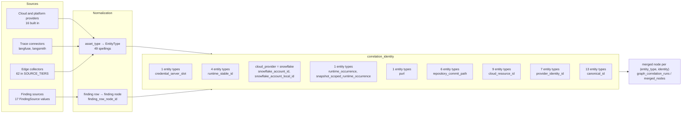

# Cross-source correlation

> Generated from the code by `scripts/generate_graph_data_model.py`. Do not edit by hand: re-run the
> generator and commit the result. CI runs it with `--check` and fails on drift.

How records from different scanners, providers and environments become one graph node. The merge rule is `agent_bom.graph.correlation.correlation_identity`: it returns `(entity_type, identity, basis)`, and observations with the same pair merge. When no exact identity is present the identity is snapshot-scoped (`snapshot:<scan_id>:<node canonical id>`), so the record never merges across scans. Back to the [data model](../DATA_MODEL.md).

## Sources

- Cloud and platform providers (`cloud/__init__.py` `_PROVIDERS`): `aws`, `azure`, `coreweave`, `crusoe`, `databricks`, `gcp`, `huggingface`, `lambda`, `mlflow`, `nebius`, `ollama`, `openai`, `runpod`, `snowflake`, `vastai`, `wandb`
- Trace connectors (`trace_connectors.py`): `langfuse`, `langsmith`
- Finding sources (`agent_bom.finding.FindingSource`): `IAC_SCAN`, `MCP_SCAN`, `CONTAINER`, `SBOM`, `CLOUD_CIS`, `CLOUD_SECURITY`, `PROXY`, `SAST`, `SKILL`, `BROWSER_EXT`, `EXTERNAL`, `FILESYSTEM`, `PROMPT_SCAN`, `SECRET_SCAN`, `GRAPH_ANALYSIS`, `DSPM`, `MODEL_SCAN`
- Edge collectors (`graph/edge_evidence.py` `SOURCE_TIERS`): `access-advisor`, `agent_discovery`, `ai-inventory`, `aspm-overlay`, `asset-canonicalization`, `ast_analysis`, `authorization-evidence`, `aws-organizations`, `browser-extension-scan`, `ci_graph_overlay`, `cloud-audit-trail`, `cloud-cis`, `cloud-inventory`, `cloud-rbac`, `cloud-security`, `cloud_origin`, `cloud_principal`, `cloud_principal_trust`, `cnapp-overlay`, `code_graph_overlay`, `container-scan`, `cortex-agent-usage`, `dspm`, `external-import`, `filesystem-scan`, `framework-agent`, `gcp-organizations`, `github-actions`, `governance-overlay`, `hardware-attestation-ingest`, `iac`, `kubernetes`, `mcp-audit`, `mcp-scan`, `model-scan`, `nhi-discovery`, `operator_reported_timestamps`, `prompt-scan`, `repo-structure-overlay`, `repo-trust-overlay`, `runtime-feedback`, `runtime-identity`, `runtime-proxy`, `runtime-trace`, `sast`, `sbom-ingest`, `secret-scan`, `skill-audit`, `snowflake-cortex-agents`, `snowflake-cortex-observability`, `snowflake-exfil`, `snowflake-external-data`, `snowflake-governance`, `snowflake-integrations`, `snowflake-objects`, `snowflake-organizations`, `snowflake-pipeline`, `snowflake-services`, `source-ast`, `tpm-quote`, `vendor-inventory-export`, `warehouse-export`

## Normalization

`core/asset_types.py` maps a vendor or scanner `asset_type` to an entity type (full table in the [data model](../DATA_MODEL.md#asset-type-normalization)). Spellings per entity type:

| Entity | Accepted `asset_type` spellings |
|---|---|
| `cloud_resource` | `iac_resource` |
| `config_file` | `browser_extension`, `prompt_template` |
| `managed_identity` | `identity` |
| `server` | `mcp_server` |
| `source_file` | `file` |
| `tool` | `mcp_tool` |

A finding row becomes a finding node through `evidence/finding_node_ids.py`:

| Function | Node id |
|---|---|
| `iac_misconfig_node_id` | `misconfig:iac:{rule_id or 'unknown'}:{path or 'unknown'}:{line or 0}` |
| `benchmark_misconfig_node_id` | `misconfig:{section}:{check_id or 'unknown'}` |
| `mcp_audit_node_id` | `misconfig:mcp_audit:{finding_id}` |
| `skill_audit_node_id` | `misconfig:skill_audit:{key}` |
| `finding_row_node_id` | `misconfig:{source}:{finding_id}` |
| `finding_row_node_id` | `vuln:{vuln_id}` |

`graph/resource_aliases.py` (Unambiguous resource aliases used to join findings with discovered cloud assets.) resolves a finding's resource reference to an existing node of type `cloud_resource`, `data_store` by provider-native id, typed name or unambiguous name, scoped to provider and account.

`api/auto_correlation.py`: Exact-batch scheduling for immutable graph correlations.

## Identity rules

Top-level branches of `correlation_identity`, in evaluation order. The first branch whose condition holds decides; within a branch the first non-empty key wins.

| # | Condition | Entity types | Identity keys | Basis recorded | Helpers |
|---|---|---|---|---|---|
| 1 | `entity_type == EntityType.CREDENTIAL.value and is_credential_slot(node)` | `credential` | — | `credential_server_slot` | `credential_occurrence`, `snapshot_scoped_identity` |
| 2 | `entity_type in runtime types` | `agent`, `server`, `tool`, `tool_call` | `runtime_id`, `stable_id`, `canonical_id` | `runtime_stable_id` | `runtime_stable_identity` |
| 3 | `str(node.attributes.get('cloud_provider') or node.dimensions.cloud_provider).lower() == 'snowflake'` | any, when the provider matches | `account_id`, `snowflake_local_id`, `fqn` | `snowflake_account_id`, `snowflake_account_local_id` | `snapshot_scoped_identity` |
| 4 | `entity_type == EntityType.CONTAINER.value` | `container` | `cloud_provider`, `cloud_account_id`, `account_id`, `tenant_id`, `subscription_id`, `project_id`, `cluster_id`, `cluster_arn`, `runtime_host_id`, `environment` | `runtime_occurrence`, `snapshot_scoped_runtime_occurrence` | `container_identity` |
| 5 | `entity_type == EntityType.PACKAGE.value` | `package` | `purl` | `purl` | `snapshot_scoped_identity` |
| 6 | `entity_type in _REPOSITORY_ENTITY_TYPES` | `ci_job`, `code_module`, `config_file`, `directory`, `external_import`, `source_file` | `repository_commit`, `commit_sha`, `git_commit`, `repository_path`, `path`, `source_file`, `config_path` | `repository_commit_path` | `snapshot_scoped_identity` |
| 7 | `entity_type in _CLOUD_RESOURCE_ENTITY_TYPES` | `account`, `api_gateway`, `cloud_resource`, `cluster`, `data_store`, `dataset`, `org`, `provider`, `resource` | `arn`, `resource_arn`, `kubernetes_uid`, `uid`, `resource_id`, `provider_id`, `object_fqn`, `self_link`, `canonical_id`, `stable_id` | `cloud_resource_id` | `strong_identity`, `exact_attribute_identity`, `snapshot_scoped_identity` |
| 8 | `entity_type in _PROVIDER_IDENTITY_ENTITY_TYPES` | `federated_identity`, `group`, `managed_identity`, `role`, `service_account`, `service_principal`, `user` | `provider_identity_id`, `principal_id`, `directory_principal_id`, `object_id`, `subject_id`, `arn`, `client_id`, `canonical_id`, `stable_id` | `provider_identity_id` | `strong_identity`, `exact_attribute_identity`, `snapshot_scoped_identity` |
| 9 | `every other entity type` | `access_grant`, `access_policy`, `application`, `blueprint`, `credential_ref`, `drift_incident`, `environment`, `fleet`, `framework`, `misconfiguration`, `model`, `policy`, `vulnerability` | `canonical_id`, `stable_id` | `canonical_id` | `exact_attribute_identity`, `snapshot_scoped_identity` |

## Per entity type

*Canonical id functions* are `agent_bom.canonical_ids` functions named for the type. *Node id formats* are the statically detected `UnifiedNode(id=…)` templates.

| Entity | Merge branch | Canonical id functions | Node id formats |
|---|---|---|---|
| `access_grant` | 9 | — | — |
| `access_policy` | 9 | — | — |
| `account` | 7 | — | `account:{provider}:{account_scope}` |
| `agent` | 2 | `canonical_agent_id` | — |
| `api_gateway` | 7 | — | `api_gateway:{provider}:{api_id}` |
| `application` | 9 | — | — |
| `blueprint` | 9 | — | — |
| `ci_job` | 6 | — | — |
| `cloud_resource` | 7 | — | `cloud_resource:runtime:{stable_id}`, `cloud_resource:snowflake:integration:{name}`, `cloud_resource:snowflake:pipe:{fqn}` (+12) |
| `cluster` | 7 | — | — |
| `code_module` | 6 | — | `application_entrypoint:source:{…}` |
| `config_file` | 6 | — | — |
| `container` | 4 | — | `container:k8s:pod:{pod_uid}`, `container:serving-config:{…}` |
| `credential` | 1 | — | — |
| `credential_ref` | 9 | — | — |
| `data_store` | 7 | — | `data_store:snowflake:db:{name}`, `data_store:snowflake:schema:{fqn}`, `data_store:snowflake:share:{share_name}` (+4) |
| `dataset` | 7 | — | `dataset:card:{…}` |
| `directory` | 6 | — | `directory:manifest:{agent_node_key}:{srv_name}` |
| `drift_incident` | 9 | — | — |
| `environment` | 9 | — | `env:{provider}:{account_scope}:{environment}` |
| `external_import` | 6 | — | — |
| `federated_identity` | 8 | — | — |
| `fleet` | 9 | — | `endpoint:{endpoint_id}` |
| `framework` | 9 | — | `stable_node_id(…) — UUIDv5` |
| `group` | 8 | — | — |
| `managed_identity` | 8 | — | `configured_identity:{digest}`, `managed_identity:{provider}:{scoped_id}` |
| `misconfiguration` | 9 | — | `misconfig:cloud-org:{provider}:{check_id}`, `misconfig:graph_analysis:{fid}`, `misconfig:sast:{rule_id}:{finding_path}:{finding_line}` (+2) |
| `model` | 9 | — | — |
| `org` | 7 | — | `org:snowflake:{org_name}` |
| `package` | 5 | `canonical_package_id` | `stable_node_id(…) — UUIDv5` |
| `policy` | 9 | — | `policy:aws:scp:{scp_id}`, `policy:gcp:orgpolicy:{constraint}` |
| `provider` | 7 | — | `provider:{provider}` |
| `resource` | 7 | `canonical_mcp_resource_id` | `stable_node_id(…) — UUIDv5` |
| `role` | 8 | — | — |
| `server` | 2 | `canonical_mcp_server_id` | `directory:manifest:{agent_node_key}:{srv_name}` |
| `service_account` | 8 | — | — |
| `service_principal` | 8 | — | — |
| `source_file` | 6 | — | `{value}:{source_file}` |
| `tool` | 2 | `canonical_mcp_tool_id` | `tool:source:{…}`, `tool:{srv_id}:{tool_name}` |
| `tool_call` | 2 | — | — |
| `user` | 8 | — | `user:snowflake:{name}` |
| `vulnerability` | 9 | — | `stable_node_id(…) — UUIDv5`, `vuln:{vuln_id_str}` |

## Not correlated across sources yet

Entity types that reach only the generic fallback branch, have no `canonical_ids` function and no detected UUIDv5 node id. Two sources describing the same thing merge only if each stamps the same `canonical_id` / `stable_id` attribute; otherwise each record stays snapshot-scoped.

- `access_grant`
- `access_policy`
- `application`
- `blueprint`
- `credential_ref`
- `drift_incident`
- `environment`
- `fleet`
- `misconfiguration`
- `model`
- `policy`
