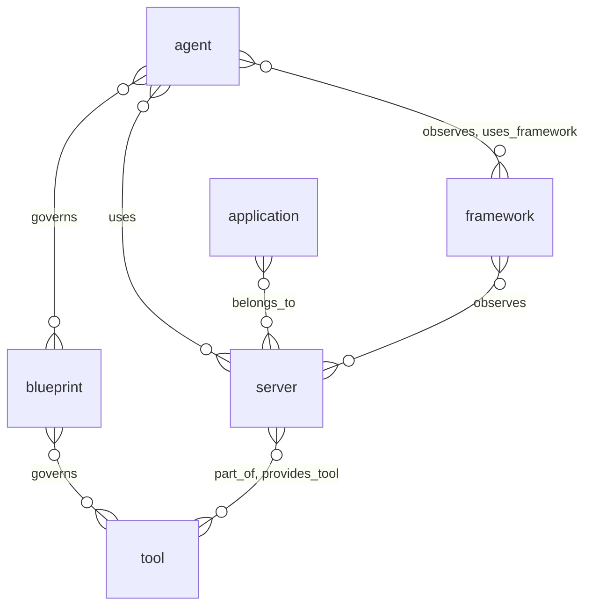
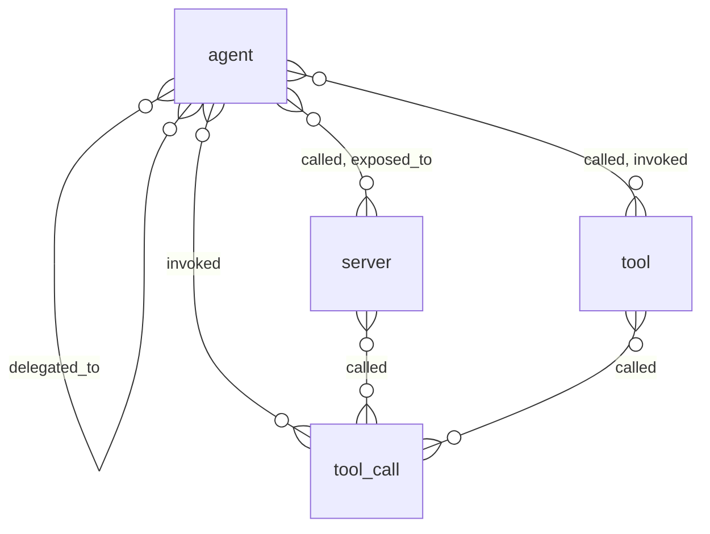
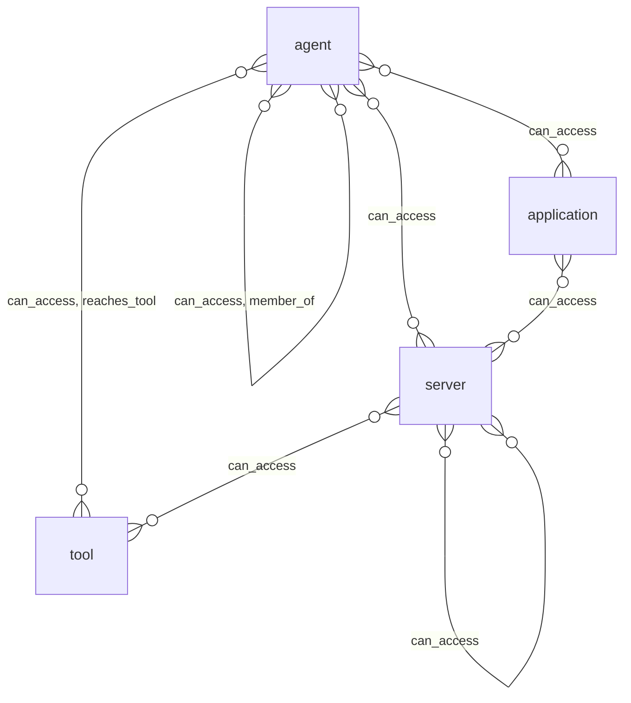

# AI and agents: entity relationships

> Generated from the code by `scripts/generate_graph_data_model.py`. Do not edit by hand: re-run the
> generator and commit the result. CI runs it with `--check` and fails on drift.

Entity types in the ai and agents domain and the relationships allowed between them. A line means the relationship is allowed between the two types; cardinality is not modelled. Back to the [data model](../../DATA_MODEL.md) · [all relationship pairs](../relationships.md).

## Inside the domain

### Structure: what contains, depends on or governs what

### Exposure and runtime: what is exposed to, observed or affected

### Authority: who can act on what

Not drawn, because they can connect almost any two types: `correlates_with`, `lateral_path`, `possibly_correlates_with`, `shares_cred`, `shares_server`, `trace_step`. They are listed in the tables below.

## Relationship reference

### Inside the domain

| Relationship | Class | Traversable | From | To |
|---|---|---|---|---|
| `belongs_to` | `structural` | yes | `server` | `application` |
| `called` | `runtime` | yes | `agent`, `tool_call` | `server`, `tool` |
| `can_access` | `authority` | yes | `agent`, `application`, `server`, `tool` | `agent`, `server` |
| `correlates_with` | `correlation` | no | `agent`, `server` | `agent`, `server` |
| `delegated_to` | `runtime` | yes | `agent` | `agent` |
| `exposed_to` | `exposure` | yes | `server` | `agent` |
| `governs` | `governance` | no | `blueprint` | `agent`, `tool` |
| `invoked` | `runtime` | yes | `agent` | `tool`, `tool_call` |
| `lateral_path` | `derived` | yes | `agent` | `agent` |
| `member_of` | `authority` | yes | `agent` | `agent` |
| `observes` | `structural` | yes | `framework` | `agent`, `server` |
| `part_of` | `structural` | yes | `tool` | `server` |
| `possibly_correlates_with` | `correlation` | no | `agent`, `server` | `agent`, `server` |
| `provides_tool` | `structural` | yes | `server` | `tool` |
| `reaches_tool` | `authority` | yes | `agent` | `tool` |
| `shares_cred` | `correlation` | no | `agent` | `agent` |
| `shares_server` | `correlation` | no | `agent` | `agent` |
| `trace_step` | `runtime` | yes | `agent`, `application`, `framework`, `server`, `tool` | `agent`, `application`, `framework`, `server`, `tool` |
| `uses` | `dependency` | yes | `agent` | `server` |
| `uses_framework` | `dependency` | yes | `agent` | `framework` |

### Across domains

| Relationship | Class | Traversable | From | To |
|---|---|---|---|---|
| `accessed` | `runtime` | yes | `agent`, `tool`, `tool_call` | Cloud, infrastructure and data: `cloud_resource`, `data_store`, `dataset`, `resource` Identity and access: `credential`, `credential_ref` |
| `acted_as` | `runtime` | yes | Identity and access: `federated_identity`, `service_account`, `service_principal`, `user` | `agent` |
| `affects` | `finding` | yes | Findings: `misconfiguration`, `vulnerability` | `agent`, `application`, `framework`, `server`, `tool` |
| `assumes` | `authority` | yes | `agent`, `server` | Identity and access: `managed_identity`, `role`, `service_account`, `service_principal` |
| `authenticates_as` | `authority` | yes | `agent` | Identity and access: `managed_identity`, `service_account`, `service_principal` |
| `belongs_to` | `structural` | yes | Cloud, infrastructure and data: `cloud_resource`, `container` Identity and access: `credential` Findings: `misconfiguration`, `vulnerability` Code and supply chain: `package` | `application` |
| `can_access` | `authority` | yes | `agent`, `application`, `server`, `tool` Cloud, infrastructure and data: `cloud_resource`, `cluster`, `container`, `model` Identity and access: `group`, `managed_identity`, `role`, `service_account`, `service_principal`, `user` | `agent`, `server` Cloud, infrastructure and data: `api_gateway`, `cloud_resource`, `cluster`, `container`, `data_store`, `dataset`, `model`, `resource` Code and supply chain: `config_file` |
| `configures` | `structural` | yes | Code and supply chain: `config_file` | `agent`, `server`, `tool` |
| `contains` | `structural` | yes | `agent`, `application`, `framework`, `server`, `tool` Identity and access: `account` Cloud, infrastructure and data: `cluster`, `container`, `environment`, `fleet` Code and supply chain: `directory` | `agent`, `application`, `framework`, `server`, `tool` Findings: `misconfiguration`, `vulnerability` |
| `defines` | `structural` | yes | Code and supply chain: `source_file` | `tool` |
| `depends_on` | `dependency` | yes | `framework`, `server` | Code and supply chain: `package` |
| `exhibits_drift` | `governance` | yes | `agent` | Findings: `drift_incident` |
| `exploitable_via` | `finding` | yes | Findings: `misconfiguration`, `vulnerability` | `tool` |
| `exposed_to` | `exposure` | yes | `agent`, `server` | Cloud, infrastructure and data: `cloud_resource`, `data_store`, `resource` |
| `exposes_cred` | `authority` | yes | `agent`, `server` | Identity and access: `credential` |
| `governs` | `governance` | no | `blueprint` Identity and access: `access_policy` | `agent`, `tool` Findings: `drift_incident` Identity and access: `managed_identity` |
| `has_permission` | `authority` | yes | Identity and access: `group`, `managed_identity`, `role`, `service_account`, `service_principal`, `user` | `tool` |
| `hosted_on` | `dependency` | yes | `agent`, `server` | Cloud, infrastructure and data: `cloud_resource`, `cluster`, `container`, `fleet` |
| `hosts` | `structural` | yes | Identity and access: `account` Cloud, infrastructure and data: `cloud_resource`, `environment`, `fleet`, `provider` | `agent`, `server` |
| `invoked` | `runtime` | yes | Identity and access: `user` | `tool`, `tool_call` |
| `manages` | `governance` | yes | Identity and access: `federated_identity`, `group`, `role`, `service_account`, `service_principal`, `user` | `agent` |
| `member_of` | `authority` | yes | `agent` Identity and access: `federated_identity`, `group`, `role`, `service_account`, `service_principal`, `user` | `agent` Identity and access: `account`, `group` Cloud, infrastructure and data: `fleet` |
| `owns` | `governance` | yes | Identity and access: `account`, `group`, `org`, `role`, `service_account`, `service_principal`, `user` | `agent` |
| `part_of` | `structural` | yes | `agent`, `server` Code and supply chain: `ci_job` | `application` Cloud, infrastructure and data: `cluster`, `environment`, `fleet` Identity and access: `org` |
| `reaches_tool` | `authority` | yes | Identity and access: `credential` | `tool` |
| `runs` | `structural` | yes | Code and supply chain: `ci_job` | `agent`, `server`, `tool` |
| `scoped_to` | `governance` | yes | Identity and access: `access_grant`, `managed_identity` Findings: `drift_incident` | `tool` |
| `serves_model` | `dependency` | yes | `agent`, `framework`, `server` | Cloud, infrastructure and data: `model` |
| `stores` | `structural` | yes | `server` | Cloud, infrastructure and data: `data_store`, `dataset` |
| `trace_step` | `runtime` | yes | `agent`, `application`, `framework`, `server`, `tool` Identity and access: `access_policy`, `role`, `service_account`, `service_principal`, `user` Cloud, infrastructure and data: `api_gateway`, `cloud_resource`, `cluster`, `container`, `data_store`, `dataset`, `model` Code and supply chain: `ci_job`, `config_file`, `package` | `agent`, `application`, `framework`, `server`, `tool` Identity and access: `access_policy`, `role`, `service_account`, `service_principal`, `user` Cloud, infrastructure and data: `api_gateway`, `cloud_resource`, `cluster`, `container`, `data_store`, `dataset`, `model` Code and supply chain: `ci_job`, `config_file`, `package` |
| `used_credential` | `runtime` | yes | `agent`, `tool`, `tool_call` | Identity and access: `credential`, `credential_ref` |
| `vulnerable_to` | `finding` | yes | `agent`, `server`, `tool` | Findings: `misconfiguration`, `vulnerability` |
