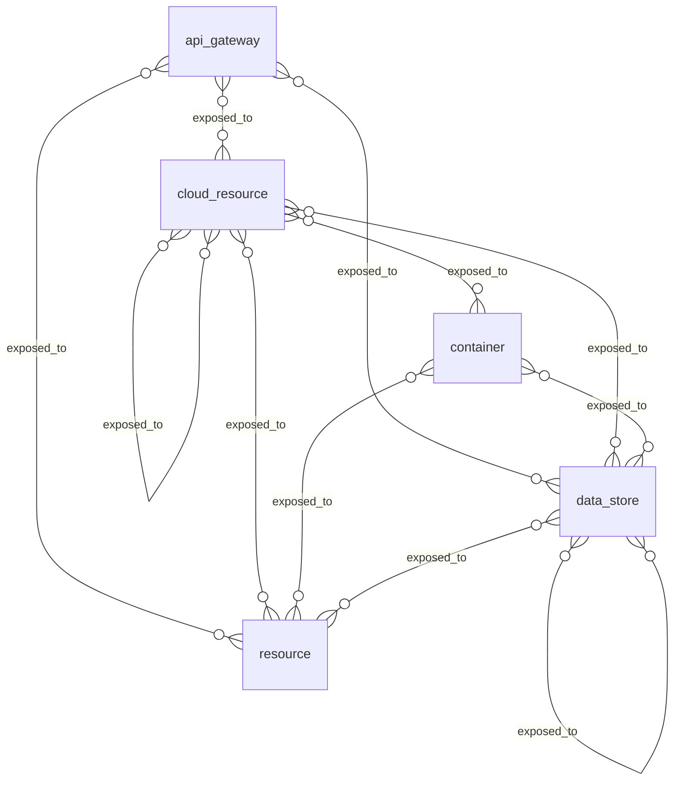

# Cloud, infrastructure and data: entity relationships

> Generated from the code by `scripts/generate_graph_data_model.py`. Do not edit by hand: re-run the
> generator and commit the result. CI runs it with `--check` and fails on drift.

Entity types in the cloud, infrastructure and data domain and the relationships allowed between them. A line means the relationship is allowed between the two types; cardinality is not modelled. Back to the [data model](../../DATA_MODEL.md) · [all relationship pairs](../relationships.md).

## Inside the domain

### Structure: what contains, depends on or governs what

28 type pairs, too many to draw legibly. Read a row as *source → relationship → target*.

| Source ↓ / target → | `api_gateway` | `cloud_resource` | `cluster` | `container` | `data_store` | `dataset` | `environment` | `fleet` | `model` | `resource` |
|---|---|---|---|---|---|---|---|---|---|---|
| `api_gateway` |  | protects |  |  | protects |  |  |  |  | protects |
| `cloud_resource` |  | contains depends_on hosts part_of protects |  |  | protects stores | stores |  |  |  | protects |
| `cluster` |  |  |  | contains |  |  |  |  |  | contains |
| `container` |  | hosted_on | hosted_on part_of | contains depends_on hosted_on |  |  | part_of | hosted_on part_of | serves_model |  |
| `data_store` |  | depends_on |  |  | contains depends_on stores | stores |  |  |  |  |
| `environment` | contains | contains hosts | contains | contains | contains | contains |  |  | contains |  |
| `fleet` |  | hosts |  | contains |  |  |  |  |  |  |
| `provider` |  | hosts |  |  |  |  |  |  |  |  |
| `resource` |  |  |  | contains | stores | stores |  |  |  | part_of |

### Exposure and runtime: what is exposed to, observed or affected

### Authority: who can act on what

26 type pairs, too many to draw legibly. Read a row as *source → relationship → target*.

| Source ↓ / target → | `api_gateway` | `cloud_resource` | `cluster` | `container` | `data_store` | `dataset` | `model` | `resource` |
|---|---|---|---|---|---|---|---|---|
| `cloud_resource` | can_access | can_access | can_access | can_access | can_access | can_access | can_access | can_access |
| `cluster` | can_access | can_access | can_access | can_access | can_access | can_access | can_access | can_access |
| `container` | can_access | can_access | can_access | can_access | can_access | can_access | can_access | can_access |
| `model` | can_access | can_access | can_access | can_access | can_access | can_access | can_access | can_access |

Not drawn, because they can connect almost any two types: `possibly_correlates_with`, `recorded_activity`, `trace_step`. They are listed in the tables below.

## Relationship reference

### Inside the domain

| Relationship | Class | Traversable | From | To |
|---|---|---|---|---|
| `can_access` | `authority` | yes | `cloud_resource`, `cluster`, `container`, `model` | `api_gateway`, `cloud_resource`, `cluster`, `container`, `data_store`, `dataset`, `model`, `resource` |
| `contains` | `structural` | yes | `cloud_resource`, `cluster`, `container`, `data_store`, `environment`, `fleet`, `resource` | `api_gateway`, `cloud_resource`, `cluster`, `container`, `data_store`, `dataset`, `model`, `resource` |
| `depends_on` | `dependency` | yes | `cloud_resource`, `container`, `data_store` | `cloud_resource`, `container`, `data_store` |
| `exposed_to` | `exposure` | yes | `api_gateway`, `cloud_resource`, `container`, `data_store` | `cloud_resource`, `data_store`, `resource` |
| `hosted_on` | `dependency` | yes | `container` | `cloud_resource`, `cluster`, `container`, `fleet` |
| `hosts` | `structural` | yes | `cloud_resource`, `environment`, `fleet`, `provider` | `cloud_resource` |
| `part_of` | `structural` | yes | `cloud_resource`, `container`, `resource` | `cloud_resource`, `cluster`, `environment`, `fleet`, `resource` |
| `possibly_correlates_with` | `correlation` | no | `cloud_resource`, `cluster`, `container`, `data_store` | `cloud_resource`, `cluster`, `container`, `data_store` |
| `protects` | `governance` | no | `api_gateway`, `cloud_resource` | `cloud_resource`, `data_store`, `resource` |
| `recorded_activity` | `correlation` | no | `resource` | `api_gateway`, `cloud_resource`, `cluster`, `container`, `data_store`, `dataset`, `model`, `resource` |
| `serves_model` | `dependency` | yes | `container` | `model` |
| `stores` | `structural` | yes | `cloud_resource`, `data_store`, `resource` | `data_store`, `dataset` |
| `trace_step` | `runtime` | yes | `api_gateway`, `cloud_resource`, `cluster`, `container`, `data_store`, `dataset`, `model` | `api_gateway`, `cloud_resource`, `cluster`, `container`, `data_store`, `dataset`, `model` |

### Across domains

| Relationship | Class | Traversable | From | To |
|---|---|---|---|---|
| `accessed` | `runtime` | yes | AI and agents: `agent`, `tool`, `tool_call` Identity and access: `federated_identity`, `role`, `service_account`, `service_principal`, `user` | `cloud_resource`, `data_store`, `dataset`, `resource` |
| `affects` | `finding` | yes | Findings: `misconfiguration`, `vulnerability` | `api_gateway`, `cloud_resource`, `cluster`, `container`, `data_store`, `dataset`, `model`, `resource` |
| `assumes` | `authority` | yes | `cloud_resource`, `cluster`, `container`, `model` | Identity and access: `managed_identity`, `role`, `service_account`, `service_principal` |
| `belongs_to` | `structural` | yes | `cloud_resource`, `container` | AI and agents: `application` |
| `can_access` | `authority` | yes | `cloud_resource`, `cluster`, `container`, `model` Identity and access: `account`, `federated_identity`, `group`, `managed_identity`, `role`, `service_account`, `service_principal`, `user` AI and agents: `agent`, `application`, `server`, `tool` | `api_gateway`, `cloud_resource`, `cluster`, `container`, `data_store`, `dataset`, `model`, `resource` AI and agents: `agent`, `server` Code and supply chain: `config_file` Identity and access: `credential` |
| `contains` | `structural` | yes | `api_gateway`, `cloud_resource`, `cluster`, `container`, `data_store`, `dataset`, `environment`, `fleet`, `model`, `resource` Identity and access: `account` Code and supply chain: `directory` | `api_gateway`, `cloud_resource`, `container`, `data_store`, `environment` Identity and access: `access_policy`, `role`, `service_account`, `service_principal` AI and agents: `agent`, `application`, `framework`, `server`, `tool` Code and supply chain: `ci_job`, `config_file`, `directory`, `package`, `source_file` Findings: `misconfiguration`, `vulnerability` |
| `depends_on` | `dependency` | yes | `container` | Code and supply chain: `package` |
| `exposed_to` | `exposure` | yes | `data_store` AI and agents: `agent`, `server` | `cloud_resource`, `data_store`, `resource` Identity and access: `account` |
| `has_permission` | `authority` | yes | Identity and access: `group`, `managed_identity`, `role`, `service_account`, `service_principal`, `user` | `cloud_resource`, `cluster`, `data_store`, `resource` |
| `hosted_on` | `dependency` | yes | AI and agents: `agent`, `server` | `cloud_resource`, `cluster`, `container`, `fleet` |
| `hosts` | `structural` | yes | `cloud_resource`, `environment`, `fleet`, `provider` Identity and access: `account` | `cloud_resource` Identity and access: `account`, `org` AI and agents: `agent`, `server` |
| `invoked` | `runtime` | yes | Identity and access: `federated_identity`, `role`, `service_account`, `service_principal`, `user` | `cloud_resource` |
| `manages` | `governance` | yes | Identity and access: `federated_identity`, `group`, `role`, `service_account`, `service_principal`, `user` | `cloud_resource`, `environment`, `fleet` |
| `member_of` | `authority` | yes | AI and agents: `agent` Identity and access: `federated_identity`, `group`, `role`, `service_account`, `service_principal`, `user` | `fleet` |
| `owns` | `governance` | yes | Identity and access: `account`, `group`, `org`, `role`, `service_account`, `service_principal`, `user` | `api_gateway`, `cloud_resource`, `data_store`, `environment` |
| `part_of` | `structural` | yes | `container` Identity and access: `account` AI and agents: `agent`, `server` | `cluster`, `environment`, `fleet` Identity and access: `org` |
| `platform_for` | `structural` | no | `provider` | AI and agents: `agent` |
| `recorded_activity` | `correlation` | no | `resource` AI and agents: `agent`, `server`, `tool_call` Identity and access: `federated_identity`, `managed_identity`, `role`, `service_account`, `service_principal`, `user` | `api_gateway`, `cloud_resource`, `cluster`, `container`, `data_store`, `dataset`, `model`, `resource` Identity and access: `access_policy`, `credential`, `credential_ref`, `policy`, `role`, `service_account`, `service_principal`, `user` AI and agents: `agent`, `application`, `framework`, `server`, `tool`, `tool_call` Code and supply chain: `ci_job`, `config_file`, `package` |
| `serves_model` | `dependency` | yes | AI and agents: `agent`, `framework`, `server` | `model` |
| `stores` | `structural` | yes | AI and agents: `server` | `data_store`, `dataset` |
| `trace_step` | `runtime` | yes | `api_gateway`, `cloud_resource`, `cluster`, `container`, `data_store`, `dataset`, `model` Identity and access: `access_policy`, `role`, `service_account`, `service_principal`, `user` AI and agents: `agent`, `application`, `framework`, `server`, `tool` Code and supply chain: `ci_job`, `config_file`, `package` | `api_gateway`, `cloud_resource`, `cluster`, `container`, `data_store`, `dataset`, `model` Identity and access: `access_policy`, `role`, `service_account`, `service_principal`, `user` AI and agents: `agent`, `application`, `framework`, `server`, `tool` Code and supply chain: `ci_job`, `config_file`, `package` |
| `vulnerable_to` | `finding` | yes | `cloud_resource`, `container` | Findings: `misconfiguration`, `vulnerability` |
