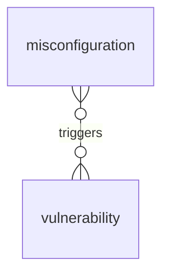

# Findings: entity relationships

> Generated from the code by `scripts/generate_graph_data_model.py`. Do not edit by hand: re-run the
> generator and commit the result. CI runs it with `--check` and fails on drift.

Entity types in the findings domain and the relationships allowed between them. A line means the relationship is allowed between the two types; cardinality is not modelled. Back to the [data model](../../DATA_MODEL.md) · [all relationship pairs](../relationships.md).

## Inside the domain

### Exposure and runtime: what is exposed to, observed or affected

## Relationship reference

### Inside the domain

| Relationship | Class | Traversable | From | To |
|---|---|---|---|---|
| `triggers` | `finding` | yes | `vulnerability` | `misconfiguration` |

### Across domains

| Relationship | Class | Traversable | From | To |
|---|---|---|---|---|
| `affects` | `finding` | yes | `misconfiguration`, `vulnerability` | Identity and access: `access_policy`, `account`, `org`, `role`, `service_account`, `service_principal` AI and agents: `agent`, `application`, `framework`, `server`, `tool` Cloud, infrastructure and data: `api_gateway`, `cloud_resource`, `cluster`, `container`, `data_store`, `dataset`, `model`, `resource` Code and supply chain: `ci_job`, `config_file`, `package`, `source_file` |
| `belongs_to` | `structural` | yes | `misconfiguration`, `vulnerability` | AI and agents: `application` |
| `contains` | `structural` | yes | Identity and access: `access_policy`, `role`, `service_account`, `service_principal` AI and agents: `agent`, `application`, `framework`, `server`, `tool` Cloud, infrastructure and data: `api_gateway`, `cloud_resource`, `cluster`, `container`, `data_store`, `dataset`, `model` Code and supply chain: `ci_job`, `config_file`, `package` | `misconfiguration`, `vulnerability` |
| `exhibits_drift` | `governance` | yes | AI and agents: `agent` | `drift_incident` |
| `exploitable_via` | `finding` | yes | `misconfiguration`, `vulnerability` | Identity and access: `credential` AI and agents: `tool` |
| `governs` | `governance` | no | Identity and access: `access_policy` AI and agents: `blueprint` | `drift_incident` |
| `remediates` | `finding` | no | Code and supply chain: `package` | `misconfiguration`, `vulnerability` |
| `scoped_to` | `governance` | yes | `drift_incident` | AI and agents: `tool` |
| `vulnerable_to` | `finding` | yes | AI and agents: `agent`, `server`, `tool` Cloud, infrastructure and data: `cloud_resource`, `container` Identity and access: `credential`, `credential_ref`, `role` Code and supply chain: `directory`, `package` | `misconfiguration`, `vulnerability` |
