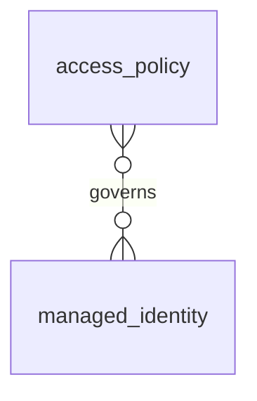

# Identity and access: entity relationships

> Generated from the code by `scripts/generate_graph_data_model.py`. Do not edit by hand: re-run the
> generator and commit the result. CI runs it with `--check` and fails on drift.

Entity types in the identity and access domain and the relationships allowed between them. A line means the relationship is allowed between the two types; cardinality is not modelled. Back to the [data model](../../DATA_MODEL.md) · [all relationship pairs](../relationships.md).

## Inside the domain

### Structure: what contains, depends on or governs what

### Authority: who can act on what

39 type pairs, too many to draw legibly. Read a row as *source → relationship → target*.

| Source ↓ / target → | `access_grant` | `credential` | `federated_identity` | `group` | `managed_identity` | `policy` | `role` | `service_account` | `service_principal` | `user` |
|---|---|---|---|---|---|---|---|---|---|---|
| `credential` |  |  |  |  | authenticates_as |  | authenticates_as | authenticates_as | authenticates_as |  |
| `federated_identity` |  | can_access | cross_account_trust | member_of |  |  | assumes cross_account_trust |  | cross_account_trust |  |
| `group` | attached | can_access |  | member_of |  | attached inherits | inherits |  |  |  |
| `managed_identity` | attached |  |  |  | can_access | attached | can_access | can_access | can_access |  |
| `role` | attached | can_access | cross_account_trust trusts | member_of trusts | can_access | attached inherits | assumes can_access cross_account_trust inherits member_of trusts | can_access trusts | can_access cross_account_trust trusts | trusts |
| `service_account` | attached | can_access |  | member_of | can_access | attached inherits | assumes can_access inherits | can_access | can_access |  |
| `service_principal` | attached | can_access | cross_account_trust | member_of | can_access | attached inherits | assumes can_access cross_account_trust inherits | can_access | can_access cross_account_trust |  |
| `user` | attached | can_access |  | member_of |  | attached inherits | assumes inherits member_of |  |  |  |

Not drawn, because they can connect almost any two types: `possibly_correlates_with`, `recorded_activity`, `trace_step`. They are listed in the tables below.

## Relationship reference

### Inside the domain

| Relationship | Class | Traversable | From | To |
|---|---|---|---|---|
| `assumes` | `authority` | yes | `federated_identity`, `role`, `service_account`, `service_principal`, `user` | `role` |
| `attached` | `authority` | yes | `group`, `managed_identity`, `role`, `service_account`, `service_principal`, `user` | `access_grant`, `policy` |
| `authenticates_as` | `authority` | yes | `credential` | `managed_identity`, `role`, `service_account`, `service_principal` |
| `can_access` | `authority` | yes | `federated_identity`, `group`, `managed_identity`, `role`, `service_account`, `service_principal`, `user` | `credential`, `managed_identity`, `role`, `service_account`, `service_principal` |
| `cross_account_trust` | `authority` | yes | `federated_identity`, `role`, `service_principal` | `federated_identity`, `role`, `service_principal` |
| `governs` | `governance` | no | `access_policy` | `managed_identity` |
| `inherits` | `authority` | yes | `group`, `role`, `service_account`, `service_principal`, `user` | `policy`, `role` |
| `member_of` | `authority` | yes | `federated_identity`, `group`, `role`, `service_account`, `service_principal`, `user` | `group`, `role` |
| `possibly_correlates_with` | `correlation` | no | `managed_identity`, `role`, `service_account`, `service_principal`, `user` | `managed_identity`, `role`, `service_account`, `service_principal`, `user` |
| `recorded_activity` | `correlation` | no | `federated_identity`, `managed_identity`, `role`, `service_account`, `service_principal`, `user` | `access_policy`, `credential`, `credential_ref`, `policy`, `role`, `service_account`, `service_principal`, `user` |
| `trace_step` | `runtime` | yes | `access_policy`, `role`, `service_account`, `service_principal`, `user` | `access_policy`, `role`, `service_account`, `service_principal`, `user` |
| `trusts` | `authority` | yes | `role` | `federated_identity`, `group`, `role`, `service_account`, `service_principal`, `user` |

### Across domains

| Relationship | Class | Traversable | From | To |
|---|---|---|---|---|
| `accessed` | `runtime` | yes | `federated_identity`, `role`, `service_account`, `service_principal`, `user` AI and agents: `tool`, `tool_call` | `credential`, `credential_ref` Cloud, infrastructure and data: `cloud_resource`, `data_store`, `dataset`, `resource` |
| `acted_as` | `runtime` | yes | `federated_identity`, `service_account`, `service_principal`, `user` | AI and agents: `agent` |
| `affects` | `finding` | yes | Findings: `misconfiguration` | `access_policy`, `role`, `service_account`, `service_principal` |
| `assumes` | `authority` | yes | AI and agents: `agent`, `server` Cloud, infrastructure and data: `cloud_resource`, `cluster`, `container`, `model` | `managed_identity`, `role`, `service_account`, `service_principal` |
| `authenticates_as` | `authority` | yes | AI and agents: `agent` | `managed_identity`, `service_account`, `service_principal` |
| `belongs_to` | `structural` | yes | `credential` | AI and agents: `application` |
| `can_access` | `authority` | yes | `federated_identity`, `group`, `managed_identity`, `role`, `service_account`, `service_principal`, `user` Cloud, infrastructure and data: `account`, `container` | `credential` AI and agents: `agent`, `server` Cloud, infrastructure and data: `api_gateway`, `cloud_resource`, `cluster`, `container`, `data_store`, `dataset`, `model`, `resource` Code and supply chain: `config_file` |
| `contains` | `structural` | yes | `access_policy`, `role`, `service_account`, `service_principal` Cloud, infrastructure and data: `environment`, `resource` | `access_policy`, `role`, `service_account`, `service_principal` Findings: `misconfiguration`, `vulnerability` |
| `cross_account_trust` | `authority` | yes | `federated_identity`, `role`, `service_principal` Cloud, infrastructure and data: `account` | `federated_identity`, `role`, `service_principal` Cloud, infrastructure and data: `account` |
| `exploitable_via` | `finding` | yes | Findings: `misconfiguration`, `vulnerability` | `credential` |
| `exposes_cred` | `authority` | yes | AI and agents: `agent`, `server` Cloud, infrastructure and data: `resource` | `credential` |
| `governs` | `governance` | no | `access_policy`, `policy` AI and agents: `blueprint` | `managed_identity` Cloud, infrastructure and data: `account`, `org` AI and agents: `agent`, `tool` Findings: `drift_incident` |
| `has_permission` | `authority` | yes | `group`, `managed_identity`, `role`, `service_account`, `service_principal`, `user` | Cloud, infrastructure and data: `account`, `cloud_resource`, `cluster`, `data_store`, `org`, `resource` AI and agents: `tool` |
| `invoked` | `runtime` | yes | `federated_identity`, `role`, `service_account`, `service_principal`, `user` | Cloud, infrastructure and data: `cloud_resource` AI and agents: `tool`, `tool_call` |
| `manages` | `governance` | yes | `federated_identity`, `group`, `role`, `service_account`, `service_principal`, `user` | AI and agents: `agent` Cloud, infrastructure and data: `cloud_resource`, `environment`, `fleet` |
| `member_of` | `authority` | yes | `federated_identity`, `group`, `managed_identity`, `role`, `service_account`, `service_principal`, `user` AI and agents: `agent` | `group` Cloud, infrastructure and data: `account`, `fleet` AI and agents: `agent` |
| `owns` | `governance` | yes | `group`, `role`, `service_account`, `service_principal`, `user` Cloud, infrastructure and data: `account`, `org` | `group`, `policy`, `role`, `service_account`, `service_principal`, `user` AI and agents: `agent` Cloud, infrastructure and data: `cloud_resource`, `environment` |
| `reaches_tool` | `authority` | yes | `credential` | AI and agents: `tool` |
| `recorded_activity` | `correlation` | no | `federated_identity`, `managed_identity`, `role`, `service_account`, `service_principal`, `user` AI and agents: `agent`, `server`, `tool_call` Cloud, infrastructure and data: `resource` | `access_policy`, `credential`, `credential_ref`, `policy`, `role`, `service_account`, `service_principal`, `user` AI and agents: `agent`, `application`, `framework`, `server`, `tool`, `tool_call` Cloud, infrastructure and data: `api_gateway`, `cloud_resource`, `cluster`, `container`, `data_store`, `dataset`, `model`, `resource` Code and supply chain: `ci_job`, `config_file`, `package` |
| `scoped_to` | `governance` | yes | `access_grant`, `managed_identity` | AI and agents: `tool` |
| `trace_step` | `runtime` | yes | `access_policy`, `role`, `service_account`, `service_principal`, `user` AI and agents: `agent`, `application`, `framework`, `server`, `tool` Cloud, infrastructure and data: `api_gateway`, `cloud_resource`, `cluster`, `container`, `data_store`, `dataset`, `model` Code and supply chain: `ci_job`, `config_file`, `package` | `access_policy`, `role`, `service_account`, `service_principal`, `user` AI and agents: `agent`, `application`, `framework`, `server`, `tool` Cloud, infrastructure and data: `api_gateway`, `cloud_resource`, `cluster`, `container`, `data_store`, `dataset`, `model` Code and supply chain: `ci_job`, `config_file`, `package` |
| `trusts` | `authority` | yes | `role` Cloud, infrastructure and data: `account` | `federated_identity`, `group`, `role`, `service_account`, `service_principal`, `user` Cloud, infrastructure and data: `account` |
| `used_credential` | `runtime` | yes | AI and agents: `agent`, `tool`, `tool_call` | `credential`, `credential_ref` |
| `vulnerable_to` | `finding` | yes | `credential`, `credential_ref`, `role` | Findings: `misconfiguration`, `vulnerability` |
