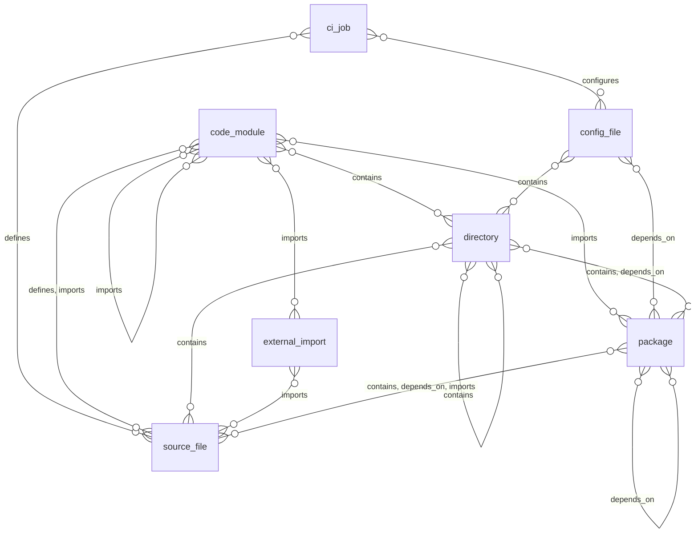

# Code and supply chain: entity relationships

> Generated from the code by `scripts/generate_graph_data_model.py`. Do not edit by hand: re-run the
> generator and commit the result. CI runs it with `--check` and fails on drift.

Entity types in the code and supply chain domain and the relationships allowed between them. A line means the relationship is allowed between the two types; cardinality is not modelled. Back to the [data model](../../DATA_MODEL.md) · [all relationship pairs](../relationships.md).

## Inside the domain

### Structure: what contains, depends on or governs what

Not drawn, because they can connect almost any two types: `recorded_activity`, `trace_step`. They are listed in the tables below.

## Relationship reference

### Inside the domain

| Relationship | Class | Traversable | From | To |
|---|---|---|---|---|
| `configures` | `structural` | yes | `config_file` | `ci_job` |
| `contains` | `structural` | yes | `directory`, `source_file` | `code_module`, `config_file`, `directory`, `package`, `source_file` |
| `defines` | `structural` | yes | `source_file` | `ci_job`, `code_module` |
| `depends_on` | `dependency` | yes | `config_file`, `directory`, `package`, `source_file` | `package` |
| `imports` | `dependency` | yes | `code_module`, `source_file` | `code_module`, `external_import`, `package` |
| `trace_step` | `runtime` | yes | `ci_job`, `config_file`, `package` | `ci_job`, `config_file`, `package` |

### Across domains

| Relationship | Class | Traversable | From | To |
|---|---|---|---|---|
| `affects` | `finding` | yes | Findings: `misconfiguration`, `vulnerability` | `ci_job`, `config_file`, `package`, `source_file` |
| `belongs_to` | `structural` | yes | `package` | AI and agents: `application` |
| `can_access` | `authority` | yes | AI and agents: `agent`, `application`, `server`, `tool` Cloud, infrastructure and data: `cloud_resource`, `cluster`, `container`, `model` Identity and access: `group`, `managed_identity`, `role`, `service_account`, `service_principal`, `user` | `config_file` |
| `configures` | `structural` | yes | `config_file` | AI and agents: `agent`, `server`, `tool` |
| `contains` | `structural` | yes | `ci_job`, `config_file`, `directory`, `package` Cloud, infrastructure and data: `cluster`, `container`, `environment`, `fleet` | `ci_job`, `config_file`, `directory`, `package`, `source_file` Cloud, infrastructure and data: `container` Findings: `misconfiguration`, `vulnerability` AI and agents: `server` |
| `defines` | `structural` | yes | `source_file` | AI and agents: `tool` |
| `depends_on` | `dependency` | yes | Cloud, infrastructure and data: `container` AI and agents: `framework`, `server` | `package` |
| `part_of` | `structural` | yes | `ci_job` | AI and agents: `application` |
| `recorded_activity` | `correlation` | no | AI and agents: `agent`, `server`, `tool_call` Identity and access: `federated_identity`, `managed_identity`, `role`, `service_account`, `service_principal`, `user` Cloud, infrastructure and data: `resource` | `ci_job`, `config_file`, `package` |
| `remediates` | `finding` | no | `package` | Findings: `misconfiguration`, `vulnerability` |
| `runs` | `structural` | yes | `ci_job` | AI and agents: `agent`, `server`, `tool` |
| `trace_step` | `runtime` | yes | `ci_job`, `config_file`, `package` Identity and access: `access_policy`, `role`, `service_account`, `service_principal`, `user` AI and agents: `agent`, `application`, `framework`, `server`, `tool` Cloud, infrastructure and data: `api_gateway`, `cloud_resource`, `cluster`, `container`, `data_store`, `dataset`, `model` | `ci_job`, `config_file`, `package` Identity and access: `access_policy`, `role`, `service_account`, `service_principal`, `user` AI and agents: `agent`, `application`, `framework`, `server`, `tool` Cloud, infrastructure and data: `api_gateway`, `cloud_resource`, `cluster`, `container`, `data_store`, `dataset`, `model` |
| `vulnerable_to` | `finding` | yes | `directory`, `package` | Findings: `misconfiguration`, `vulnerability` |
