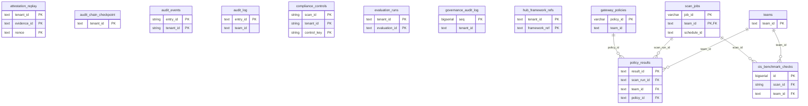

# Compliance, audit and evidence

> Generated from the code by `scripts/generate_graph_data_model.py`. Do not edit by hand: re-run the
> generator and commit the result. CI runs it with `--check` and fails on drift.

Storage tables in this domain. Back to the [storage ERD](../storage-erd.md).

10 tables.

Tables from other domains drawn for their relations: `gateway_policies`, `scan_jobs`, `teams`.

## Relations

| Parent | Child | Column | Kind |
|---|---|---|---|
| `gateway_policies` | `policy_results` | `policy_id` | declared FK |
| `scan_jobs` | `cis_benchmark_checks` | `scan_id → scan_jobs.job_id` | declared FK |
| `scan_jobs` | `policy_results` | `scan_run_id → scan_jobs.job_id` | declared FK |
| `teams` | `cis_benchmark_checks` | `team_id` | declared FK |
| `teams` | `policy_results` | `team_id` | declared FK |

## Shared key columns without an owning table

Same column name in several tables here, but no table owns it, so no join is drawn.

| Column | Tables |
|---|---|
| `entry_id` | `audit_events`, `audit_log` |

## Tables

| Table | Backends | Columns | Partitioned |
|---|---|---|---|
| `attestation_replay` | SQLite | 4 |  |
| `audit_chain_checkpoint` | Postgres, SQLite | 4 |  |
| `audit_events` | ClickHouse | 10 | yes |
| `audit_log` | Postgres, SQLite | 10 |  |
| `cis_benchmark_checks` | Postgres, ClickHouse | 22 | yes |
| `compliance_controls` | ClickHouse | 11 | yes |
| `evaluation_runs` | Postgres, SQLite | 5 |  |
| `governance_audit_log` | Postgres, SQLite | 8 |  |
| `hub_framework_refs` | Postgres, SQLite | 4 |  |
| `policy_results` | Postgres | 10 |  |
