# Connectors, delivery and schedules

> Generated from the code by `scripts/generate_graph_data_model.py`. Do not edit by hand: re-run the
> generator and commit the result. CI runs it with `--check` and fails on drift.

Storage tables in this domain. Back to the [storage ERD](../storage-erd.md).

16 tables.

```mermaid
erDiagram
  bound_references {
    varchar reference_name PK
    varchar object_name PK
  }
  cloud_connections {
    text id PK
    text tenant_id
  }
  control_plane_sources {
    text source_id PK
    text tenant_id
  }
  delivery_breaker {
    text destination_id PK
  }
  delivery_ledger {
    text idempotency_key PK
    text destination_id PK
  }
  delivery_log {
    integer id PK
  }
  delta_stream_watermarks {
    text tenant_id PK
    text destination_id PK
  }
  endpoint_connections {
    text tenant_id PK
    text id PK
  }
  endpoint_sync_events {
    text tenant_id PK
    text connection_id PK
    text event_id PK
  }
  endpoint_syncs {
    text tenant_id PK
    text connection_id PK
    text run_id PK
  }
  export_destinations {
    text id PK
    text tenant_id PK
  }
  export_schedules {
    text schedule_id PK
    text tenant_id PK
  }
  posture_webhook_outbox {
    integer id PK
    text tenant_id
  }
  sources {
    text source_id PK
    text tenant_id
  }
  ticketing_connections {
    text id PK
    text tenant_id
  }
  webhook_subscriptions {
    text tenant_id PK
    text subscription_id PK
  }
```

## Relations

| Parent | Child | Column | Kind |
|---|---|---|---|

## Shared key columns without an owning table

Same column name in several tables here, but no table owns it, so no join is drawn.

| Column | Tables |
|---|---|
| `connection_id` | `endpoint_sync_events`, `endpoint_syncs` |
| `destination_id` | `delivery_breaker`, `delivery_ledger`, `delivery_log`, `delta_stream_watermarks`, `posture_webhook_outbox` |
| `event_id` | `endpoint_sync_events`, `posture_webhook_outbox` |
| `source_id` | `control_plane_sources`, `sources` |

## Tables

| Table | Backends | Columns | Partitioned |
|---|---|---|---|
| `bound_references` | Snowflake | 4 |  |
| `cloud_connections` | Postgres, SQLite | 21 |  |
| `control_plane_sources` | Postgres | 5 |  |
| `delivery_breaker` | SQLite | 5 |  |
| `delivery_ledger` | SQLite | 7 |  |
| `delivery_log` | SQLite | 10 |  |
| `delta_stream_watermarks` | SQLite | 5 |  |
| `endpoint_connections` | Postgres | 6 |  |
| `endpoint_sync_events` | Postgres, SQLite | 5 |  |
| `endpoint_syncs` | Postgres, SQLite | 5 |  |
| `export_destinations` | Postgres, SQLite | 12 |  |
| `export_schedules` | Postgres, SQLite | 5 |  |
| `posture_webhook_outbox` | SQLite | 13 |  |
| `sources` | SQLite | 5 |  |
| `ticketing_connections` | Postgres, SQLite | 13 |  |
| `webhook_subscriptions` | Postgres, SQLite | 5 |  |
