# Findings, triage and VEX

> Generated from the code by `scripts/generate_graph_data_model.py`. Do not edit by hand: re-run the
> generator and commit the result. CI runs it with `--check` and fails on drift.

Storage tables in this domain. Back to the [storage ERD](../storage-erd.md).

25 tables.

Tables from other domains drawn for their relations: `scan_jobs`, `scan_runs`, `teams`.

```mermaid
erDiagram
  campaign_evidence_state {
    text tenant_id PK
  }
  compliance_hub_findings {
    varchar tenant_id PK
    varchar finding_id PK
    text scan_id
  }
  drift_incidents {
    text tenant_id PK
    text incident_id PK
  }
  exceptions {
    text exception_id PK
    text team_id FK
  }
  finding_history_jobs {
    text tenant_id PK
    text job_id PK
  }
  finding_history_rows {
    text tenant_id PK
    text job_id PK
    integer ordinal PK
  }
  findings {
    text finding_id PK
    text scan_run_id FK
    text team_id FK
    text cve_id
  }
  findings_by_framework {
    varchar finding_id PK
    varchar framework_slug PK
    varchar tenant_id
  }
  findings_feed {
    string tenant_id PK
    string run_id
    string finding_id PK
    string canonical_id
  }
  findings_feed_runs {
    string tenant_id PK
    string run_id PK
  }
  findings_feed_staged {
    string tenant_id PK
    string run_id PK
    string publication_attempt_id PK
    string finding_id PK
    string canonical_id
  }
  hitl_approvals {
    text item_id PK
    text tenant_id
  }
  hub_cve_intel {
    text tenant_id PK
    text cve_id PK
  }
  hub_findings_current {
    text tenant_id PK
    text canonical_id PK
    text scan_id
  }
  hub_findings_current_observations {
    text tenant_id PK
    text canonical_id PK
    text scan_id PK
  }
  hub_ledger_ingest_state {
    text tenant_id PK
  }
  hub_overview_revisions {
    text tenant_id PK
  }
  issue_mappings {
    text tenant_id PK
    text mapping_id PK
  }
  operator_advisories {
    text tenant_id PK
    text advisory_id PK
  }
  operator_advisory_rematch_state {
    text tenant_id PK
  }
  risk_campaign_workflows {
    text tenant_id PK
    text campaign_id PK
  }
  scan_findings {
    text run_id PK, FK
    text scan_id
    text finding_key PK
    text canonical_id
    text asset_canonical_id
  }
  ticket_links {
    text id PK
    text tenant_id
  }
  trend_history {
    bigserial id PK
    text team_id
    text scan_id
  }
  vulnerability_scans {
    string scan_id PK
    string tenant_id PK
    string finding_key PK
  }
  scan_jobs {
    varchar job_id PK
    text team_id PK, FK
    text schedule_id
  }
  scan_runs {
    text run_id PK
    text scan_id
    text tenant_id
  }
  teams {
    text team_id PK
  }
  finding_history_jobs ||..o{ finding_history_rows : "logical job_id"
  findings_feed_runs ||..o{ findings_feed : "logical run_id"
  findings_feed_runs ||..o{ findings_feed_staged : "logical run_id"
  hub_cve_intel ||..o{ findings : "logical cve_id"
  hub_findings_current ||..o{ hub_findings_current_observations : "logical canonical_id"
  hub_findings_current ||..o{ scan_findings : "logical canonical_id"
  scan_jobs ||--o{ findings : "scan_run_id"
  scan_runs ||--o{ scan_findings : "run_id"
  teams ||--o{ exceptions : "team_id"
  teams ||--o{ findings : "team_id"
```

## Relations

| Parent | Child | Column | Kind |
|---|---|---|---|
| `finding_history_jobs` | `finding_history_rows` | `job_id` | logical |
| `findings_feed_runs` | `findings_feed` | `run_id` | logical |
| `findings_feed_runs` | `findings_feed_staged` | `run_id` | logical |
| `hub_cve_intel` | `findings` | `cve_id` | logical |
| `hub_findings_current` | `hub_findings_current_observations` | `canonical_id` | logical |
| `hub_findings_current` | `scan_findings` | `canonical_id` | logical |
| `scan_jobs` | `findings` | `scan_run_id → scan_jobs.job_id` | declared FK |
| `scan_runs` | `scan_findings` | `run_id` | declared FK |
| `teams` | `exceptions` | `team_id` | declared FK |
| `teams` | `findings` | `team_id` | declared FK |

## Shared key columns without an owning table

Same column name in several tables here, but no table owns it, so no join is drawn.

| Column | Tables |
|---|---|
| `canonical_id` | `findings_feed`, `findings_feed_staged` |
| `cve_id` | `findings_feed`, `findings_feed_staged`, `vulnerability_scans` |
| `external_id` | `issue_mappings`, `ticket_links` |
| `finding_id` | `compliance_hub_findings`, `findings`, `findings_by_framework`, `findings_feed`, `findings_feed_staged` |
| `publication_attempt_id` | `findings_feed_runs`, `findings_feed_staged` |
| `scan_id` | `compliance_hub_findings`, `hub_findings_current`, `hub_findings_current_observations`, `scan_findings`, `trend_history`, `vulnerability_scans` |

## Tables

| Table | Backends | Columns | Partitioned | Lifetime |
|---|---|---|---|---|
| `campaign_evidence_state` | Postgres, SQLite | 3 |  | persistent |
| `compliance_hub_findings` | Postgres, SQLite, Snowflake | 13 |  | persistent |
| `drift_incidents` | Postgres, SQLite | 5 |  | persistent |
| `exceptions` | Postgres, SQLite, Snowflake | 17 |  | persistent |
| `finding_history_jobs` | Postgres | 4 |  | persistent |
| `finding_history_rows` | Postgres | 7 |  | persistent |
| `findings` | Postgres | 26 |  | persistent |
| `findings_by_framework` | Snowflake | 9 |  | persistent |
| `findings_feed` | ClickHouse | 18 | yes | persistent |
| `findings_feed_runs` | ClickHouse | 6 |  | persistent |
| `findings_feed_staged` | ClickHouse | 18 | yes | persistent |
| `hitl_approvals` | SQLite | 14 |  | persistent |
| `hub_cve_intel` | Postgres, SQLite | 4 |  | persistent |
| `hub_findings_current` | Postgres | 18 |  | persistent |
| `hub_findings_current_observations` | Postgres, SQLite | 4 | yes | persistent |
| `hub_ledger_ingest_state` | SQLite | 3 |  | persistent |
| `hub_overview_revisions` | Postgres, SQLite | 2 |  | persistent |
| `issue_mappings` | Postgres, SQLite | 11 |  | persistent |
| `operator_advisories` | Postgres, SQLite | 4 |  | persistent |
| `operator_advisory_rematch_state` | Postgres, SQLite | 3 |  | persistent |
| `risk_campaign_workflows` | Postgres, SQLite | 13 |  | persistent |
| `scan_findings` | SQLite | 20 |  | persistent |
| `ticket_links` | Postgres, SQLite | 11 |  | persistent |
| `trend_history` | Postgres, SQLite | 14 |  | persistent |
| `vulnerability_scans` | ClickHouse | 16 | yes | persistent |
