# Graph nodes, edges, snapshots and attack paths

> Generated from the code by `scripts/generate_graph_data_model.py`. Do not edit by hand: re-run the
> generator and commit the result. CI runs it with `--check` and fails on drift.

Storage tables in this domain. Back to the [storage ERD](../storage-erd.md).

21 tables.

Scratch tables are temporary SQLite build/correlation workspaces, not durable evidence stores.

```mermaid
erDiagram
  attack_paths {
    text scan_id PK
    text tenant_id PK
    text path_key PK
  }
  edge_groups {
    text source_type PK
    text source_identity PK
    text target_type PK
    text target_identity PK
    text relationship PK
  }
  edge_observations {
    text source_type PK
    text source_identity PK
    text target_type PK
    text target_identity PK
    text relationship PK
    text scan_id PK
    text edge_id PK
  }
  graph_attack_paths {
    text tenant_id PK
    text scan_id PK
    text path_key PK
  }
  graph_build_workspace_edges {
    text workspace_id PK
    text tenant_id PK
    text edge_key PK
  }
  graph_build_workspace_nodes {
    text workspace_id PK
    text tenant_id PK
    text node_id PK
  }
  graph_correlation_runs {
    text correlation_id PK
    text tenant_id PK
  }
  graph_edges {
    text source_id PK
    text target_id PK
    text relationship PK
    text scan_id PK
    text tenant_id PK
  }
  graph_filter_presets {
    text name PK
    text tenant_id PK
  }
  graph_node_aliases {
    text tenant_id PK
    text alias_id PK
    text canonical_id
    text scan_id
  }
  graph_node_search {
    text node_id PK
    text tenant_id PK
    text scan_id PK
  }
  graph_nodes {
    text id PK
    text scan_id PK
    text tenant_id PK
  }
  graph_scenarios {
    text id PK
    text tenant_id PK
  }
  graph_snapshots {
    text scan_id PK
    text tenant_id PK
    text correlation_id
  }
  interaction_risks {
    text pattern PK
    text agents PK
    text scan_id PK
    text tenant_id PK
  }
  merged_nodes {
    text entity_type PK
    text identity PK
  }
  node_groups {
    text entity_type PK
    text identity PK
  }
  node_observations {
    text entity_type PK
    text identity PK
    text scan_id PK
    text node_id PK
  }
  strong_members {
    text scan_id PK
    text node_id PK
  }
  ws_edges {
    text tenant_id
    integer seq PK
  }
  ws_nodes {
    text tenant_id
    integer seq PK
  }
  graph_correlation_runs ||..o{ graph_snapshots : "logical correlation_id"
  graph_snapshots ||..o{ attack_paths : "logical scan_id"
  graph_snapshots ||..o{ edge_observations : "logical scan_id"
  graph_snapshots ||..o{ graph_attack_paths : "logical scan_id"
  graph_snapshots ||..o{ graph_edges : "logical scan_id"
  graph_snapshots ||..o{ graph_node_aliases : "logical scan_id"
  graph_snapshots ||..o{ graph_node_search : "logical scan_id"
  graph_snapshots ||..o{ graph_nodes : "logical scan_id"
  graph_snapshots ||..o{ interaction_risks : "logical scan_id"
  graph_snapshots ||..o{ node_observations : "logical scan_id"
  graph_snapshots ||..o{ strong_members : "logical scan_id"
```

## Relations

| Parent | Child | Column | Kind |
|---|---|---|---|
| `graph_correlation_runs` | `graph_snapshots` | `correlation_id` | logical |
| `graph_snapshots` | `attack_paths` | `scan_id` | logical |
| `graph_snapshots` | `edge_observations` | `scan_id` | logical |
| `graph_snapshots` | `graph_attack_paths` | `scan_id` | logical |
| `graph_snapshots` | `graph_edges` | `scan_id` | logical |
| `graph_snapshots` | `graph_node_aliases` | `scan_id` | logical |
| `graph_snapshots` | `graph_node_search` | `scan_id` | logical |
| `graph_snapshots` | `graph_nodes` | `scan_id` | logical |
| `graph_snapshots` | `interaction_risks` | `scan_id` | logical |
| `graph_snapshots` | `node_observations` | `scan_id` | logical |
| `graph_snapshots` | `strong_members` | `scan_id` | logical |

## Shared key columns without an owning table

Same column name in several tables here, but no table owns it, so no join is drawn.

| Column | Tables |
|---|---|
| `node_id` | `graph_build_workspace_nodes`, `graph_node_search`, `node_observations`, `strong_members`, `ws_nodes` |
| `source_id` | `graph_build_workspace_edges`, `graph_edges`, `ws_edges` |
| `target_id` | `graph_build_workspace_edges`, `graph_edges`, `ws_edges` |
| `workspace_id` | `graph_build_workspace_edges`, `graph_build_workspace_nodes` |

## Tables

| Table | Backends | Columns | Partitioned | Lifetime |
|---|---|---|---|---|
| `attack_paths` | Postgres, SQLite | 20 |  | persistent |
| `edge_groups` | SQLite | 5 |  | scratch |
| `edge_observations` | SQLite | 11 |  | scratch |
| `graph_attack_paths` | Postgres, SQLite | 17 |  | persistent |
| `graph_build_workspace_edges` | Postgres | 7 |  | persistent |
| `graph_build_workspace_nodes` | Postgres | 6 |  | persistent |
| `graph_correlation_runs` | Postgres, SQLite | 17 |  | persistent |
| `graph_edges` | Postgres, SQLite | 18 |  | persistent |
| `graph_filter_presets` | Postgres | 5 |  | persistent |
| `graph_node_aliases` | Postgres, SQLite | 7 |  | persistent |
| `graph_node_search` | Postgres | 8 |  | persistent |
| `graph_nodes` | Postgres, SQLite | 18 |  | persistent |
| `graph_scenarios` | Postgres, SQLite | 12 |  | persistent |
| `graph_snapshots` | Postgres, SQLite | 13 |  | persistent |
| `interaction_risks` | Postgres, SQLite | 7 |  | persistent |
| `merged_nodes` | SQLite | 4 |  | scratch |
| `node_groups` | SQLite | 2 |  | scratch |
| `node_observations` | SQLite | 7 |  | scratch |
| `strong_members` | SQLite | 4 |  | scratch |
| `ws_edges` | SQLite | 6 |  | scratch |
| `ws_nodes` | SQLite | 5 |  | scratch |
