# Inventory and assets

> Generated from the code by `scripts/generate_graph_data_model.py`. Do not edit by hand: re-run the
> generator and commit the result. CI runs it with `--check` and fails on drift.

Storage tables in this domain. Back to the [storage ERD](../storage-erd.md).

16 tables.

Tables from other domains drawn for their relations: `scan_jobs`, `scan_runs`, `teams`.

```mermaid
erDiagram
  agent_bom_snapshots {
    text tenant_id PK
    text snapshot_id PK
  }
  agent_lifecycle_records {
    text tenant_id PK
    text kind PK
    text record_id PK
  }
  agents {
    text agent_id PK
    text scan_run_id FK
    text team_id FK
  }
  ai_system_blueprint_versions {
    text tenant_id PK
    text blueprint_id PK
    integer version PK
  }
  ai_system_blueprints {
    text tenant_id PK
    text blueprint_id PK
  }
  assets {
    text tenant_id PK
    text vuln_id PK
    text package PK
    text ecosystem PK
  }
  dataset_versions {
    text tenant_id PK
    text dataset_id PK
    text version_id PK
  }
  device_posture {
    text tenant_id PK
    text device_id PK
  }
  endpoint_agent_bindings {
    text tenant_id PK
    text device_id PK
    text agent_id PK
  }
  endpoint_devices {
    text tenant_id PK
    text connection_id PK
    text run_id PK
    text device_id PK
  }
  fleet_agents {
    varchar agent_id PK
    varchar tenant_id PK
    text canonical_id
  }
  fleet_endpoints {
    varchar tenant_id PK
    varchar endpoint_id PK
  }
  kspm_cluster_posture {
    text tenant_id PK
    text run_id PK
  }
  mcp_client_configs {
    text config_id PK
    text tenant_id
  }
  mcp_observations {
    text tenant_id PK
    text observation_id PK
    text server_canonical_id
  }
  scan_packages {
    text run_id PK, FK
    text scan_id
    text agent_name PK
    text server_name PK
    text package_name PK
    text package_version PK
    text ecosystem PK
    text package_canonical_id
  }
  scan_jobs {
    varchar job_id PK
    text team_id PK, FK
    text schedule_id
  }
  scan_runs {
    text run_id PK
    text scan_id
    text tenant_id
  }
  teams {
    text team_id PK
  }
  ai_system_blueprints ||..o{ ai_system_blueprint_versions : "logical blueprint_id"
  device_posture ||..o{ endpoint_agent_bindings : "logical device_id"
  device_posture ||..o{ endpoint_devices : "logical device_id"
  scan_jobs ||--o{ agents : "scan_run_id"
  scan_runs ||--o{ scan_packages : "run_id"
  teams ||--o{ agents : "team_id"
```

## Relations

| Parent | Child | Column | Kind |
|---|---|---|---|
| `ai_system_blueprints` | `ai_system_blueprint_versions` | `blueprint_id` | logical |
| `device_posture` | `endpoint_agent_bindings` | `device_id` | logical |
| `device_posture` | `endpoint_devices` | `device_id` | logical |
| `scan_jobs` | `agents` | `scan_run_id → scan_jobs.job_id` | declared FK |
| `scan_runs` | `scan_packages` | `run_id` | declared FK |
| `teams` | `agents` | `team_id` | declared FK |

## Shared key columns without an owning table

Same column name in several tables here, but no table owns it, so no join is drawn.

| Column | Tables |
|---|---|
| `agent_id` | `agent_lifecycle_records`, `agents`, `endpoint_agent_bindings`, `fleet_agents` |
| `run_id` | `endpoint_devices`, `kspm_cluster_posture` |
| `version_id` | `ai_system_blueprint_versions`, `dataset_versions` |

## Tables

| Table | Backends | Columns | Partitioned |
|---|---|---|---|
| `agent_bom_snapshots` | Postgres, SQLite | 3 |  |
| `agent_lifecycle_records` | Postgres, SQLite | 6 |  |
| `agents` | Postgres | 14 |  |
| `ai_system_blueprint_versions` | Postgres, SQLite | 7 |  |
| `ai_system_blueprints` | Postgres, SQLite | 5 |  |
| `assets` | SQLite | 11 |  |
| `dataset_versions` | Postgres, SQLite | 5 |  |
| `device_posture` | SQLite | 5 |  |
| `endpoint_agent_bindings` | Postgres, SQLite | 4 |  |
| `endpoint_devices` | Postgres, SQLite | 5 |  |
| `fleet_agents` | Postgres, SQLite, Snowflake, ClickHouse | 16 | yes |
| `fleet_endpoints` | Postgres, SQLite, Snowflake | 5 |  |
| `kspm_cluster_posture` | Postgres, SQLite | 6 |  |
| `mcp_client_configs` | Postgres, SQLite | 13 |  |
| `mcp_observations` | Postgres, SQLite | 6 |  |
| `scan_packages` | SQLite | 9 |  |
