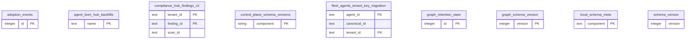

# Schema metadata and maintenance

> Generated from the code by `scripts/generate_graph_data_model.py`. Do not edit by hand: re-run the
> generator and commit the result. CI runs it with `--check` and fails on drift.

Storage tables in this domain. Back to the [storage ERD](../storage-erd.md).

9 tables.

## Relations

| Parent | Child | Column | Kind |
|---|---|---|---|

## Tables

| Table | Backends | Columns | Partitioned |
|---|---|---|---|
| `adoption_events` | SQLite | 7 |  |
| `agent_bom_hub_backfills` | Postgres | 2 |  |
| `compliance_hub_findings_v2` | SQLite | 13 |  |
| `control_plane_schema_versions` | Postgres, SQLite, ClickHouse | 3 |  |
| `fleet_agents_tenant_key_migration` | SQLite | 9 |  |
| `graph_retention_state` | SQLite | 3 |  |
| `graph_schema_version` | SQLite | 1 |  |
| `local_schema_meta` | SQLite | 3 |  |
| `schema_version` | SQLite | 1 |  |
