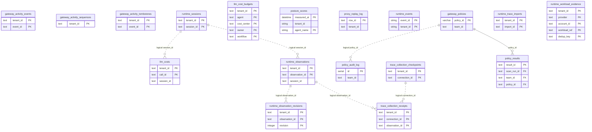

# Runtime, gateway and traces

> Generated from the code by `scripts/generate_graph_data_model.py`. Do not edit by hand: re-run the
> generator and commit the result. CI runs it with `--check` and fails on drift.

Storage tables in this domain. Back to the [storage ERD](../storage-erd.md).

17 tables.

Tables from other domains drawn for their relations: `policy_results`.

## Relations

| Parent | Child | Column | Kind |
|---|---|---|---|
| `gateway_policies` | `policy_audit_log` | `policy_id` | logical |
| `gateway_policies` | `policy_results` | `policy_id` | declared FK |
| `runtime_observations` | `runtime_observation_revisions` | `observation_id` | logical |
| `runtime_observations` | `trace_collection_receipts` | `observation_id` | logical |
| `runtime_sessions` | `llm_costs` | `session_id` | logical |
| `runtime_sessions` | `runtime_observations` | `session_id` | logical |
| `trace_collection_checkpoints` | `trace_collection_receipts` | `connection_id` | logical |

## Shared key columns without an owning table

Same column name in several tables here, but no table owns it, so no join is drawn.

| Column | Tables |
|---|---|
| `event_id` | `gateway_activity_events`, `gateway_activity_tombstones`, `runtime_events` |
| `source_id` | `runtime_events`, `runtime_workload_evidence` |

## Tables

| Table | Backends | Columns | Partitioned | Lifetime |
|---|---|---|---|---|
| `gateway_activity_events` | Postgres, SQLite | 7 |  | persistent |
| `gateway_activity_sequences` | Postgres, SQLite | 2 |  | persistent |
| `gateway_activity_tombstones` | Postgres, SQLite | 4 |  | persistent |
| `gateway_policies` | Postgres, SQLite, Snowflake | 8 |  | persistent |
| `llm_cost_budgets` | Postgres, SQLite | 8 |  | persistent |
| `llm_costs` | Postgres, SQLite | 13 |  | persistent |
| `policy_audit_log` | Postgres, SQLite, Snowflake | 14 |  | persistent |
| `posture_scores` | ClickHouse | 10 | yes | persistent |
| `proxy_replay_log` | Postgres, SQLite | 5 |  | persistent |
| `runtime_events` | ClickHouse | 16 | yes | persistent |
| `runtime_observation_revisions` | Postgres | 5 |  | persistent |
| `runtime_observations` | Postgres, SQLite | 5 |  | persistent |
| `runtime_sessions` | Postgres, SQLite | 4 |  | persistent |
| `runtime_trace_imports` | Postgres | 4 |  | persistent |
| `runtime_workload_evidence` | Postgres, SQLite | 12 |  | persistent |
| `trace_collection_checkpoints` | Postgres | 3 |  | persistent |
| `trace_collection_receipts` | Postgres | 5 |  | persistent |
