# Scans, jobs and reports

> Generated from the code by `scripts/generate_graph_data_model.py`. Do not edit by hand: re-run the
> generator and commit the result. CI runs it with `--check` and fails on drift.

Storage tables in this domain. Back to the [storage ERD](../storage-erd.md).

15 tables.

Tables from other domains drawn for their relations: `agents`, `cis_benchmark_checks`, `findings`, `policy_results`, `scan_findings`, `scan_packages`, `teams`.

```mermaid
erDiagram
  job_overview_identity {
    integer singleton PK
  }
  job_overview_revisions {
    text tenant_id PK
  }
  job_queue {
    text job_id PK
    text team_id FK
  }
  jobs {
    text job_id PK
    text tenant_id
    text schedule_id
  }
  mcp_scan_results {
    text tenant_id PK
    text result_id PK
  }
  report_jobs {
    text job_id PK
    text tenant_id PK
  }
  scan_dispatch_queue {
    text job_id PK, FK
    text tenant_id PK
  }
  scan_jobs {
    varchar job_id PK
    text team_id PK, FK
    text schedule_id
  }
  scan_metadata {
    string scan_id PK
    string tenant_id PK
  }
  scan_runs {
    text run_id PK
    text scan_id
    text tenant_id
  }
  scan_schedules {
    text schedule_id PK
    text tenant_id
  }
  scan_snapshot_jobs {
    text tenant_id PK
    text job_id PK
  }
  scan_snapshot_rows {
    text tenant_id PK
    text job_id PK
    integer ordinal PK
    text canonical_id
  }
  side_scan_execution_state {
    text execution_id PK
    text tenant_id
  }
  skills_scan_run {
    text tenant_id PK
    text run_id PK
  }
  agents {
    text agent_id PK
    text scan_run_id FK
    text team_id FK
  }
  cis_benchmark_checks {
    bigserial id PK
    string scan_id FK
    text team_id FK
  }
  findings {
    text finding_id PK
    text scan_run_id FK
    text team_id FK
    text cve_id
  }
  policy_results {
    text result_id PK
    text scan_run_id FK
    text team_id FK
    text policy_id FK
  }
  scan_findings {
    text run_id PK, FK
    text scan_id
    text finding_key PK
    text canonical_id
    text asset_canonical_id
  }
  scan_packages {
    text run_id PK, FK
    text scan_id
    text agent_name PK
    text server_name PK
    text package_name PK
    text package_version PK
    text ecosystem PK
    text package_canonical_id
  }
  teams {
    text team_id PK
  }
  scan_jobs ||--o{ agents : "scan_run_id"
  scan_jobs ||--o{ cis_benchmark_checks : "scan_id"
  scan_jobs ||--o{ findings : "scan_run_id"
  scan_jobs ||..o{ job_queue : "logical job_id"
  scan_jobs ||..o{ jobs : "logical job_id"
  scan_jobs ||--o{ policy_results : "scan_run_id"
  scan_jobs ||..o{ report_jobs : "logical job_id"
  scan_jobs ||--o{ scan_dispatch_queue : "job_id"
  scan_jobs ||..o{ scan_snapshot_jobs : "logical job_id"
  scan_jobs ||..o{ scan_snapshot_rows : "logical job_id"
  scan_runs ||--o{ scan_findings : "run_id"
  scan_runs ||--o{ scan_packages : "run_id"
  scan_schedules ||..o{ jobs : "logical schedule_id"
  scan_schedules ||..o{ scan_jobs : "logical schedule_id"
  teams ||--o{ job_queue : "team_id"
  teams ||--o{ scan_jobs : "team_id"
```

## Relations

| Parent | Child | Column | Kind |
|---|---|---|---|
| `scan_jobs` | `agents` | `scan_run_id → scan_jobs.job_id` | declared FK |
| `scan_jobs` | `cis_benchmark_checks` | `scan_id → scan_jobs.job_id` | declared FK |
| `scan_jobs` | `findings` | `scan_run_id → scan_jobs.job_id` | declared FK |
| `scan_jobs` | `job_queue` | `job_id` | logical |
| `scan_jobs` | `jobs` | `job_id` | logical |
| `scan_jobs` | `policy_results` | `scan_run_id → scan_jobs.job_id` | declared FK |
| `scan_jobs` | `report_jobs` | `job_id` | logical |
| `scan_jobs` | `scan_dispatch_queue` | `job_id` | declared FK |
| `scan_jobs` | `scan_snapshot_jobs` | `job_id` | logical |
| `scan_jobs` | `scan_snapshot_rows` | `job_id` | logical |
| `scan_runs` | `scan_findings` | `run_id` | declared FK |
| `scan_runs` | `scan_packages` | `run_id` | declared FK |
| `scan_schedules` | `jobs` | `schedule_id` | logical |
| `scan_schedules` | `scan_jobs` | `schedule_id` | logical |
| `teams` | `job_queue` | `team_id` | declared FK |
| `teams` | `scan_jobs` | `team_id` | declared FK |

## Shared key columns without an owning table

Same column name in several tables here, but no table owns it, so no join is drawn.

| Column | Tables |
|---|---|
| `batch_id` | `jobs`, `scan_jobs` |
| `parent_job_id` | `jobs`, `scan_jobs` |
| `scan_id` | `scan_metadata`, `scan_runs` |

## Tables

| Table | Backends | Columns | Partitioned |
|---|---|---|---|
| `job_overview_identity` | SQLite | 2 |  |
| `job_overview_revisions` | Postgres, SQLite | 3 |  |
| `job_queue` | Postgres | 13 |  |
| `jobs` | SQLite | 14 |  |
| `mcp_scan_results` | Postgres | 6 |  |
| `report_jobs` | Postgres | 11 |  |
| `scan_dispatch_queue` | Postgres | 6 |  |
| `scan_jobs` | Postgres, Snowflake | 15 |  |
| `scan_metadata` | ClickHouse | 14 | yes |
| `scan_runs` | SQLite | 14 |  |
| `scan_schedules` | Postgres, SQLite, Snowflake | 5 |  |
| `scan_snapshot_jobs` | Postgres, SQLite | 12 |  |
| `scan_snapshot_rows` | Postgres, SQLite | 7 |  |
| `side_scan_execution_state` | Postgres, SQLite | 10 |  |
| `skills_scan_run` | Postgres, SQLite | 5 |  |
