# Tenancy, identity and access

> Generated from the code by `scripts/generate_graph_data_model.py`. Do not edit by hand: re-run the
> generator and commit the result. CI runs it with `--check` and fails on drift.

Storage tables in this domain. Back to the [storage ERD](../storage-erd.md).

24 tables.

Tables from other domains drawn for their relations: `agents`, `cis_benchmark_checks`, `exceptions`, `findings`, `job_queue`, `policy_results`, `scan_jobs`.

```mermaid
erDiagram
  access_review_campaigns {
    text campaign_id PK
    text tenant_id PK
  }
  access_review_items {
    text item_id PK
    text campaign_id
    text tenant_id PK
  }
  agent_bom_tenant_access {
    varchar tenant_id PK
    varchar snowflake_role PK
  }
  agent_bom_tenant_binding_keys {
    text key_id PK
  }
  agent_conditional_access_policies {
    text policy_id PK
    text tenant_id
  }
  agent_identities {
    text identity_id PK
    text tenant_id PK
  }
  agent_identity_jit_grants {
    text grant_id PK
    text tenant_id
    text identity_id
  }
  api_keys {
    text key_id PK
    text team_id FK
  }
  api_rate_limit_hits {
    text bucket_key
  }
  api_rate_limits {
    text bucket_key PK
    integer window_started PK
  }
  auth_session_attempts {
    text key
  }
  credential_refs {
    text credential_ref_id PK
    text tenant_id
  }
  idempotency_keys {
    text endpoint PK
    text tenant_id PK
    text source_id PK
    text idempotency_key PK
  }
  managed_trial_invitations {
    text invitation_id PK
    text tenant_id FK
  }
  managed_trial_tenants {
    text tenant_id PK
  }
  model_provider_keys {
    text provider_key_id PK
    text tenant_id
  }
  model_virtual_keys {
    text virtual_key_id PK
    text tenant_id
    text provider_key_id
  }
  revoked_session_nonces {
    text nonce PK
  }
  scim_groups {
    text tenant_id PK
    text group_id PK
  }
  scim_users {
    text tenant_id PK
    text user_id PK
  }
  teams {
    text team_id PK
  }
  tenant_graph_retention_overrides {
    text tenant_id PK
  }
  tenant_quota_overrides {
    text tenant_id PK
  }
  tenant_score_config_overrides {
    text tenant_id PK
  }
  agents {
    text agent_id PK
    text scan_run_id FK
    text team_id FK
  }
  cis_benchmark_checks {
    bigserial id PK
    string scan_id FK
    text team_id FK
  }
  exceptions {
    text exception_id PK
    text team_id FK
  }
  findings {
    text finding_id PK
    text scan_run_id FK
    text team_id FK
    text cve_id
  }
  job_queue {
    text job_id PK
    text team_id FK
  }
  policy_results {
    text result_id PK
    text scan_run_id FK
    text team_id FK
    text policy_id FK
  }
  scan_jobs {
    varchar job_id PK
    text team_id PK, FK
    text schedule_id
  }
  access_review_campaigns ||..o{ access_review_items : "logical campaign_id"
  agent_identities ||..o{ agent_identity_jit_grants : "logical identity_id"
  model_provider_keys ||..o{ model_virtual_keys : "logical provider_key_id"
  teams ||--o{ agents : "team_id"
  teams ||--o{ api_keys : "team_id"
  teams ||--o{ cis_benchmark_checks : "team_id"
  teams ||--o{ exceptions : "team_id"
  teams ||--o{ findings : "team_id"
  teams ||--o{ job_queue : "team_id"
  teams ||--o{ managed_trial_invitations : "tenant_id"
  teams ||--o{ policy_results : "team_id"
  teams ||--o{ scan_jobs : "team_id"
```

## Relations

| Parent | Child | Column | Kind |
|---|---|---|---|
| `access_review_campaigns` | `access_review_items` | `campaign_id` | logical |
| `agent_identities` | `agent_identity_jit_grants` | `identity_id` | logical |
| `model_provider_keys` | `model_virtual_keys` | `provider_key_id` | logical |
| `teams` | `agents` | `team_id` | declared FK |
| `teams` | `api_keys` | `team_id` | declared FK |
| `teams` | `cis_benchmark_checks` | `team_id` | declared FK |
| `teams` | `exceptions` | `team_id` | declared FK |
| `teams` | `findings` | `team_id` | declared FK |
| `teams` | `job_queue` | `team_id` | declared FK |
| `teams` | `managed_trial_invitations` | `tenant_id → teams.team_id` | declared FK |
| `teams` | `policy_results` | `team_id` | declared FK |
| `teams` | `scan_jobs` | `team_id` | declared FK |

## Shared key columns without an owning table

Same column name in several tables here, but no table owns it, so no join is drawn.

| Column | Tables |
|---|---|
| `external_id` | `scim_groups`, `scim_users` |
| `key_id` | `agent_bom_tenant_binding_keys`, `api_keys` |

## Tables

| Table | Backends | Columns | Partitioned | Lifetime |
|---|---|---|---|---|
| `access_review_campaigns` | Postgres, SQLite | 6 |  | persistent |
| `access_review_items` | Postgres, SQLite | 6 |  | persistent |
| `agent_bom_tenant_access` | Snowflake | 3 |  | persistent |
| `agent_bom_tenant_binding_keys` | Postgres | 4 |  | persistent |
| `agent_conditional_access_policies` | Postgres, SQLite | 6 |  | persistent |
| `agent_identities` | Postgres, SQLite | 7 |  | persistent |
| `agent_identity_jit_grants` | Postgres, SQLite | 8 |  | persistent |
| `api_keys` | Postgres, SQLite | 20 |  | persistent |
| `api_rate_limit_hits` | Postgres | 2 |  | persistent |
| `api_rate_limits` | Postgres | 4 |  | persistent |
| `auth_session_attempts` | Postgres | 2 |  | persistent |
| `credential_refs` | Postgres, SQLite | 5 |  | persistent |
| `idempotency_keys` | Postgres, SQLite | 9 |  | persistent |
| `managed_trial_invitations` | Postgres | 9 |  | persistent |
| `managed_trial_tenants` | Postgres | 9 |  | persistent |
| `model_provider_keys` | Postgres, SQLite | 6 |  | persistent |
| `model_virtual_keys` | Postgres, SQLite | 7 |  | persistent |
| `revoked_session_nonces` | Postgres | 2 |  | persistent |
| `scim_groups` | Postgres, SQLite | 6 |  | persistent |
| `scim_users` | Postgres, SQLite | 7 |  | persistent |
| `teams` | Postgres | 6 |  | persistent |
| `tenant_graph_retention_overrides` | Postgres | 3 |  | persistent |
| `tenant_quota_overrides` | Postgres | 3 |  | persistent |
| `tenant_score_config_overrides` | Postgres, SQLite | 3 |  | persistent |
