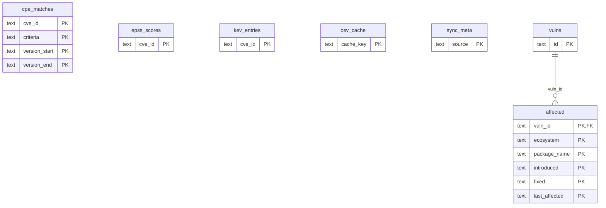

# Vulnerability intelligence (local database)

> Generated from the code by `scripts/generate_graph_data_model.py`. Do not edit by hand: re-run the
> generator and commit the result. CI runs it with `--check` and fails on drift.

Storage tables in this domain. Back to the [storage ERD](../storage-erd.md).

7 tables.

## Relations

| Parent | Child | Column | Kind |
|---|---|---|---|
| `vulns` | `affected` | `vuln_id → vulns.id` | declared FK |

## Shared key columns without an owning table

Same column name in several tables here, but no table owns it, so no join is drawn.

| Column | Tables |
|---|---|
| `cve_id` | `cpe_matches`, `epss_scores`, `kev_entries` |

## Tables

| Table | Backends | Columns | Partitioned |
|---|---|---|---|
| `affected` | SQLite | 6 |  |
| `cpe_matches` | SQLite | 9 |  |
| `epss_scores` | SQLite | 4 |  |
| `kev_entries` | SQLite | 5 |  |
| `osv_cache` | Postgres, SQLite | 3 |  |
| `sync_meta` | SQLite | 4 |  |
| `vulns` | SQLite | 12 |  |
