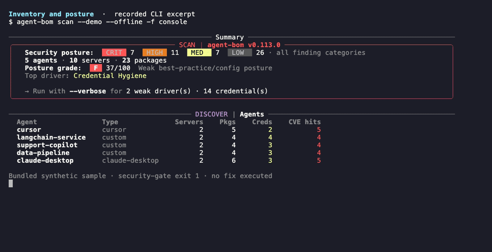
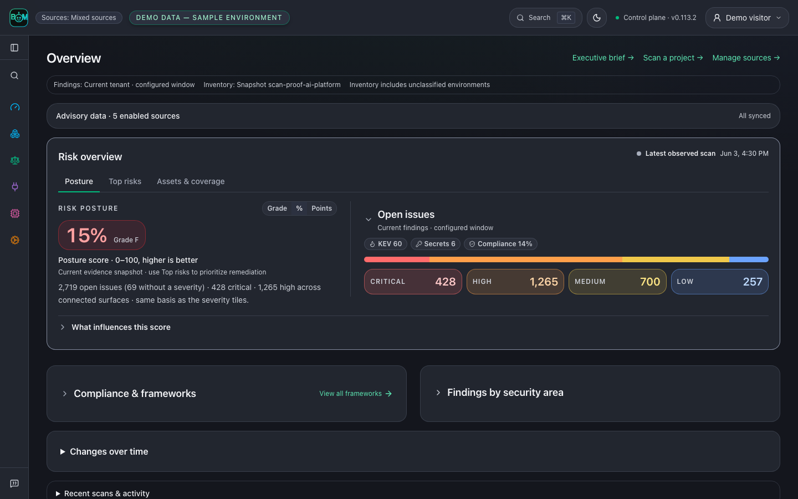
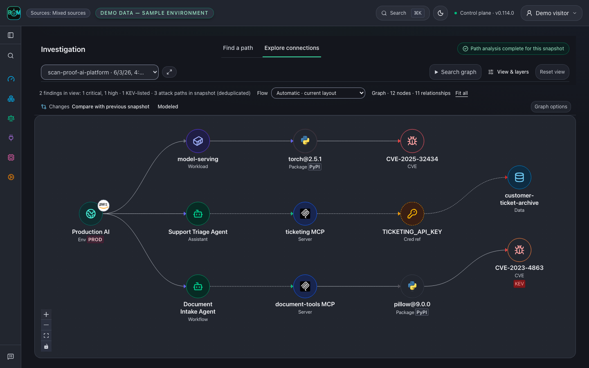
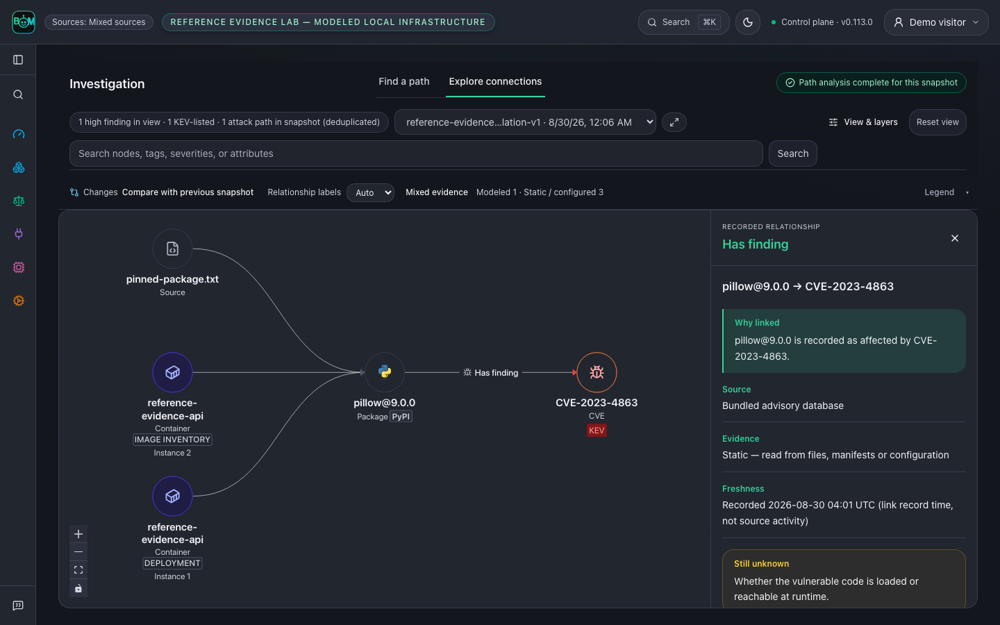
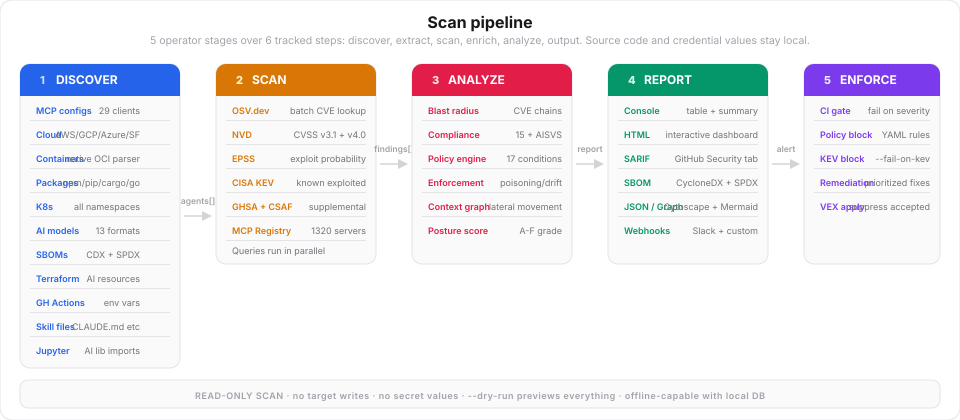

# agent-bom

<!-- mcp-name: io.github.koda-ai-studio/agent-bom -->

**AI supply-chain BOM: supported agents, MCP servers and AI packages, and what each one can reach.**

For AppSec teams and developers who run Claude Code, Cursor, Codex or any MCP
client: see which agents, MCP servers, tools and packages are installed, which
are vulnerable, and what each one can reach. Local scans need no account.
[Try it in your browser](https://koda-ai-studio.github.io/agent-bom/demo/) first,
no install.

With [uv installed](https://docs.astral.sh/uv/getting-started/installation/), run
from the repository you want to inspect:

```bash
uvx agent-bom scan . -f html -o agent-bom-report.html
```

Open `agent-bom-report.html` for inventory, findings and fix guidance. Run it
again later to see what changed. The scan stays inside this repository. No MCP
configuration? Package findings still apply. Incomplete evidence is not a clean
result: [what a scan does and does not establish](https://github.com/koda-ai-studio/agent-bom/blob/main/docs/FIRST_RUN.md#what-this-scan-does-and-does-not-establish).
For a bundled sample, run `uvx agent-bom scan --demo --offline`; status `1` is
the expected security verdict for its blocking findings.



| Where | Start with | You get |
|---|---|---|
| On your laptop | `uvx agent-bom scan .` and `claude mcp add agent-bom -- uvx agent-bom mcp server` | Findings with fixes, a delta on every rescan, agent-bom as a tool in your coding agent |
| In your team | `uses: koda-ai-studio/agent-bom@v0` on pull requests plus a weekly `schedule:` | A PR gate with a findings comment and SARIF, and a weekly rescan for new CVEs |
| Across your org | `agent-bom up`, then Docker Compose or the Helm chart | Retained scans, one graph of agents, servers, packages and credentials, SSO and audit in your infrastructure |

## Recommended starting points

```bash
pip install agent-bom

agent-bom scan .                                 # Repo + MCP + package blast radius
agent-bom samples first-run                      # Inspectable sample AI stack
agent-bom scan --inventory agent-bom-first-run/inventory.json -p agent-bom-first-run --enrich
agent-bom check flask@2.2.0 --ecosystem pypi     # Pre-install package verdict
agent-bom image nginx:latest                     # Container image scan
agent-bom scan . --remediate remediation.md       # Fix-first remediation plan
agent-bom quickstart --dry-run --offline          # Sample-data and API/UI next steps
pip install 'agent-bom[ui]'                      # once, if you want the dashboard
agent-bom serve --persist ~/.agent-bom/control-plane.db  # restart-safe local control plane
```

The base wheel is the scanner/CLI and includes MCP server mode
(`agent-bom mcp server`). `agent-bom[ui]` adds the local API and dashboard;
`agent-bom[all]` adds the supported first-run extras (MLflow stays separate
until its upstream CVE backlog is fixed). A missing extra exits with the
matching install hint. The guided flow is `docs/FIRST_RUN.md` in the repository.

Self-hosted pilot:

```bash
curl -fsSL https://raw.githubusercontent.com/koda-ai-studio/agent-bom/main/deploy/docker-compose.pilot.yml -o docker-compose.pilot.yml
docker compose -f docker-compose.pilot.yml up -d
# Dashboard -> http://localhost:3000
```

For production, configure the database, identity and ingress settings in a
release checkout. Follow the [required secret bootstrap](https://github.com/koda-ai-studio/agent-bom/tree/main/deploy/helm/agent-bom#production-externalsecrets-are-a-separate-stage)
and wait for all four target Secrets before installing the workload:

```bash
helm upgrade --install agent-bom oci://ghcr.io/koda-ai-studio/charts/agent-bom --version 0.114.0 \
  --namespace agent-bom --create-namespace \
  -f deploy/helm/agent-bom/examples/eks-production-values.yaml
```

## Product views





Follow Document Intake Agent → document-tools MCP → pillow@9.0.0 → CVE-2023-4863.
Sample data; dashed links are modeled, not observed.



A repository pin, image SBOM and Kubernetes workload resolve to one package; the
image inventory and deployment occurrence stay distinct. Sample data; a graph
path does not prove execution or exploitation.

[Explore the reference evidence lab](https://github.com/koda-ai-studio/agent-bom/tree/main/examples/reference-evidence-lab) · [Graph guide](https://github.com/koda-ai-studio/agent-bom/blob/main/docs/GALLERY.md)

## What it covers

- **Agents + MCP** — MCP clients, servers, tools, transports, trust posture
- **Skills + instructions** — `CLAUDE.md`, `AGENTS.md`, `.cursorrules`, `.windsurfrules`, `skills/*`, with stable bundle hashes for review
- **Package risk** — 15 package ecosystems (including `mix.lock` / `pubspec.lock` for Hex and Pub) with OSV/GHSA enrichment, dependency-confusion detection and blast radius
- **CWE-aware impact** — RCE shows credential exposure, DoS does not; symbol-level CVE reachability when OSV/GHSA carry affected symbols (Python, npm, Go), with VEX generation
- **AI models + datasets** — malicious-model detection via safe pickle-opcode disassembly (no execution), model/dataset cards, and target-scoped PII/PHI dataset-file scanning
- **Container images + IaC** — native OCI parsing plus Dockerfile, Terraform, CloudFormation, Helm, and Kubernetes coverage
- **Cloud estate** — read-only, gated asset inventory across AWS/Azure/GCP plus AI/GPU posture and CIS benchmarks
- **Identity (NHI)** — non-human identity discovery (Okta/Entra), credential-expiry posture, and access-review campaigns
- **LLM cost** — spend forecasting, budget runway, chargeback/allocation, and seasonal-aware spend-anomaly detection
- **Secrets + runtime** — MCP proxy/gateway, inline firewall enforcement, A2A/MCP auth posture, Shield SDK, secrets, and redaction surfaces
- **MCP server mode** — start with 8 scan-profile tools; use `agent-bom mcp server --profile full` for the complete catalog of 100 MCP tools, 7 resources, and 8 workflow prompts in Claude, Cursor, Windsurf, and Cortex CoCo / Cortex Code
- **Outputs + evidence** — SARIF, CycloneDX, SPDX, OCSF, HTML, graph, JSON and ZIP evidence bundles for auditors

Discovery and static/cloud scanning are read-only by default. Explicit disk
side-scans create temporary cloud resources and need additional permissions.
Proxy, gateway, Shield, and control-plane write tools are separate, explicit
runtime or authenticated operations. Credential references are names, not
secret values; recorded relationships do not prove exploitation or successful
data access. See the [permission and network boundaries](https://github.com/koda-ai-studio/agent-bom/blob/main/docs/PERMISSIONS.md)
before enabling cloud scans or outbound integrations.

## Supported sources

Discovery and scanning read from these sources today; the last row lists where evidence can be sent. The list is generated from a code-backed manifest (`docs/images/integrations-manifest.json`); a test fails if it names anything without an implementation.

<!-- integrations:begin (generated by scripts/render_social_preview_svg.py; do not edit) -->
| Area | Integrations |
|---|---|
| AI clients + IDEs | Claude, Codex, Cursor, GitHub Copilot, Windsurf, Cortex Code, Gemini CLI, JetBrains AI, Junie, Amazon Q, Cline, Roo Code, Continue, Zed, Goose, Snowflake CLI, Docker MCP Toolkit, Tabnine, Sourcegraph Cody, Aider, Void, Aide, Trae, Pieces, OpenClaw, mcp-cli |
| AI platforms + model hubs | OpenAI, Hugging Face, Ollama, MLflow, W&B, Langfuse, LangSmith |
| GPU + neo clouds | CoreWeave, Nebius, Lambda, RunPod, Vast.ai, Crusoe, GPU containers + K8s GPU nodes |
| Hyperscalers + Kubernetes | AWS, Azure, GCP, Kubernetes |
| Data + vector stores | Snowflake, Databricks, Supabase, Pinecone, Qdrant, Weaviate, Chroma, Milvus |
| Identity + SaaS + dev | Okta, GitHub Actions, Vercel, Microsoft Entra ID, Jira, ServiceNow, Slack, Jamf |
| Evidence out | ClickHouse, BigQuery, S3, GCS, Azure Blob, Jira tickets, Slack alerts, Vanta, Drata, OCSF syslog |

Product names and logos are trademarks of their owners, used only to identify supported evidence sources. Their use does not imply endorsement or partnership.
<!-- integrations:end -->

## How the data moves



## Blast radius


## Links

- [GitHub](https://github.com/koda-ai-studio/agent-bom)
- [Docker Hub](https://hub.docker.com/r/agentbom/agent-bom)
- [Documentation](https://github.com/koda-ai-studio/agent-bom#readme)
- [Product brief](https://github.com/koda-ai-studio/agent-bom/blob/main/docs/ARCHITECTURE.md)
- [Verified metrics](https://github.com/koda-ai-studio/agent-bom/blob/main/docs/PRODUCT_METRICS.md)
- [Enterprise controls map](https://github.com/koda-ai-studio/agent-bom/blob/main/docs/TRUST.md)
- [Discord](https://discord.gg/3YmYPqKZh5)
