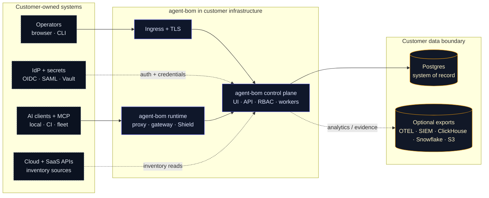
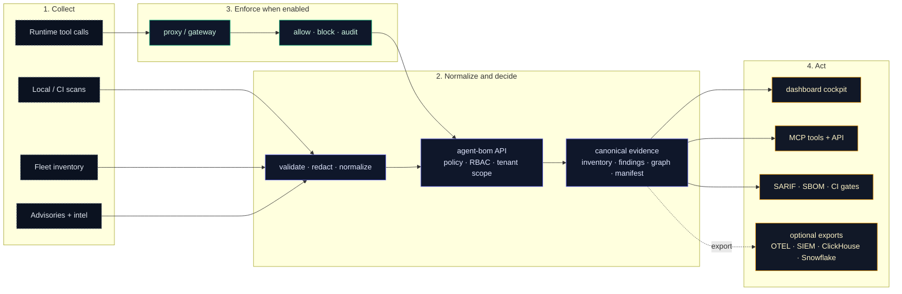
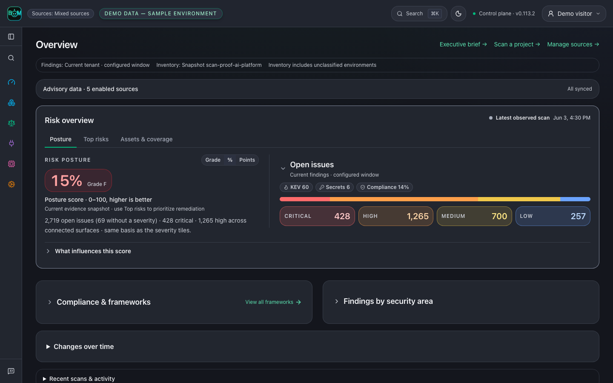
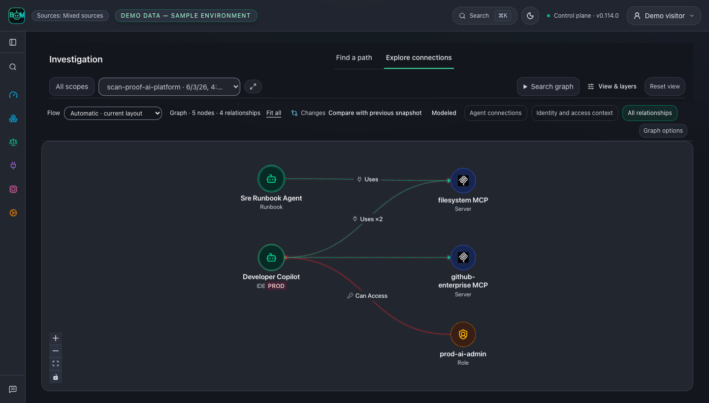
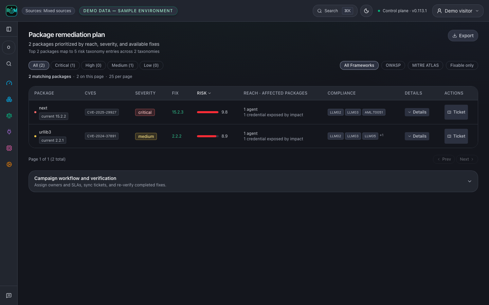

# Deployment Overview

> **Unified quickstart:** [`docs/DEPLOY_PLATFORM.md`](https://github.com/koda-ai-studio/agent-bom/blob/main/docs/DEPLOY_PLATFORM.md)
> — `scripts/deploy/install.sh` for pilot, EKS, AKS, GKE, Snowflake, and
> read-only cloud connect.

Use this page when the question is not "how do I install `agent-bom`?" but
"what should I deploy first, what does that give me, and when do I add runtime
enforcement?"

Treat this as the primary deployment chooser and the canonical deployment
decision matrix. The rest of the deployment docs either deepen one of these
supported paths or act as reference material for teams intentionally diverging
from them.

## Choose your workflow

Start with the work you need to do, then choose where to run it. These paths
use the same open-source product; they are not editions, license tiers or
authorization roles.

### Individual / developer

From the project you want to inspect, with [uv installed](https://docs.astral.sh/uv/getting-started/installation/):

```bash
uvx agent-bom scan . -f html -o agent-bom-report.html
```

Open the report, review coverage, fix a finding and rescan the same scope.
Add CI gates, MCP tools, a local proxy or a dashboard only when useful.

### Team

Start with CLI or GitHub Action checks. Retain reports or scan IDs, review
findings and compare follow-up scans. Add an authenticated control plane when
evidence needs to be shared; connect sources, fleet collection or shared
runtime policy as needed.

### Organization

Start with a shared control plane and the identity, storage and operating
controls required for the deployment. Review scoped inventory, findings and
audit evidence. Add framework assessments and executive reports for governance
needs, with SSO, additional tenants and retention/export integrations as required.

Individual use does not require PostgreSQL, SSO, compliance configuration or
executive reporting. A team can also use only CLI/CI reports. Framework tags
in a finding are context, not an obligation to adopt a governance workflow or
proof of certification. Local proxy and MCP server use are available without
adopting an organization-wide control plane.

"Local" describes where work or collection happens, not who owns it: a team
can retain local scans, and one developer can inspect a cloud workload. The
dashboard exposes one platform navigation. Deployment modes describe where
services run; permissions govern access and source scopes govern evidence.
See [Modes and alignment](deployment-modes-and-alignment.md)
for the distinction between workflow, hosting and observed evidence.

## Choose where to run it

| Situation | Deploy | Get |
|---|---|---|
| **Laptop scan** | `pip install agent-bom` | local findings, SBOM, SARIF, HTML, graph export |
| **Dashboard evaluation** | `docker compose` pilot | loopback-only API + UI with SQLite on one workstation; not a shared deployment |
| **Shared team instance** | authenticated Compose platform | API + UI with PostgreSQL, configured identity and protected network access |
| **Production** | Helm / EKS Terraform | tenant-aware self-hosted control plane in your cluster |
| **Private cloud-connected instance** | `docker compose` platform + product overlay | login-gated single host, no demo data, real cloud connected read-only |
| **Snowflake evaluation** | SPCS / Native App preview | installation contract; Native App scan dispatch is unavailable |

The software is open source; hosting, database storage, identity, monitoring and
operator time still have costs. Keep the first deployment small and measure the
workload before adding services. See [Product boundaries](product-boundaries.md)
for support tiers and preview limitations.

## Start with a small stack

| Component | When to run it | Boundary |
|---|---|---|
| CLI / CI scanner | First scan or build gate | No control-plane database, login service or paid model is required. |
| Loopback API + UI with SQLite | Evaluate the dashboard on one workstation | The pilot is local-only. Configure authenticated shared hosting before making it available to other users. |
| API + UI + PostgreSQL | Shared inventory, retained findings, graph and governance | PostgreSQL is the default shared transactional and graph store; apply the documented migrations and role separation. |
| Chosen identity provider | Shared authenticated access | Use the documented authentication flow for each surface. Keycloak is an available self-hosted choice; it is not required for local scans. |
| Grafana + Prometheus | Metrics, dashboards and alerts | Optional. Reuse an existing monitoring stack where possible. |
| ClickHouse | Measured event-analytics or retention pressure | Optional analytics sink; it does not replace PostgreSQL jobs, authorization or graph persistence. |
| MCP proxy / gateway | Selected tool-call enforcement | Add where inline policy is needed; validate authentication and failure behavior before routing traffic. |

Start with a [local scan](https://github.com/koda-ai-studio/agent-bom/blob/main/docs/FIRST_RUN.md),
retain an exported report and verify a fix. Use the pilot below if you want to
evaluate the dashboard. Connect a scoped source to an authenticated shared
control plane when shared evidence is useful. Core checks do not require LLM enrichment. Standard vulnerability lookups
may contact external services; use the documented offline path when required.

For identity setup, use [authenticated deployment](authenticated-hosted-instance.md)
and the [MCP OAuth guide](https://github.com/koda-ai-studio/agent-bom/blob/main/docs/MCP_OAUTH.md). MCP clients have distinct
registration and resource-audience requirements; verify the actual client flow
before advertising compatibility.

For the private, login-gated single-host instance where a real cloud account is
connected read-only, follow
[Hosted Authenticated Instance + Connect Your Cloud](authenticated-hosted-instance.md).

`agent-bom` is one product with two deployable images:

- `agentbom/agent-bom` for scanner, API, jobs, gateway, proxy, and other non-browser runtimes
- `agentbom/agent-bom-ui` for the browser dashboard

Pilot on one workstation:

```bash
scripts/deploy/install.sh pilot
# or without a checkout:
curl -fsSL https://raw.githubusercontent.com/koda-ai-studio/agent-bom/main/deploy/docker-compose.pilot.yml -o docker-compose.pilot.yml
docker compose -f docker-compose.pilot.yml up -d
# Dashboard -> http://localhost:3000
```

Production in your own cluster from a checked-out repo:

```bash
export AWS_REGION="<your-aws-region>"
cp deploy/terraform/platform-eks/terraform.tfvars.example \
  deploy/terraform/platform-eks/terraform.tfvars
# Configure staged prerequisites and secret names, then:
scripts/deploy/install.sh eks
```

Advanced/manual chart install from a checked-out repo requires the four
pre-created role-separated Secrets documented in
[Control Plane Helm](control-plane-helm.md):

```bash
helm upgrade --install agent-bom oci://ghcr.io/koda-ai-studio/charts/agent-bom --version 0.114.0 \
  --namespace agent-bom --create-namespace \
  -f deploy/helm/agent-bom/examples/eks-production-values.yaml
```

## Read This Way

Do not read every deployment page. Pick one path, then open reference pages only
when your platform team needs that specific detail.

| You are trying to... | Start with | Stop there unless... |
|---|---|---|
| inspect one project | [First Run Guide](https://github.com/koda-ai-studio/agent-bom/blob/main/docs/FIRST_RUN.md) | you need CI checks, shared evidence or runtime enforcement |
| run a local pilot | [Docker](docker.md) | you need EKS, SSO, or fleet sync |
| deploy in vanilla EKS | [Vanilla EKS Quickstart](eks-vanilla-quickstart.md) | you need service mesh, ESO, or cert-manager |
| deploy in hardened AWS / EKS | [Your Own AWS / EKS](own-infra-eks.md) | you need a lower-level Helm or Terraform reference |
| run a Snowflake POV | [Snowflake POV](snowflake-pov.md) | you need backend-parity details |
| choose proxy vs gateway vs fleet | [Proxy vs Gateway vs Fleet](proxy-vs-gateway-vs-fleet.md) | you need runtime operations or gateway discovery |

Everything else in the deployment section is reference material.

## Product Surfaces

| Surface | Deploy when | What it gives you |
|---|---|---|
| **Scan** | day 1 | discovery, package/image/IaC/cloud checks, findings, blast radius |
| **Fleet** | endpoint or collector inventory needs to be centralized | endpoint and collector inventory without inline traffic control |
| **API + UI** | self-hosted pilots and production | auth, RBAC, tenant scope, graph, remediation, audit, policy |
| **Proxy** | selected local or sidecar MCPs | inline local MCP inspection, policy decisions, signed audit events |
| **Gateway** | shared remote MCP traffic | central remote MCP relay, policy distribution, audit events |
| **MCP server mode** | agent-invoked scanning | exposes `agent-bom` as read-mostly MCP tools, resources, and prompts |

For individual use, start with a scan and its report. For shared use, deploy an
authenticated API + UI with Postgres and retain the first scan before adding
more sources. Add fleet sync for endpoint inventory, compliance workflows for
governance needs, and proxy or gateway where runtime enforcement is needed.

## Deployment Defaults

| Decision | Default |
|---|---|
| **first individual scan** | CLI and an exported report; no shared services |
| **dashboard evaluation** | `deploy/docker-compose.pilot.yml`, loopback-only with SQLite |
| **shared single host** | authenticated `deploy/docker-compose.platform.yml` with PostgreSQL |
| **production installer** | `scripts/deploy/install.sh eks` + `deploy/terraform/platform-eks` |
| **shared production system of record** | Postgres |
| **analytics/lake** | optional ClickHouse, Snowflake, OTEL, or S3 exports |
| **runtime enforcement** | selected proxy or gateway, not all traffic by default |

## Support tiers

`deploy/` holds more targets than the project can test on every release. This
table says which ones the maintainers keep working, so you can choose with the
right expectations. Nothing here has been removed; a lower tier means less
release testing, not that the files are broken.

| Tier | Target | Files | What to expect |
|---|---|---|---|
| **Supported** | Docker Compose pilot | `deploy/docker-compose.pilot.yml` | Local dashboard evaluation. Exercised by `scripts/deploy/install.sh pilot`; loopback-only, not a shared service. |
| **Supported** | Docker Compose platform (plus `hosted-poc` / `product` overlays) | `deploy/docker-compose.platform.yml` | Production-shaped single host. Overlays are layered on the platform file only. |
| **Supported** | Helm chart | `deploy/helm/agent-bom/` | The control-plane and runtime chart. Production values live in `examples/`. |
| **Supported** | EKS Terraform | `deploy/terraform/platform-eks/` | The reference production install (`scripts/deploy/install.sh eks`). |
| **Supported** | Read-only cloud connect | `deploy/terraform/connect-*`, `deploy/cloudformation/agent-bom-readonly-role.yaml` | Customer-side roles the control plane assumes. |
| **Preview** | AKS / GKE | Helm chart plus `examples/aks-*` / `examples/gke-*` values | Same chart on a cluster you already run; cloud-specific workload-identity values render but have no recorded live install. |
| **Preview** | Snowflake Native App / SPCS | `deploy/snowflake/` | Installation contract only. Native App scan dispatch is unavailable; see `deploy/snowflake/native-app/README.md`. |
| **Preview** | Snowflake POV backend | `scripts/deploy/install.sh snowflake` | Self-hosted API/UI with explicit [backend parity](backend-parity.md) limits. |
| **Preview** | Air-gapped image bundle | `scripts/release/build-airgap-image-bundle.sh` | See [Air-Gapped Image Bundle](airgapped-image-bundle.md). |
| **Preview** | CloudFormation serverless self-scan | `deploy/cloudformation/agent-bom-scan.yaml` | CodeBuild scan that writes reports to S3, without a control plane. |
| **Reference** | Raw Kubernetes manifests | `deploy/k8s/` | Examples (CronJob, DaemonSet, sidecar). Prefer the Helm chart for real installs. |
| **Reference** | Dev and example Compose files | `deploy/docker-compose.fullstack.yml`, `docker-compose.runtime-example.yml` | Local development and a sidecar example. Not for customer deployments. |
| **Community** | Procfile hosts | `deploy/Procfile` | Run the MCP server alone (streamable HTTP), not the control plane. Config is syntax-checked in tests; no live deploy runs in CI. |
| **Community** | Railway | `railway.json` | MCP SSE server only. The release workflow `deploy-mcp-sse.yml` deploys it only when the repository variable `DEPLOY_TARGET` is `railway`. |

`deploy/supabase/` is not a separate deployment target: it holds the Postgres
and ClickHouse schema and migrations that the supported Compose stacks mount.
Contributions that keep a Community target working are welcome. Please open an
issue before adding a new target.

### Qualification evidence

A tier says how much attention a target gets. This table says what has
actually been exercised for the 0.114.0 chart and images, so a tier is never
read as proof of a live installation. "Static" means the files were linted,
rendered or validated locally without creating infrastructure or using cloud
credentials. "Not tested" means no install in that environment is recorded.

| Profile | Static validation | Live installation | Prerequisites the operator supplies |
|---|---|---|---|
| Docker Compose pilot, platform, `product` and `hosted-poc` overlays | `docker compose config` passes for each file and overlay (Compose v5.5.1); contract tests in `tests/test_compose_*.py` | Not tested in this qualification; the pilot installs with `scripts/deploy/install.sh pilot` | Docker host; for platform: TLS, authentication, PostgreSQL 16 and operational secrets |
| Helm chart (22 example profiles) | `helm lint` and `helm template` for the default and every profile in `scripts/validate_helm_profiles.py` (Helm v4.1.4), with the ingress-path structural check; chart tests in `tests/test_helm_*.py` and `tests/test_deploy_profiles.py` | Local kind only (see "Local live qualification" below): three API replicas on one Postgres 16 behind a NodePort. No cloud cluster is tested | An existing Kubernetes cluster, storage class, ingress controller and the Secrets each profile references |
| EKS (`deploy/terraform/platform-eks`) | `terraform init -backend=false` and `terraform validate` pass (Terraform 1.15.4) | Not tested | AWS account and provisioner role, three pre-created Secrets Manager entries, External Secrets Operator. The module can create a minimal VPC and EKS cluster, or target an existing cluster, and provisions RDS, IRSA roles, S3 and the Helm releases |
| AKS / GKE | Same chart; `aks-collector-workload-identity` and `gke-collector-workload-identity` profiles render | Not tested | A pre-existing cluster with workload identity enabled. `install.sh aks` / `gke` install Helm onto that cluster; nothing in `deploy/` provisions an AKS or GKE cluster |
| Read-only cloud connect (`connect-*`, sidescan, `aws/baseline`, `azure/ingestion`) | `terraform validate` passes for all ten Terraform modules; `terraform fmt -check` passes | Not tested | Customer cloud account with rights to create the read-only roles |
| Snowflake Native App / SPCS | `scripts/release/snowflake_native_app.py validate` passes; `tests/test_snowflake_native_app.py` | Not tested | Provider account with SPCS, compute pool, image repository and consumer grants. Defines API, UI, scanner and MCP runtime containers, but scan dispatch is unavailable: `core.trigger_scan()` refuses without creating a job, so this is not a full frontend/API/worker installation |
| Databricks Apps | None: no Databricks Apps packaging exists | Unavailable | Not applicable. The Databricks collector and scheduled export are evidence integrations, not hosting |
| Iceberg REST catalog export | `tests/test_iceberg_*.py` and `tests/test_parquet_export.py` pass with the locked `pyiceberg` 0.12.0 and `pyarrow` 25.0.1, including real in-memory catalog commits, field-ID retention across schema evolution and credential redaction | Not tested against Polaris or a hosted catalog | `agent-bom[lake]`, a catalog URL, credential and warehouse. Tenant namespaces, retry/idempotency and cross-engine reads are not qualified |
| SQLite / PostgreSQL primary store, ClickHouse analytics | `tests/test_storage_tiers.py`, `tests/test_clickhouse_qualification.py` and `tests/test_clickhouse_tenant_isolation.py` pass without a live server | Not tested here; PostgreSQL migration contracts run in `make preflight` | SQLite for a single host; PostgreSQL for shared deployments. ClickHouse stays optional analytics and is never the primary store |

Platform identity, tenant isolation, network egress, secrets, persistence,
background jobs, upgrade and rollback, recovery, removal and resource
consumption still need to be tested in each authorized environment before a
profile above is described as qualified there.

#### Local live qualification

Run on 2026-11-11 on one Apple silicon host (Docker Desktop 29.8.0, 10 CPUs,
7.7 GiB for containers) with the API image built from `main` at `179801f`
(version 0.114.0) and Postgres 16. These are local installations, not cloud
ones. Each lane in `scripts/qualification/` writes its checks to
`qualification-results/` and can be rerun.

| Check | Command | Result |
|---|---|---|
| Helm chart, 3 API replicas on one Postgres, NodePort load balancer (kind v0.32.0, Helm v4.1.4) | `kind_replicas.py up`, then `replicas.py` | Installs once the documented trusted-proxy attestation is set. Requests spread over all three replicas (8-13 of 30 each). Three estates pushed concurrently were each stored with exactly their findings (35, 42, 30). Six concurrent pushes with one `Idempotency-Key` became one job. Read directly, every replica served the same jobs, findings and current graph on the first read after the pushes and after a rolling restart; in an earlier run one first read disagreed and its detail was not kept. Each job was stored once (one row, one ingest commit) |
| Replica killed mid-ingest | `replicas.py` (`kill`) | A 100-agent push's replica was force-deleted after admission. In two of three runs the job stayed `pending` until an identical retry re-offered it, then stored exactly the 115 expected findings (361 s after the retry); in one run it was stored 140 s after the kill without a retry. Without `AGENT_BOM_DISTRIBUTED_SCANS`, recovery depends on a client retry |
| Rolling restart under steady reads | `replicas.py` (`restart`) | With the default role connection limit the rollout never finished: the surge pod failed with `too many connections for role "agent_bom_app"`. After `ALTER ROLE agent_bom_app CONNECTION LIMIT 60` it finished in 73-121 s, and 2-5 of 293-527 reads (about 1%) failed with a reset connection or a 10 s timeout |
| Upgrade 0.114.0 → this build, rollback, backup and restore, removal | `upgrade.py --from-image agentbom/agent-bom:0.114.0` | Migration `20261106_01` → `20261111_01` took 15 s; the new API served the same jobs, findings and graph and stored a new push. Downgrade back to `20261106_01` took 24 s, and the 0.114.0 API served both pushes. A `pg_dump` (1.7 MB) restored into a new Postgres served the backed-up push. Removing the containers, volumes and network left nothing |
| Enforced CPU and memory limits | `cgroup_limits.py` | See [performance benchmarks](https://github.com/koda-ai-studio/agent-bom/blob/main/docs/PERFORMANCE_BENCHMARKS.md#enforced-cgroup-limits): no OOM kill at 2 CPU / 2 GiB, with peak anonymous memory 1,972 MiB on SQLite |

What a multi-replica install needs beyond the values a single replica uses:

- **Postgres connections.** Migrations cap `agent_bom_app` at 20 connections
  for every replica, worker and hook together. An idle API replica held 5-6
  (`AGENT_BOM_POSTGRES_POOL_MAX_SIZE=8`), so three replicas plus one rolling
  surge exceed the cap. Raise the role's limit to cover
  (replicas + surge + workers) × per-replica connections before scaling out.
- **Listener posture.** More than one replica (the chart default is 2) makes
  the API refuse a non-loopback listener without trusted-proxy attestation
  (`AGENT_BOM_TRUST_PROXY_AUTH`, `_SECRET`, `_ISSUER`) or delegated mTLS
  evidence. The chart renders without them and the pods then fail to start.
- **NetworkPolicy.** The chart's policy admits only the `ingress-nginx`
  namespace. A `NodePort` or `LoadBalancer` Service needs
  `controlPlane.networkPolicy.additionalIngress` for the node or load-balancer
  range.
- **Verification hook.** `postgres-verify` fails the release when Postgres
  TLS is not active (`tls_not_active`), as intended. The kind run used a
  Postgres without TLS and turned the hook off.

## Enterprise Deployment Promise

This self-hosted shape is designed around a few explicit operating principles:

- **Customer-controlled hosting**: no mandatory vendor control plane and no mandatory SaaS dependency
- **Zero-trust access**: OIDC, SAML, API keys, RBAC, tenant propagation, quotas, and signed audit trails
- **Least privilege**: read-only discovery roles where possible, selected proxy enforcement only where needed
- **Low latency**: runtime inspection stays close to the MCP workloads instead of hairpinning through a global gateway
- **Cheap by default**: scan workers scale to zero, offline vuln DB reduces repeated network lookups, ClickHouse stays optional
- **Interoperable**: one shared graph and policy model spans scanner, proxy, gateway, fleet, and API/UI

## Self-hosted now, provider track later

The supported strength today is the self-hosted enterprise path:

- one organization running `agent-bom` in its own infrastructure
- strong tenant-aware auth, RBAC, audit, fleet, graph, and gateway routing
- customer-owned storage, telemetry, and support-sharing decisions

That should not be read as a hidden claim of turnkey MSSP maturity. Provider
surfaces such as tenant lifecycle automation, richer delegation templates, and
provider-style admin operations remain a separate product track.

## Enterprise Self-Hosted Diagrams

Use two readable views. The first explains where each service runs. The second
explains how inventory, runtime evidence, and exports move. Each diagram keeps
agent-bom in the center and leaves customer-owned systems at the edges.

Every box prefixed with `agent-bom` is code from this project running in the
customer's environment. Identity, cloud APIs, MCP servers, secret stores, and
analytics destinations stay customer-owned.

### Deployment Topology



Truth block:
- Operators enter through customer ingress and TLS; the API remains the auth,
  RBAC, tenant, and audit authority.
- Postgres is the system of record for this shared production topology. ClickHouse, Snowflake, S3, SIEM,
  and OTEL are optional export paths.
- agent-bom integrates with customer-owned IdP, secrets, cloud APIs, MCP
  servers, and endpoints; it does not replace or host them.

### Evidence Workflow



Truth block:
- Inventory works without runtime enforcement. Proxy and gateway add policy
  decisions and audit events when teams choose to enforce MCP/tool traffic.
- All evidence passes through validation and redaction before it becomes
  inventory, findings, graph, manifest, or compliance output.
- The same evidence model feeds humans through the dashboard and agents through
  the API/MCP surface.

## Best Self-Hosted Path

If you want the best current self-hosted rollout in your own infrastructure,
start with this shape:

1. Deploy the packaged API + UI control plane with Postgres.
2. Add scheduled scan jobs for cluster, container, and MCP discovery.
3. Add endpoint fleet sync for developer laptops and workstations.
4. Add `agent-bom proxy` only to the MCP workloads that need inline runtime
   enforcement.
5. Use the gateway surface to manage policy centrally and front shared remote
   MCPs, while proxies pull the same policies and push audit events back.

For managed endpoint rollout, `agent-bom proxy-bootstrap` now generates a
single onboarding bundle that can be:

- pushed directly as shell / PowerShell bootstrap assets
- wrapped into Jamf, Kandji, or Intune rollout scripts
- assembled into `.pkg` and `.msi` installers from the same generated bundle
- published into a Homebrew tap via the shipped formula renderer

That gives you one operator story while keeping proxy, gateway, and fleet as
separate runtime choices.

For the post-install maintenance path around proxy policy-signing key rotation
and cert-manager-backed webhook certificate renewal, see
[Runtime Operations](runtime-operations.md).

For the default self-hosted data-ownership and support-sharing boundary, see
[Customer Data and Support Boundary](customer-data-and-support-boundary.md).

## How the surfaces connect

| Path | Starts from | Ends at | Purpose |
|---|---|---|---|
| **Inventory** | scan jobs, CI, `agent-bom agents`, fleet sync | API + UI + Postgres | discover what is installed, configured, risky, and reachable |
| **Proxy runtime** | endpoint or sidecar workload | local MCP + control-plane audit/policy | workload-local stdio/runtime enforcement |
| **Gateway runtime** | shared remote MCP client | remote MCP + control-plane audit/policy | central remote MCP traffic plane |
| **Analytics / archive** | control plane | ClickHouse, S3, SIEM, OTEL | optional longer retention, analytics, and exports |

By default, the control plane, job results, fleet inventory, graph snapshots,
remediation output, and proxy audit data stay inside the customer's
infrastructure. External egress only happens when the operator explicitly enables
it for catalog refresh, enrichment, registry lookups, SIEM export, OTLP, or
webhooks.

That same self-hosted boundary also means `agent-bom` maintainers do not get
silent access to tenant data. For the full operator-facing contract, see
[Customer Data and Support Boundary](customer-data-and-support-boundary.md).

## Approved intake paths today

“Approved” here means explicit, customer-controlled backend intake paths. The
Node UI is not one of them.

| Intake path | Code-backed today | How it enters `agent-bom` |
|---|---|---|
| Direct scan | yes | CLI, CI, or API-triggered worker job reads repos, lockfiles, images, IaC, MCP configs, and selected cloud targets |
| Read-only integration | partial, source-dependent | backend connector or worker reads customer-approved cloud or warehouse APIs with customer-managed credentials |
| Pushed ingest | yes | `POST /v1/fleet/sync`, `POST /v1/traces`, `POST /v1/results/push`, `POST /v1/proxy/audit` |
| Imported artifact | yes | uploaded or provided SBOMs, inventories, and external scanner JSON are parsed by the backend |
| Proxy enforcement | yes | `agent-bom proxy` sidecar or local wrapper inspects MCP traffic and pushes audit to the API |
| Central gateway traffic plane | present, still maturing operationally | `agent-bom gateway serve` fronts remote MCP upstreams and pushes the same audit/policy signals back to the control plane |

Covered source categories today:

- repos, packages, and lockfiles
- container images
- IaC: Terraform, Kubernetes, Helm, CloudFormation, Dockerfile
- agents, MCP servers, tools, skills, and instruction files
- runtime traces and proxy/gateway audit events
- fleet inventory pushed by endpoints or collectors
- exported SBOMs and third-party scanner artifacts
- selected cloud and AI infrastructure surfaces where the scanner or connector exists

## What is live now vs still maturing

The self-hosted control-plane pattern is live now. The rough edges are mostly
operator polish, not the core trust boundary.

| Area | Live now | Still maturing |
|---|---|---|
| API + UI control plane | findings, graph, remediation, fleet, audit, compliance, auth | source/connector UX should become more explicit in the UI |
| Direct scans | repo, image, IaC, package, MCP, cloud-backed scan jobs | broader one-click source onboarding in the UI |
| Pushed ingest | fleet sync, traces, proxy audit, pushed results | clearer product-level “data sources” management surface |
| Proxy runtime path | sidecar and local wrapper deployment docs, metrics, audit, enforcement | more turnkey rollout guidance by workload type |
| Gateway | central policy and audit are real; traffic-plane shape and docs exist | still more design/runbook than a single polished operator guide |
| Hosted packaging | self-hosted API/UI and Helm control plane are real | release-path polish for every artifact path should stay under CI guard |

## Security and Data-Flow Boundaries

The deployment model is intentionally split by trust boundary:

1. **Discovery and scan paths** read from repos, images, manifests, cloud APIs, or local configs and write reports. Control-plane jobs and explicit result pushes also retain evidence in the control plane.
2. **Fleet ingest** persists workstation and collector inventory without requiring a shared privileged daemon across every endpoint.
3. **Proxy/runtime** stays near the MCP servers so enforcement is low-latency and least-privilege.
4. **Gateway** centralizes policy definition and auditability, and can also
   front shared remote MCP traffic when that is the better fit.
5. **Control plane** owns storage, graph views, remediation, audit review, and operator workflows.

That keeps request latency low, avoids a single giant runtime chokepoint, and
lets customers adopt only the surfaces they actually need.

## Recommended Deployment Choices

| Need | Recommended path |
|---|---|
| Run one scan locally | CLI |
| Gate pull requests and releases | GitHub Action |
| Keep runtime isolated for a single job | Docker |
| Self-host the operator plane for a team | API + UI + Postgres |
| Deploy in your own AWS / EKS | Helm control plane + scheduled scan jobs + selected proxy sidecars |
| Bring developer endpoints into the same plane | Fleet sync |
| Add live MCP enforcement | Proxy + gateway policy pull |
| Expose agent-bom as a tool server | MCP server |
| Add event-scale analytics | ClickHouse alongside the control plane |
| Use warehouse-native governance workflows | Snowflake with explicit backend parity limits |

## What Operators See After Deploy

The deployment story should end in usable operator surfaces, not just pods and
YAML.

**Risk overview**



**Focused fleet and graph visibility**



**Remediation workflow**



## Where to go next

The chooser table at the top of this page is the canonical entry. After that:

- runtime surface decision lives in [When To Use Proxy vs Gateway vs Fleet](proxy-vs-gateway-vs-fleet.md)
- backend choice (Postgres / ClickHouse / Snowflake) is documented in [Backend Parity Matrix](backend-parity.md) and [Backend and Security-Lake Strategy](backend-and-security-lakes.md)
- the deeper data-model and store mapping is in [Control-Plane Data Model and Store Parity](control-plane-data-model.md)
- the API + UI control-plane image and operator split is in [Packaged API + UI Control Plane](control-plane-helm.md) and [Self-Hosted Product Architecture](../architecture/self-hosted-product-architecture.md)

Everything else in the deployment section is reference material — open it only when your platform team needs that specific detail.
