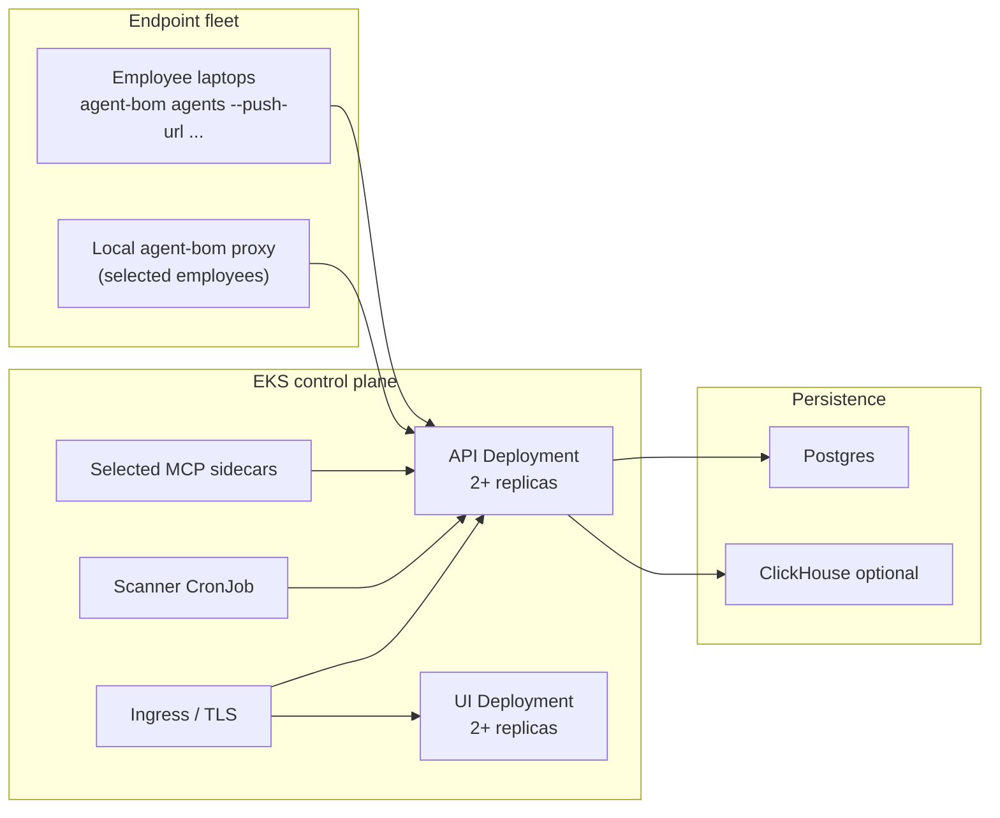

# Performance, Sizing, and Benchmarks

> **You do not need to read this unless** you are sizing nodes / replicas
> / autoscaling for a real EKS rollout, or validating the shipped
> benchmark harness against your own load. Defaults from the paved
> installers fit pilot and small-team workloads without tuning.

This guide is the operator-facing follow-up to the packaged Helm control plane
and enterprise pilot docs. It does not promise fixed throughput numbers the
repo has not published. It gives a defensible starting point for sizing,
autoscaling, and validating a self-hosted `agent-bom` deployment in EKS.

## What this guide covers

- control-plane API and UI sizing
- endpoint-fleet and proxy-audit growth boundaries
- when to keep analytics in `Postgres` and when to turn on `ClickHouse`
- what to load test before calling the deployment production-ready

## Reference topology



## Starting point by deployment size

These are starting bands, not SLA guarantees. Use them to choose the right
backend and Helm values before running your own load tests.

| Shape | Typical use | Recommended path |
|---|---|---|
| Small team | up to ~250 endpoints, selected proxy sidecars, low audit retention needs | `Postgres` only, 2 API replicas, 2 UI replicas, no `ClickHouse` |
| Initial enterprise pilot | ~250-2,000 endpoints, scheduled endpoint sync, selected runtime sidecars, retained proxy audit | `Postgres`, packaged `HPA`, topology spread, internal ingress, add `ClickHouse` only if audit/query latency grows |
| Broader rollout | 2,000+ endpoints or sustained high-volume proxy audit/event analytics | `Postgres` for transactional state plus `ClickHouse` for analytics, explicit retention policy, benchmark before rollout |

## Practical switch points

These are planning thresholds, not product-enforced limits.

| Signal | Stay on Postgres only | Add ClickHouse |
|---|---|---|
| Endpoint count | up to ~2,000 endpoints | above ~2,000 endpoints with retained analytics needs |
| Scan cadence | low to moderate scheduled scans/day | sustained high-volume scheduled scans across many tenants |
| Runtime / proxy audit volume | recent operational visibility | long retention, heavy trend queries, event-style analytics |
| Dashboard/query shape | mostly transactional reads | trend-heavy or fleet-wide historical analytics |

The product intent is:

- `Postgres` remains the transactional control-plane source of truth
- `ClickHouse` is the scale-out answer for analytics-heavy workloads

## Control-plane sizing guidance

Start from the packaged production example:

- [eks-production-values.yaml](https://github.com/koda-ai-studio/agent-bom/blob/main/deploy/helm/agent-bom/examples/eks-production-values.yaml)

That example already enables:

- API and UI `HPA`
- topology spread
- `external-secrets`
- `cert-manager`-friendly ingress annotations
- restricted ingress policy

### API

Current chart defaults in [values.yaml](https://github.com/koda-ai-studio/agent-bom/blob/main/deploy/helm/agent-bom/values.yaml):

- replicas: `2`
- requests: `100m` CPU / `512Mi` memory
- limits: `1000m` CPU / `2Gi` memory
- `HPA` packaged but off by default

A worker serving posture, compliance and fix-first reads can hold graph and
scan payloads in memory while building the response. The default memory limit
provides headroom; measure peak resident memory with your inventory and expected
concurrency before choosing production limits.

Pushed results (`POST /v1/results/push`) are bounded by
`AGENT_BOM_API_RESULT_PUSH_MAX_BYTES` (default 192 MiB). That is a body cap,
not a sizing promise: peak memory grows with the estate in the push much faster
than the body size. Peak API resident memory with one push in flight, measured
by `scripts/qualification/performance.py`:

| Agents per push | Push body | Package instances | Peak on SQLite | Peak on PostgreSQL |
| --- | --- | --- | --- | --- |
| 25 | under 1 MB | — | 335 MB | 333 MB |
| 1,000 | 3.8 MB | — | 660–730 MB | 789 MB; 802 MB sampled |
| 5,000 | 18 MB | 116,907 | 1.3–2.4 GB | 2.0–4.1 GB |

730 MB, 789 MB, 2.4 GB and 4.1 GB are the Linux kernel high-water mark from
earlier qualification runs. The other values are medians of three to four runs
on 2026-11-13, sampled every 100 ms on macOS, which can miss a short spike.
Size for the larger value.

Graph and findings reads from the same lane, medians of three to four runs per
row on 2026-11-13, on a shared 10-core host with a 1-minute load average of 4
to 7 (single runs ranged widely, see the ranges in the
[benchmark notes](https://github.com/koda-ai-studio/agent-bom/blob/main/docs/PERFORMANCE_BENCHMARKS.md)).
"First read" is the first `GET /v1/graph?limit=100` after the push is stored;
p50 and p95 cover 20 reads, the first included:

| Backend | Agents per push | Graph nodes | Push stored | Graph first read | Graph p50 | Graph p95 | Findings p95 |
| --- | --- | ---: | ---: | ---: | ---: | ---: | ---: |
| SQLite | 1,000 | 38,914 | 40 s | 1.0 s | 0.45 s | 1.8 s | 0.08 s |
| SQLite | 5,000 | 170,330 | 349 s | 4.5 s | 0.37 s | 0.48 s | 2.1 s |
| PostgreSQL | 1,000 | 38,914 | 60 s | 1.4 s | 0.51 s | 1.7 s | 0.54 s |
| PostgreSQL | 5,000 | 170,330 | 320 s | 3.8 s | 0.96 s | 7.8 s | 1.2 s |

On SQLite at 5,000 agents, a run at load 3.6 measured 0.30 s p50 and 0.40 s
p95 for the 19 reads after the first. On PostgreSQL at 5,000 agents, reads in
the first 30 to 40 seconds after a push take 1.3 to 1.6 s with stalls of 6 to
14 s, then fall to about 0.3 s; the slower early reads set the p95. Before
2026-11-13 the same runs measured, at 5,000 agents, a 19.9 s first read and a
5.7 s p95 on SQLite, and a 7.5 s first read on PostgreSQL.

Which limit to set for the API pod (and worker pods, which parse queued pushes):

- up to about 1,000 agents per push: the `2Gi` default
- about 5,000 agents per push: at least `3Gi` on SQLite or `5Gi` on PostgreSQL,
  or split the estate into pushes of about 1,000 agents
- several large pushes per pod at once: add one peak per concurrent push

With `2Gi` containers the API was OOM-killed at 5,000 agents on both backends.
Data already committed stayed committed and the API recovered after the
restart, but the push in flight failed and must be resent.

Repeated reads use a per-process cache of at most 64 responses, keyed by tenant,
query parameters and evidence revisions, including graph snapshot replacements.
The default TTL is 60 seconds (`AGENT_BOM_READ_CACHE_TTL_SECONDS`; `0` disables
caching). Inputs outside the revision token, such as runtime observations, can
remain cached until that TTL expires. If a store cannot report its revision,
the request computes directly. Concurrent async graph requests can still rebuild
the same response; size for concurrent cold reads as well as retained cache data.

Recommended production operator posture:

- keep `2` replicas as the minimum steady-state floor
- enable the shipped API `HPA` before larger endpoint or proxy rollouts
- raise requests before raising limits when sustained CPU stays above `70%`
- keep the API same-origin behind one ingress hostname unless you have a
  strong reason to split UI and API

### UI

Current chart defaults:

- replicas: `2`
- requests: `100m` CPU / `128Mi` memory
- limits: `500m` CPU / `512Mi` memory

Recommended posture:

- keep `2` replicas for zone and node failure tolerance
- enable the shipped UI `HPA` for heavier internal usage or dashboard-heavy
  SOC workflows
- scale UI based on browser concurrency, not endpoint count alone

### Scanner CronJob

The scanner is batch-oriented. The main knobs are:

- schedule frequency
- namespace scope
- `--introspect`
- `--enforce`

If scans begin overlapping, do not immediately add more control-plane replicas.
First widen the CronJob interval, split scope, or reduce introspection scope for
the rollout phase.

For the full execution model, including scheduler leader election, tenant quota
enforcement, and the split between recurring schedules and the packaged scanner
`CronJob`, see [Worker and Scheduler
Concurrency](worker-and-scheduler-concurrency.md).

## Postgres vs ClickHouse

Use `Postgres` as the source of truth for:

- fleet and policy state
- RBAC and tenant-scoped reads
- audit and control-plane writes
- scheduler coordination

Turn on `ClickHouse` when analytics starts behaving like analytics rather than
control-plane state:

- large retained proxy audit history
- heavy dashboard trend queries
- many endpoints with long retention windows
- event-style workloads where write buffering matters more than relational reads

Do not move the transactional control plane out of `Postgres` just because
analytics volume grows. The intended shape is:

- `Postgres` for the control plane
- `ClickHouse` for optional analytics scale-out

## Operational thresholds to watch

Watch these before widening rollout:

- API `p95` latency on authenticated reads and writes
- Postgres CPU, memory, and connection pressure
- scanner run duration versus schedule interval
- proxy audit ingest rate and retained volume
- UI response time under simultaneous SOC usage

If any of these fail first:

- API CPU saturation: increase API requests and enable or widen the API `HPA`
- Postgres pressure: tune connection pool, size the database, and move
  analytics-heavy reads toward `ClickHouse`
- overlapping scans: lengthen schedule or split scope
- audit query drag: add retention boundaries and move analytics to `ClickHouse`

## Security graph cardinality and windowing

The security graph is one of the main operator surfaces, but it should be read
as a persisted, filterable investigation view, not as a promise that every
tenant should dump full topology into one browser canvas.

Operationally important boundaries:

- graph snapshots can contain many more nodes and edges than one page should
  render at once
- UI pagination, focus mode, search, and blast-radius drilldown are part of the
  scaling model, not optional decoration
- the operator workflow should narrow by tenant, snapshot, attack path, source,
  or asset family before expecting one giant all-entity canvas to stay useful

Recommended posture for larger tenants:

1. keep graph investigation windowed by snapshot and page
2. start from blast radius, focused graph, or asset search before expanding
3. treat full-topology rendering as an exception path, not the default view
4. benchmark the control plane with your expected snapshot size before calling
   the graph production-ready at large scale

What the product claims today:

- persisted graph snapshots
- stable node identifiers in the operator detail view
- explicit snapshot metadata, scope, and timestamps
- filterable graph investigation flows
- paginated agent-node selectors through `GET /v1/graph/agents`
- bounded fleet list windows through `GET /v1/fleet?limit=...&offset=...`

What it does not yet publish as a hard contract:

- universal node/edge ceilings that apply to every tenant shape
- a CI-enforced multi-tenant graph load harness

## Tenant quotas

For multi-tenant or shared internal deployments, set explicit per-tenant quotas
 on the API instead of relying only on request rate limits.

Available environment variables:

- `AGENT_BOM_API_MAX_ACTIVE_SCAN_JOBS_PER_TENANT`
- `AGENT_BOM_API_MAX_RETAINED_JOBS_PER_TENANT`
- `AGENT_BOM_API_MAX_FLEET_AGENTS_PER_TENANT`
- `AGENT_BOM_API_MAX_SCHEDULES_PER_TENANT`

These are enforced on:

- scan creation
- scheduled scan creation
- pushed scan-result ingestion
- fleet sync
- schedule creation

The packaged production example already shows how to inject these through
 `controlPlane.api.env` in:

- [eks-production-values.yaml](https://github.com/koda-ai-studio/agent-bom/blob/main/deploy/helm/agent-bom/examples/eks-production-values.yaml)

Recommended starting posture:

- keep active scan jobs low enough that one tenant cannot saturate the API
- keep retained jobs bounded to match your retention expectations
- keep fleet-agent quotas aligned to your actual endpoint/runtime rollout size
- keep schedule quotas low unless you deliberately expose scheduled scans to many tenants

For large tenants with thousands of agents, do not drive dashboards from a full
fleet dump. Use server-side fleet search and pagination, graph agent selectors,
and node-context drilldown. The UI should show a readable working set first,
then let the operator expand by search, lifecycle state, environment, or graph
neighborhood. Treat the exact fleet size as an operator sizing input, not a
fixed product ceiling.

## Benchmark before production rollout

The repo now ships a small benchmark harness under:

- [deploy/loadtest/README.md](https://github.com/koda-ai-studio/agent-bom/blob/main/deploy/loadtest/README.md)
- [k6-control-plane-api.js](https://github.com/koda-ai-studio/agent-bom/blob/main/deploy/loadtest/k6-control-plane-api.js)
- [k6-graph-api.js](https://github.com/koda-ai-studio/agent-bom/blob/main/deploy/loadtest/k6-graph-api.js)
- [k6-proxy-audit.js](https://github.com/koda-ai-studio/agent-bom/blob/main/deploy/loadtest/k6-proxy-audit.js)

Use that harness to validate:

1. authenticated control-plane read paths
2. graph overview and graph search operator paths
3. proxy audit ingest write paths
4. scaling behavior after enabling `HPA`
5. the point where analytics should move to `ClickHouse`

Current boundary:

- the harness is shipped and operator-usable now
- the harness is not yet a full multi-tenant performance gate in CI
- published benchmark numbers should come from your environment until the repo
  ships broader reference runs

## Minimal benchmark checklist

Run these in your own environment before broader rollout:

1. Baseline the API with the control-plane script at low and medium concurrency.
2. Baseline graph overview/search with the graph script against a representative snapshot.
3. Baseline proxy audit ingest with realistic batch sizes.
4. Repeat all runs with `HPA` enabled.
5. Repeat with `ClickHouse` disabled, then enabled if your rollout expects high
   retained analytics volume.
6. Record your chosen replica floor, resource requests, and retention policy in
   your operator runbook.

## Target operator latency envelope

Targets for self-hosted rollouts up to 5,000 agents per push, with what was
measured on 2026-11-13 (medians from the table in
the read table above, on the shared host
described there). Validate them with the bundled k6 harness on your own nodes.

| Flow | Target | Measured 2026-11-13 |
|---|---|---|
| Graph overview `GET /v1/graph?limit=100`, first read after a push is stored | < 10 s at 5,000 agents | 4.5 s SQLite, 3.8 s PostgreSQL |
| Graph overview, steady state | p50 < 1 s, p95 < 2 s | p50 0.37–0.51 s; p95 0.48 s (SQLite, 5,000), 1.7–1.8 s (1,000) |
| Graph overview, first minute after a 5,000-agent push on PostgreSQL | p95 < 10 s | 7.8 s, then about 0.3 s per read |
| Graph search `GET /v1/graph/search?q=agent&limit=25` | p95 < 1 s | 0.57–0.64 s at 5,000 agents, measured in-process |
| Fleet read `GET /v1/fleet?limit=25` | < 350 ms p95 | not re-measured |
| Fleet stats `GET /v1/fleet/stats` | < 300 ms p95 | not re-measured |
| Proxy audit ingest `POST /v1/proxy/audit` | < 500 ms p95 | not re-measured |

The earlier graph targets (300 ms pilot and 500 ms production p95 for the
overview, 250 and 400 ms for search) were not met at 1,000 or 5,000 agents on
this host and are withdrawn until a dedicated-node measurement supports them.
The steady-state overview at 5,000 agents on SQLite did measure 0.40 s p95 on a
lightly loaded run.

## Graph write batching

Graph persistence uses one batch-size knob across SQLite and Postgres:

```bash
AGENT_BOM_GRAPH_WRITE_BATCH_SIZE=1000
```

Both backends persist the same logical graph objects through the same
`save_graph(graph)` contract: nodes, search rows, edges, attack paths, and
interaction risks. The backend implementations differ internally, but the
operator tuning model stays consistent.

The write path uses lazy row generation and bounded batches. Memory is therefore
tied to the configured batch window instead of total graph size. Raising the
batch size can improve write throughput, while lowering it can reduce per-batch
memory and parameter pressure.

This setting controls graph writes only. Graph read latency is governed by
snapshot windowing, pagination, search indexes, materialized drilldowns, and UI
virtualization.

## Publish your own benchmark numbers

`agent-bom` deliberately does not claim a universal scans/day SLA. Real
throughput depends on:

- scan shape
- endpoint mix
- retention window
- whether analytics stays in Postgres or moves to ClickHouse

What the project does ship is:

- a benchmark harness
- packaged HPA/PDB controls
- explicit backend guidance

That keeps the deployment story honest while still giving operators a concrete
starting point.

## Current boundary

`agent-bom` now ships the packaged control plane, pilot path, and operator
defaults. What it still does not claim is:

- one universal throughput number for every scan and tenant shape
- one browser graph view that should render every tenant's full topology at once
- CI-proven multi-tenant graph/load guarantees beyond the shipped focused
  benchmark harness

- fixed throughput guarantees
- a bundled benchmark certification suite
- a managed control plane that hides storage or scaling choices from the buyer

Those choices stay explicit, which is why the self-hosted story remains honest.

## Large collector reports

`POST /v1/results/push` accepts a decoded report of up to 192 MiB by default
(`AGENT_BOM_API_RESULT_PUSH_MAX_BYTES`). Configured values above 240 MiB are
clamped so a stored result always fits PostgreSQL's 255 MiB `jsonb` value
limit, even with the result codec disabled. Other API requests keep their
10 MiB budget. Configure the ingress or reverse proxy to permit the same wire
size; an upstream 413 never reaches the API.

Collectors gzip pushes by default (`AGENT_BOM_PUSH_GZIP=0` keeps a receiver
older than 2026-09-10 working). JSON is serialized and compressed once per
push; retries reuse the same bytes and idempotency identity. Standard HTTP
clients can also send `Content-Encoding: gzip` to the report-push endpoint.

Authentication runs before buffering/inflation. Both wire and decoded bytes
must fit the report budget. Invalid/truncated gzip returns 400, unsupported
encoding returns 415, and over-budget requests return 413 with `max_bytes`
and a hint to split the push. The API checks actual streamed bytes even when
Content-Length is present and applies the existing 30-second body-read
deadline and throughput floor. These failures do not create a scan job or
truncate the report.

### Asynchronous ingest

Graph persistence for a large report takes minutes. The CLI therefore sends
`Prefer: respond-async`:

1. The API validates the report in a worker thread, writes the job once as
   `pending`, and enqueues it on the same dispatch queue scans use (the shared
   Postgres `scan_dispatch_queue` with `FOR UPDATE SKIP LOCKED` and leases
   when distributed dispatch is on, the local scan executor otherwise).
2. It answers `202` with `job_id`, `status_url` (`/v1/results/push/{job_id}`)
   and `Retry-After`.
3. A worker persists the graph and marks the job `done` or `failed`.
   `GET /v1/results/push/{job_id}` returns the stored receipt, including the
   graph persistence counts, without decoding the stored report.

The idempotency key is the dedupe fence. The CLI derives it from a hash of the
sanitized report and its destination, so rerunning or retrying the same report
addresses the same job instead of creating a duplicate. A key that another
request is still committing answers `202` with `Retry-After` immediately; it
never waits for that commit. Replaying a committed key returns the stored
receipt. Retrying the key of a `failed` ingest re-admits the same job.

The CLI sizes its HTTP timeout to the report, retries 408/425/429/5xx and a
`409` that carries `Retry-After`, and polls `status_url` for up to
`AGENT_BOM_PUSH_WAIT_SECONDS` (default 900). When that wait ends first it
reports the push as accepted, not failed: the server holds the report durably
and finishes it.

Clients that do not send `Prefer: respond-async` keep the synchronous `201`
receipt. Set `AGENT_BOM_PUSH_INGEST_MODE=async` on the API to make every
report push asynchronous, or `sync` to ignore the header. Pushes that carry
`endpoint_inventory` always commit synchronously, because their raw inventory
rows never enter the stored job.

For clustered deployments, run ingest and scans on dedicated workers with
`AGENT_BOM_API_ROLE`: `api` replicas serve HTTP and only enqueue, `worker`
replicas drain the queue, and `all` (the default) does both. A `worker` without
distributed dispatch (Postgres plus `AGENT_BOM_DISTRIBUTED_SCANS`) fails at
startup instead of idling. The Helm chart wires this through
`controlPlane.worker`; see [Separate scan and ingest workers](control-plane-helm.md#separate-scan-and-ingest-workers).

A full JSON report is still materialized for validation and graph projection;
compression reduces transfer size, not that working set. Size memory using
concurrent decoded reports plus graph construction and database work. Large
finding streams can use `/v1/findings/bulk` in bounded, idempotent batches;
those rows are normalized findings, not fragments of a complete graph snapshot.
Async report exports use durable SQLite job state by default, or tenant-scoped
Postgres when configured. A separate bounded worker pool claims queued exports,
renews leases, and recovers expired claims after a restart. See
[Durable report exports](durable-report-exports.md) for shared artifact storage,
worker sizing, and failure behavior.
